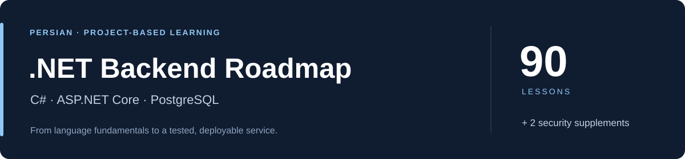

# مسیر یادگیری بک‌اند با C# و ASP.NET Core



یک مسیر فارسی و پروژه‌محور برای یادگیری طراحی، پیاده‌سازی، آزمون و تحویل سرویس‌های بک‌اند. آموزش با مبانی C# آغاز می‌شود و به API، PostgreSQL، معماری، امنیت و عملیات می‌رسد؛ هر مرحله با نمونهٔ اجرایی، تمرین مستقل و معیار پذیرش همراه است.

**۹۰ درس در ۹ بخش · دو مکمل JWT و OAuth/OIDC · نمونه‌های قابل اجرا · بررسی خودکار روی Windows و Linux**

[شروع دوره](#start) · [مسیر یادگیری](#curriculum) · [پروژه‌ها](#projects) · [پیش‌نیازها](#prerequisites) · [نقشهٔ کامل درس‌ها](ROADMAP.md)

## دستاوردهای یادگیری

در این مسیر، مهارت‌های زیر را با ساخت و توسعهٔ پروژه تمرین می‌کنید:

- تبدیل نیازمندی به قرارداد API، مدل داده و قواعد کسب‌وکار.
- تفکیک مسئولیت مدل دامنه، سرویس کاربردی، کنترلر و دسترسی به داده.
- ذخیره‌سازی با PostgreSQL و مدیریت transaction، migration و تعارض تغییرات.
- پیاده‌سازی احراز هویت، مجوزدهی و کنترل دسترسی به داده‌های هر کاربر و سازمان.
- نوشتن تست، عیب‌یابی با لاگ و trace و جلوگیری از تکرار خطا.
- ساخت بستهٔ اجرایی، اجرای سرویس با Docker و تمرین پشتیبان‌گیری و بازیابی.

محدودهٔ دوره، توسعهٔ بک‌اند وب با .NET است. معیار پیشرفت، توانایی پیاده‌سازی مستقل و توضیح تصمیم‌های فنی است؛ تجربهٔ نگه‌داری پروژهٔ واقعی و بازخورد تیمی، این آموزش را تکمیل می‌کند.

<a id="prerequisites"></a>

## مخاطبان و پیش‌نیازها

این مسیر برای شروع توسعهٔ بک‌اند و نیز انتقال تجربه از زبان‌های دیگر به C# طراحی شده است. آشنایی مقدماتی با متغیر، شرط، حلقه و تابع، یادگیری را سریع‌تر می‌کند؛ دانش قبلی C#، ASP.NET Core، SQL، JWT یا Docker الزامی نیست.

| پیش‌نیاز | میزان آشنایی مورد انتظار |
| --- | --- |
| کار با فایل و پوشه | ایجاد و ویرایش فایل، تشخیص مسیر و بازکردن ترمینال |
| منطق برنامه‌نویسی | درک مقدماتی متغیر، شرط، حلقه و تابع؛ این مفاهیم در درس‌های آغازین با C# تمرین می‌شوند |
| خواندن مستندات | توانایی دنبال‌کردن متن خطاهای انگلیسی، با کمک ترجمه در صورت نیاز |
| تمرین عملی | اختصاص زمان برای اجرای مثال‌ها، تغییر کد و رفع خطا |

برای افراد بدون سابقهٔ برنامه‌نویسی، تمرین بیشتر در درس‌های ۲ تا ۶ در نظر گرفته شده است. پیش از ادامه، لازم است بتوانید نتیجهٔ چند خط کد ساده را پیش‌بینی و علت آن را توضیح دهید. [روش یادگیری و معیار عبور](handbook/learning-method.md) راهنمای ارزیابی هر مرحله است.

شروع دوره به خرید سرور، دامنه یا دانش فرانت‌اند نیاز ندارد. ابزارهای تخصصی در مرحلهٔ مرتبط معرفی می‌شوند.

<a id="start"></a>

## شروع دوره

### ۱. دریافت محتوای دوره

```powershell
git clone https://github.com/k1nosraty/dotnet-backend-roadmap.git
cd dotnet-backend-roadmap
```

دریافت ZIP از منوی **Code** مخزن نیز امکان‌پذیر است. برای ثبت تغییرات تمرین‌ها، [راهنمای Git](handbook/git-practice.md) را دنبال کنید.

### ۲. مطالعه با README Viewer

برای خواندن و دنبال‌کردن درس‌های این دوره، **از [README Viewer](https://github.com/k1nosraty/readme-viewer.git) استفاده کنید**. برنامه و راهنمای نصب در مخزن آن در دسترس است.

پس از دریافت دوره، فایل `README.md` اصلی را در README Viewer باز کنید و درس‌ها را به ترتیب نقشهٔ دوره پیش ببرید. هنگام تمرین، متن درس را کنار ویرایشگر کد قرار دهید تا توضیح، کد و نتیجهٔ اجرا را با یکدیگر مقایسه کنید.

### ۳. اجرای اولین درس

با [درس ۱: راه‌اندازی محیط](lessons/01-foundations/001-environment/README.md) آغاز کنید؛ نصب SDK، ساخت اولین پروژه و مشاهدهٔ اجرای آن در همان درس توضیح داده شده است. سپس [بخش مبانی](lessons/01-foundations/README.md) را ادامه دهید و نتیجهٔ تمرین‌ها را در [دفتر پیشرفت](PROGRESS.md) ثبت کنید.

راهنمای آغاز برای Windows و PowerShell نوشته شده است. نمونه‌ها در CI روی Windows و Linux بررسی می‌شوند و اجرای فرمان‌ها به IDE مشخصی وابسته نیست.

<a id="curriculum"></a>

## مسیر یادگیری

| مرحله | درس‌ها | موضوع و خروجی اصلی |
| --- | --- | --- |
| [مبانی C#](lessons/01-foundations/README.md) | ۱–۱۲ | نوع‌ها، کنترل جریان، مدل، LINQ، فایل و async |
| [طراحی کد](lessons/02-design/README.md) | ۱۳–۲۲ | شیءگرایی، قراردادها، DI، مسئولیت‌ها و تحویل CLI |
| [HTTP و ASP.NET Core](lessons/03-web/README.md) | ۲۳–۳۴ | endpoint، کنترلر، DTO، اعتبارسنجی، REST و OpenAPI |
| [داده و PostgreSQL](lessons/04-data/README.md) | ۳۵–۴۸ | SQL، index، transaction، EF Core، migration و Dapper |
| [معماری و مرزها](lessons/05-architecture/README.md) | ۴۹–۶۰ | جهت وابستگی، نگاشت، use case، تست معماری و ADR |
| [امنیت و مدیریت حساب](lessons/06-security/README.md) | ۶۱–۷۰ | Identity، احراز هویت، policy، مالکیت، امنیت وب و audit |
| [تست و عیب‌یابی](lessons/07-testing/README.md) | ۷۱–۷۸ | xUnit، تست HTTP و دیتابیس، resilience، لاگ و trace |
| [محیط اجرا و عملیات](lessons/08-production/README.md) | ۷۹–۸۶ | Docker، TLS، CI، telemetry، cache، job و بازیابی |
| [پروژهٔ نهایی ServiceDesk](lessons/09-capstone/README.md) | ۸۷–۹۰ | تحلیل، پیاده‌سازی مستقل، آزمون و تحویل قابل تکرار |

فهرست جزئی موضوع‌ها و وضعیت هر درس در [نقشهٔ کامل دوره](ROADMAP.md) قرار دارد.

### مکمل‌های امنیت

پس از درس ۶۴ و پیش از ادامهٔ مجوزدهی، دو مکمل زیر را انجام دهید. شماره‌گذاری ۹۰ درس اصلی حفظ شده است.

| مکمل | موضوع | شاهد عملی |
| --- | --- | --- |
| [۶۴ـالف: JWT](lessons/06-security/064a-jwt/README.md) | ساختار و claimها، امضا، issuer، audience، انقضا و scope | API مستقل و ۱۷ حالت تست اعتبارسنجی و مجوز |
| [۶۴ـب: OAuth/OIDC و PKCE](lessons/06-security/064b-oidc/README.md) | جریان ورود، state، nonce، انواع token و session | برنامهٔ وب مستقل و ۱۲ حالت تست پروتکل |

تست خودکار OIDC از handler واقعی با ارائه‌دهندهٔ کنترل‌شده در پروژهٔ تست استفاده می‌کند. اتصال دستی به IdP واقعی، راهنمای جداگانه در مکمل دوم دارد.

<a id="projects"></a>

## پروژه‌های مسیر

| پروژه | دامنهٔ تمرین | نقطهٔ تحویل |
| --- | --- | --- |
| SupportDesk CLI | مدیریت درخواست‌های پشتیبانی با ذخیره‌سازی فایل | [درس ۲۲](lessons/02-design/022-cli-delivery/README.md) |
| SupportDesk API | قرارداد HTTP، قواعد درخواست و ذخیره‌سازی PostgreSQL | [درس ۳۴](lessons/03-web/034-api-delivery/README.md) و [درس ۴۸](lessons/04-data/048-data-delivery/README.md) |
| TeamDesk | مرزهای معماری، حساب، نقش و دسترسی به منابع | [درس ۶۰](lessons/05-architecture/060-teamdesk/README.md) و [بازبینی امنیت](lessons/06-security/070-security-review/README.md) |
| Integration Worker | ارتباط HTTP، کار پس‌زمینه و دوام پردازش | [بخش عملیات](lessons/08-production/README.md) |
| ServiceDesk | ترکیب آموخته‌ها در یک تحویل مستقل با تست و بازیابی | [صورت مسئله](capstone/BRIEF.md) و [معیار پذیرش](capstone/ACCEPTANCE.md) |

نمونهٔ هر درس یک snapshot مستقل با محدودهٔ مشخص است. فایل‌های مراحل مختلف را بدون بررسی قراردادها با یکدیگر ترکیب نکنید؛ رشد قابلیت‌ها و تغییر قواعد در متن درس توضیح داده می‌شود.

## محیط توسعه

| زمان استفاده | ابزار | راهنمای آماده‌سازی |
| --- | --- | --- |
| آغاز دوره | SDK .NET 10 و ویرایشگر کد | [نصب و اولین اجرا](lessons/01-foundations/001-environment/README.md) |
| دریافت محتوا و ثبت تمرین | Git؛ دریافت ZIP برای شروع نیز ممکن است | [تمرین Git](handbook/git-practice.md) |
| بررسی‌های خودکار | Python 3 برای اجرای اسکریپت‌ها | بخش بررسی‌های خودکار در ادامهٔ این صفحه |
| از درس ۳۵ | PostgreSQL 18؛ psql برای بازرسی و تست‌های کامل داده و امنیت | [آزمایشگاه PostgreSQL](handbook/postgresql-lab.md) |
| تست‌های کانتینری و عملیات | Docker فعال با Linux containers | [درس ۷۴](lessons/07-testing/074-database-tests/README.md) و [آزمایشگاه عملیات](handbook/operations-lab.md) |
| مکمل‌های هویت | HTTPS معتبر محلی؛ ثبت client برای اتصال دستی به IdP واقعی | [راهنمای OIDC](lessons/06-security/064b-oidc/README.md) |

ابزارهای هر مرحله را هنگام ورود به همان بخش آماده کنید. نصب SDK، دریافت اولیهٔ بسته‌های NuGet و imageهای Docker به دسترسی شبکه نیاز دارد. Python برای اجرای ابزارهای بررسی استفاده می‌شود و یادگیری آن پیش‌نیاز برنامه‌نویسی این دوره نیست. تست‌های خودکار هویت نیز به حساب سرویس خارجی نیاز ندارند.

نسخهٔ مبنا .NET 10 است؛ **SDK** را از [منبع رسمی](https://dotnet.microsoft.com/en-us/download/dotnet/10.0) نصب کنید. نصب runtime به‌تنهایی ابزار ساخت پروژه را فراهم نمی‌کند. نسخهٔ دقیق وابستگی‌ها در فایل پروژه‌ها و [راهنمای کتابخانه‌ها](handbook/libraries.md) ثبت شده است.

## روش مطالعه و ارزیابی

چرخهٔ پیشنهادی هر درس: **درک مسئله ← اجرای نمونه ← پیش‌بینی و تغییر رفتار ← حل تمرین مستقل ← بررسی نتیجه و توضیح تصمیم**.

برای عبور از هر مرحله، لازم است نمونه را با دادهٔ متفاوت بررسی کنید، ورودی نامعتبر را بیازمایید و مسیر اجرا را با نام فایل‌ها و کلاس‌ها توضیح دهید. نتیجهٔ هر بخش با معیار تحویل همان بخش سنجیده می‌شود. جزئیات در [روش یادگیری](handbook/learning-method.md) و [دفتر پیشرفت](PROGRESS.md) آمده است.

پایان دوره، آغاز ارزیابی مستقل مهارت‌هاست: پروژه‌ای با نیازمندی متفاوت بسازید، آن را با تست و روش استقرار تحویل دهید و برای تصمیم‌ها و تغییرات بعدی بازخورد بگیرید. تجربهٔ عملی و نگه‌داری پروژه، مکمل ضروری آموزش است؛ عنوان شغلی یا زمان رسیدن به آن از روی تعداد درس‌های مطالعه‌شده تعیین نمی‌شود.

## وضعیت محتوا و بررسی‌های خودکار

۹۰ درس اصلی نوشته شده‌اند و ۸۹ نمونهٔ اجرایی مستقل و ۱۶ پروژهٔ تست در مسیر اصلی وجود دارد. دو مکمل امنیت، دو نمونه و دو پروژهٔ تست جداگانه دارند و در این شمارش منظور نشده‌اند.

وضعیت build و تست هر revision در [GitHub Actions](https://github.com/k1nosraty/dotnet-backend-roadmap/actions) قابل مشاهده است. workflowهای **Check course**، **Production labs**، **Capstone** و **Identity supplements** بخش‌های مختلف را بررسی می‌کنند. موفقیت یک suite، شاهد همان محدوده است؛ نتیجهٔ build-only یا تست اجرا‌نشده، جای اجرای کامل را نمی‌گیرد.

بررسی ساختار محتوا، مسیر فرمان‌ها و لینک‌های داخلی:

```powershell
python scripts/check_content.py
```

فرمان‌های رفتاری در جدول زیر گروه‌بندی شده‌اند. پیش‌نیاز و متغیرهای محیطی هر گروه را از راهنمای همان بخش تنظیم کنید.

| محدوده | فرمان‌های بررسی |
| --- | --- |
| مبانی و CLI | `python scripts/smoke.py` |
| HTTP و API | `python scripts/web_smoke.py`، `python scripts/controller_smoke.py`، `python scripts/domain_smoke.py` |
| معماری | `python scripts/architecture_smoke.py`، `python scripts/architecture_next_smoke.py`، `python scripts/architecture_final_smoke.py` |
| PostgreSQL، EF و Dapper | `python scripts/postgres_smoke.py`، `python scripts/ef_smoke.py` |
| امنیت و حساب | `python scripts/security_smoke.py`، `python scripts/security_next_smoke.py`، `python scripts/security_final_smoke.py` |
| JWT و OIDC | `python scripts/identity_smoke.py` |
| تست و عیب‌یابی | `python scripts/testing_smoke.py`، `python scripts/testing_next_smoke.py` |
| publish، telemetry و TLS | `python scripts/production_smoke.py`، `python scripts/production_docker_smoke.py` |
| cache، job و بازیابی worker | `python scripts/operations_smoke.py --with-docker` |
| پروژهٔ نهایی | `python scripts/capstone_smoke.py`، `python scripts/capstone_smoke.py --docker-only`، `python scripts/capstone_delivery.py` |

تست‌های دیتابیس و امنیت به PostgreSQL و در برخی مسیرها به psql نیاز دارند. برای تست PostgreSQL کانتینریِ بخش تست، `python scripts/testing_smoke.py --with-docker` را اجرا کنید. آزمایش‌های Docker، Redis، TLS و restore به engine فعال نیاز دارند؛ جزئیات اتصال در راهنمای همان بخش آمده است.

[ممیزی کیفیت دوره](AUDIT-90.md) روش بررسی و محدودیت‌های آن را ثبت می‌کند. [ممیزی تا درس ۶۰](AUDIT-60.md) و [گزارش درس‌های ۱ تا ۳۴](AUDIT.md) شواهد تاریخیِ محدودهٔ خود را نگه می‌دارند.

## راهنماها و توسعهٔ محتوا

[مرجع C#](handbook/csharp-syntax.md) · [ساختار پروژه](handbook/project-structure.md) · [انتخاب کتابخانه](handbook/libraries.md) · [شرح پروژهٔ نخست](projects/01-support-desk/README.md) · [دریافت و به‌روزرسانی](PUBLISH.md)

محتوا با الگوی مسئله، پیش‌نیاز، توضیح، نمونه، تمرین و معیار عبور تدوین می‌شود. برای توسعهٔ درس‌ها از [قالب درس](templates/lesson.md) استفاده کنید. انتخاب کتابخانه و نسخهٔ تازه با بررسی مستندات رسمی، سازگاری و تست همراه است.
