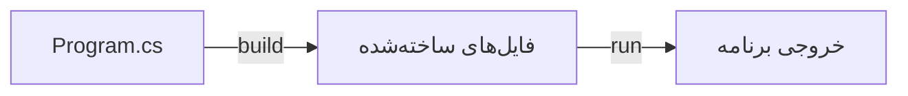

# درس ۰۰۱ — محیط توسعه و اولین اجرا

[خانه](../../../README.md) · [درس بعد](../002-first-feature/README.md)

## خروجی این درس

در این درس برنامه‌ای می‌سازی که یک پیام در کنسول چاپ می‌کند. مسیر کار را از نصب SDK تا تغییر فایل کد و اجرای دوباره دنبال می‌کنی. در پایان، اگر فرمان اجرا شکست خورد، می‌توانی بررسی کنی مشکل از نصب ابزارها و مسیر پروژه است یا از کدی که نوشته‌ای.

## پیش‌نیاز

برای شروع به Windows، دسترسی نصب برنامه و آشنایی با ساخت پوشه نیاز داری.
دانش قبلی C# یا C++ لازم نیست؛ ساخت پروژه و اجرای اولین خط کد را همین‌جا انجام می‌دهیم.
این درس از PowerShell استفاده می‌کند.

## واژگان

| واژه | معنی در این درس |
| --- | --- |
| C# | زبان نوشتن کد |
| .NET | بستری شامل runtime برای اجرای برنامه، کتابخانه‌های آماده و ابزارهای توسعه |
| SDK | ابزارهای لازم برای ساخت برنامه، همراه runtime مربوط |
| Runtime | محیط اجرای برنامه؛ به تنهایی ابزار توسعهٔ کامل نیست |
| ASP.NET Core | امکانات ساخت برنامهٔ وب روی .NET |
| CLI | ابزار خط فرمان مانند dotnet |
| Project | فایل‌های یک برنامه یا کتابخانه که تنظیمات ساخت مشترکشان در فایل `.csproj` است |
| Solution | فایلی برای کنار هم قراردادن و مدیریت چند project مرتبط |

پلتفرم .NET مدرن را با .NET Framework قدیمی یکی فرض نکن.
برای این مسیر پروژهٔ جدید با target framework برابر net10.0 می‌سازیم.

## یک نگاه: از کد تا خروجی

فلش‌ها مسیر ساخت و اجرای برنامه را نشان می‌دهند؛ SDK ابزار ساخت را دارد و runtime برنامهٔ ساخته‌شده را اجرا می‌کند.



**مکث کوتاه:** اگر فقط runtime نصب باشد، در کدام مرحله به مشکل می‌خوری؟

<details>
<summary>پاسخ را ببین</summary>
<p>در ساخت پروژه؛ runtime به‌تنهایی ابزار build را فراهم نمی‌کند. نصب SDK برای نوشتن و ساختن پروژه لازم است.</p>
</details>

## ۱. نصب SDK

[صفحهٔ رسمی دانلود .NET 10](https://dotnet.microsoft.com/en-us/download/dotnet/10.0) را باز کن.
از بخش SDK، installer مناسب سیستم خودت را انتخاب کن.
برای Windows معمولی x64 رایج است؛ سیستم ARM به بستهٔ متناسب نیاز دارد.
فقط ASP.NET Runtime یا Desktop Runtime را به جای SDK نصب نکن.

گزینهٔ خط فرمان در Windows دارای winget:

```powershell
winget install --id Microsoft.DotNet.SDK.10 --exact
```

اگر winget در دسترس نیست، همان installer رسمی کافی است.
بعد از نصب، ترمینال جدید باز کن.

```powershell
dotnet --info
dotnet --list-sdks
```

باید یک SDK با شمارهٔ 10.x ببینی.
شمارهٔ patch به تاریخ نصب بستگی دارد؛ آن را با نمونهٔ تصویری حفظ نکن.
وجود runtime در خروجی --info جای نبودن SDK را نمی‌گیرد.

## ۲. انتخاب ویرایشگر

برای شروع می‌توانی از VS Code یا IDE سازگار با .NET 10 استفاده کنی.
فرمان‌های این دوره به IDE خاصی وابسته نیستند.
اگر Visual Studio استفاده می‌کنی، سازگاری نسخهٔ نصب‌شده و workload توسعهٔ وب را از مستندات رسمی بررسی کن.
برای اولین اجرا حتی ویرایشگر ساده کافی است؛ debugger در مرحلهٔ بعد مفید می‌شود.

## ۳. ساخت فضای تمرین

بستهٔ دوره را از حالت فشرده خارج کن، یا با Git clone بگیر.
[راهنمای دریافت دوره و ثبت تمرین با Git](../../../handbook/git-practice.md) روش کار و فایل‌های قابل commit را توضیح می‌دهد.
PowerShell را داخل پوشهٔ اصلی dotnet-backend-roadmap باز کن.
پوشهٔ exercises برای کد مستقل تو است و از commitهای دوره کنار گذاشته شده است.

```powershell
New-Item -ItemType Directory -Force exercises | Out-Null
dotnet new console --name HelloBackend --output exercises/HelloBackend --framework net10.0
```

این دستور یک console project می‌سازد؛ پوشهٔ خروجی باید از قبل حاوی پروژهٔ دیگری نباشد.

```powershell
dotnet run --project exercises/HelloBackend/HelloBackend.csproj
```

خروجی اولیه باید Hello, World! باشد.
حالا Program.cs را به این متن تغییر بده:

```csharp
Console.WriteLine("My backend journey starts here.");
```

دوباره همان فرمان run را اجرا کن.

## ۴. فهم فایل‌ها

| فایل یا پوشه | مسئولیت |
| --- | --- |
| Program.cs | کد شروع برنامه |
| HelloBackend.csproj | نوع خروجی، target framework و تنظیمات ساخت |
| obj | داده‌های میانی restore و build |
| bin | خروجی ساخت |

فایل csproj نمونه:

```xml
<Project Sdk="Microsoft.NET.Sdk">
  <PropertyGroup>
    <OutputType>Exe</OutputType>
    <TargetFramework>net10.0</TargetFramework>
    <ImplicitUsings>enable</ImplicitUsings>
    <Nullable>enable</Nullable>
  </PropertyGroup>
</Project>
```

مقدار `Exe` مشخص می‌کند که خروجی پروژه یک برنامهٔ قابل اجراست. مقدار `net10.0` در `TargetFramework` می‌گوید این پروژه برای .NET 10 ساخته می‌شود؛ پس ابزار ساخت باید آن را پشتیبانی کند.

تنظیم `ImplicitUsings` باعث می‌شود بعضی namespaceهای رایج، مثل `System`، بدون نوشتن `using` جداگانه در دسترس باشند. تنظیم `Nullable` نیز به کامپایلر اجازه می‌دهد دربارهٔ استفاده از مقدار احتمالی `null` هشدار بدهد. معنی `null` را در درس‌های بعد تمرین می‌کنیم؛ فعلاً بدان این گزینه بررسی هنگام ساخت را فعال می‌کند و جلوی همهٔ خطاهای زمان اجرا را نمی‌گیرد.

## ۵. restore، build و run

```powershell
dotnet restore exercises/HelloBackend/HelloBackend.csproj
dotnet build exercises/HelloBackend/HelloBackend.csproj
dotnet run --project exercises/HelloBackend/HelloBackend.csproj
```

دستور `restore` بسته‌های موردنیاز پروژه و اطلاعات وابستگی‌ها را آماده می‌کند. سپس `build` کد را کامپایل می‌کند؛ یعنی از فایل‌های کد، خروجی قابل اجرا می‌سازد و اگر کد قابل ساخت نباشد، محل خطا را گزارش می‌دهد. دستور `run` برنامه را اجرا می‌کند و در حالت معمول، ساخت لازم را هم پیش از اجرا انجام می‌دهد. به همین دلیل برای تغییر یک پیام و دیدن نتیجه، معمولاً همان `run` کافی است.

ساخت مجدد به معنی دانلود همهٔ پکیج‌ها از ابتدا نیست؛ cache و وضعیت وابستگی‌ها اثر دارند.
اگر package جدید اضافه نکرده‌ای و restore قبلاً موفق بوده، می‌توانی build با --no-restore را بررسی کنی.
این گزینه درمان خطای restore اولیه نیست.

## ۶. کد چگونه اجرا می‌شود؟

زبان C# معمولاً به یک شکل میانی به نام IL کامپایل می‌شود و runtime آن را برای اجرا روی دستگاه آماده می‌کند.
جزئیات JIT و AOT را بعداً بررسی می‌کنیم.
GC یا جمع‌آورندهٔ زباله، حافظهٔ اشیایی را که دیگر در دسترس برنامه نیستند مدیریت می‌کند. منبعی مثل فایل باز همچنان باید در زمان مناسب بسته شود؛ این موضوع را در درس ۹ تمرین می‌کنیم.
GC دلیل مناسبی برای باز گذاشتن فایل یا connection نیست.

فایل `Program.cs` این نمونه مستقیماً با دستور چاپ شروع می‌شود. به این شکل نوشتن، `top-level statements` می‌گویند. هر برنامه به یک نقطهٔ شروع یا `entry point` نیاز دارد؛ در این شکل، کامپایلر آن را می‌سازد. بنابراین برای اجرای اولین پیام لازم نیست فعلاً متد `Main` را خودت تعریف کنی.

## ۷. تمرین مستقل

یک پروژهٔ جدید به نام EnvironmentReport در exercises بساز.
برنامه باید در سه خط این موارد را چاپ کند:

1. نام پروژه.
2. هدف تو از یادگیری بک‌اند.
3. نام پروژهٔ اول: SupportDesk.

در README پروژهٔ تمرین، این موارد را ثبت کن:

- نسخهٔ SDK که واقعاً نصب داری.
- فرمان ساخت و اجرا.
- توضیح تفاوت runtime و SDK با زبان خودت.

## ۸. یک خطای عمدی

سمی‌کالن انتهای یک دستور را حذف کن و build بزن.
پیام خطا، مسیر فایل و شمارهٔ خط را بخوان.
کد را اصلاح کن و دوباره build بزن.
این تمرین برای یادگیری خواندن پیام کامپایلر است.

اگر فقط کد خطا را جست‌وجو کنی و مکان آن را نخوانی، ممکن است علت واقعی را از دست بدهی.

## ۹. مشاهده با debugger

اگر IDE و debugger سازگار آماده است، روی Console.WriteLine breakpoint بگذار.
برنامه را با حالت Debug اجرا کن.
بررسی کن اجرا پیش از چاپ متوقف می‌شود و با ادامه دادن چاپ انجام می‌شود.
راه‌اندازی debugger برای IDEهای مختلف متفاوت است؛ فرمان dotnet run به تنهایی جلسهٔ debugger باز نمی‌کند.
اگر debugger هنوز آماده نیست، در دفتر پیشرفت آن را انجام‌نشده ثبت کن.

## عیب‌یابی

| علامت | بررسی اول |
| --- | --- |
| dotnet شناخته نمی‌شود | ترمینال تازه، نصب SDK و PATH |
| No .NET SDKs were found | runtime به جای SDK نصب نشده باشد |
| framework هدف پشتیبانی نمی‌شود | خروجی --list-sdks و وجود SDK 10 |
| project پیدا نمی‌شود | پوشهٔ فعلی و مسیر csproj |
| restore شبکه خطا دارد | متن خطا و دسترسی feed؛ حذف مداوم cache راه‌حل عمومی نیست |
| خروجی برنامهٔ دیگری دیده می‌شود | مقدار --project و پوشه‌ای که ویرایش کرده‌ای |

## معیار عبور

- [ ] SDK 10 در --list-sdks دیده می‌شود.
- [ ] پروژه را با CLI ساخته‌ام.
- [ ] متن خروجی را مستقل تغییر داده‌ام.
- [ ] یک خطای کامپایل را پیدا و اصلاح کرده‌ام.
- [ ] SDK و runtime را بدون حفظ تعریف توضیح می‌دهم.
- [ ] README تمرین شامل فرمان اجرای صحیح است.

## منابع رسمی

- [نصب .NET روی Windows](https://learn.microsoft.com/en-us/dotnet/core/install/windows)
- [ابزار dotnet](https://learn.microsoft.com/en-us/dotnet/core/tools/dotnet)
- [top-level statements](https://learn.microsoft.com/en-us/dotnet/csharp/fundamentals/program-structure/top-level-statements)

بررسی مبنای نسخه: ۲۰۲۶/۱۰/۱۴.

## قدم بعد

در درس بعد یک خلاصهٔ درخواست‌های پشتیبانی می‌سازیم.
این بار هر متغیر معنی دارد و خروجی را با چند سناریو بررسی می‌کنیم.
