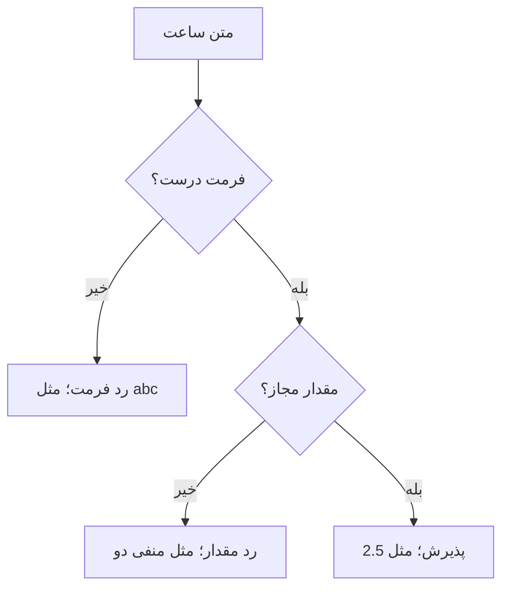

# درس ۰۰۳ — دریافت ورودی و اعتبارسنجی

[قبلی](../002-first-feature/README.md) · [خانه](../../../README.md)

## خروجی درس

عنوان یک درخواست و برآورد ساعت را دریافت می‌کنی.
متن نامعتبر و مقدار خارج از محدوده را با پیام روشن رد می‌کنی.
برنامه در این مرحله پس از یک تلاش تمام می‌شود؛ تکرار ورودی در درس حلقه‌ها می‌آید.

## پیش‌نیاز

درس ۰۰۲، متغیر، decimal، شرط و اجرای پروژه.
با if در این درس به صورت عملی آشنا می‌شوی.

## قرارداد قابلیت

عنوان پس از Trim باید ۳ تا ۱۲۰ کاراکتر باشد.
برآورد باید بزرگ‌تر از صفر و حداکثر ۱۰۰۰ ساعت باشد.
ورودی عددی این نسخه رقم لاتین و نقطهٔ اعشار دارد: مانند 2.5.
جداکنندهٔ هزارگان، نمایش علمی و ارقام فارسی در این نسخه پذیرفته نمی‌شوند.
این محدودیت قرارداد تمرین است؛ محصول فارسی به تصمیم جداگانه دربارهٔ normalization نیاز دارد.

## یک نگاه: دو دروازه برای یک عدد

ورودی ساعت اول باید قابل تبدیل به عدد باشد و بعد قانون این برنامه را رعایت کند. هر دو مسیر رد، پیش از پذیرش ورودی متوقف می‌شوند.



**مکث کوتاه:** ورودی صفر در دروازهٔ اول رد می‌شود یا دوم؟

<details>
<summary>پاسخ را ببین</summary>
<p>دروازهٔ دوم. صفر قابل تبدیل به decimal است، اما قانون برآوردِ بزرگ‌تر از صفر را رعایت نمی‌کند.</p>
</details>

## ۱. Console.ReadLine

```csharp
Console.Write("Title: ");
string? rawTitle = Console.ReadLine();
```

متد `Write` پیام پرسش را چاپ می‌کند، بدون اینکه به خط بعد برود؛ در نتیجه کاربر پاسخ را کنار همان پیام وارد می‌کند. متد `ReadLine` متن واردشده تا زدن Enter را می‌خواند. نوع خروجی آن `string?` است: ممکن است متن بدهد یا، وقتی جریان ورودی تمام شده، مقدار `null`. این مقدار یعنی متنی دریافت نشده است. زدن Enter روی خط خالی معمولاً رشتهٔ خالی می‌دهد و با تمام‌شدن جریان ورودی فرق دارد.

? در اعلان نوع مرجع یعنی احتمال null در قرارداد وجود دارد.
این علامت به تنهایی ورودی را اعتبارسنجی نمی‌کند.

## ۲. آماده‌سازی عنوان

```csharp
string title = rawTitle?.Trim() ?? string.Empty;
```

در عبارت `rawTitle?.Trim()`، عملگر `?.` ابتدا نبودن `null` را بررسی می‌کند. اگر متن داشته باشیم، متد `Trim` فاصله‌های ابتدا و انتهایش را حذف می‌کند؛ اگر متن `null` باشد، متد فراخوانی نمی‌شود و نتیجه هم `null` می‌ماند. سپس عملگر `??` در حالت `null` مقدار سمت راست، یعنی `string.Empty` یا رشتهٔ خالی، را انتخاب می‌کند. بنابراین بعد از این خط، بررسی عنوان با یک رشته انجام می‌شود.

اگر کاربر فقط فاصله وارد کند، نتیجه عنوان خالی است.
Trim فاصلهٔ وسط عنوان را حذف نمی‌کند.
عنوان `"Network issue"` همچنان دو کلمه دارد.

## ۳. بررسی محدوده

```csharp
if (title.Length < 3 || title.Length > 120)
{
    Console.WriteLine("Invalid title.");
    return;
}
```

عملگر `||` به معنی «یا» است: اگر عنوان بیش از حد کوتاه یا بیش از حد بلند باشد، آن را رد می‌کنیم. وقتی شرط چپ درست باشد، بررسی شرط راست برای نتیجه لازم نیست و انجام نمی‌شود. دستور `return` در این برنامه، اجرا را همان‌جا تمام می‌کند. این روش `early return` نام دارد: ورودی نامعتبر زود از مسیر خارج می‌شود و کد پایین‌تر فقط با ورودی پذیرفته‌شده ادامه می‌یابد.

عضو Length در string تعداد واحدهای UTF-16 است؛ لزوماً تعداد نویسه‌های قابل مشاهده نیست.
برای این تمرین همین معیار تعریف شده است.
در محصولی با emoji و قواعد دقیق طول متن، باید معیار مناسب را جدا انتخاب کنیم.

## ۴. چرا Parse مستقیم کافی نیست؟

```csharp
// نمونهٔ رفتار مسئله‌دار برای ورودی قابل اشتباه:
// decimal hours = decimal.Parse(Console.ReadLine()!);
```

علامت `!` پس از مقدار، در اینجا فقط به کامپایلر می‌گوید هشدار احتمال `null` را نشان ندهد. مقدار واقعی را اصلاح نمی‌کند: اگر کاربر `abc` بنویسد، آن متن همچنان عدد نیست و `Parse` می‌تواند `exception` ایجاد کند. چون اشتباه تایپی کاربر قابل انتظار است، از `TryParse` استفاده می‌کنیم تا موفقیت تبدیل را به‌صورت یک مقدار درست یا نادرست بررسی کنیم.

## ۵. تبدیل کنترل‌شده

```csharp
using System.Globalization;

bool parsed = decimal.TryParse(
    rawHours,
    NumberStyles.AllowDecimalPoint | NumberStyles.AllowLeadingSign,
    CultureInfo.InvariantCulture,
    out decimal estimatedHours);
```

پیش از TryParse، ورودی ساعت را با `string? rawHours = Console.ReadLine();` بگیر. دستور `using System.Globalization;` به ابتدای فایل می‌رود؛ بقیهٔ این قطعه پس از دریافت ورودی قرار می‌گیرد.
خروجی اصلی `TryParse` در متغیر `parsed` قرار می‌گیرد: مقدار `true` یعنی تبدیل موفق بوده است. عدد به‌دست‌آمده از پارامتر `out` وارد `estimatedHours` می‌شود. در نسخهٔ فراخوانی‌شدهٔ این متد، تبدیل ناموفق مقدار عددی صفر می‌دهد؛ پس از روی صفر بودن عدد نمی‌توان موفقیت تبدیل را تشخیص داد. معیار تصمیم همان `parsed` است.

تنظیم `NumberStyles` مشخص می‌کند متن عدد چه شکل‌هایی می‌تواند داشته باشد. اینجا اجازهٔ نقطهٔ اعشار و علامت ابتدا را داده‌ایم؛ با `CultureInfo.InvariantCulture` هم نقطه را مستقل از زبان سیستم به‌عنوان جداکننده انتخاب کرده‌ایم. علامت `|` این دو گزینه یا `flag` را با هم فعال می‌کند؛ این کاربرد با عملگر شرطی `||` فرق دارد.

به دلیل نبود AllowLeadingWhite و AllowTrailingWhite، فاصلهٔ بیرون عدد را نمی‌پذیریم.
این انتخاب را در تمرین می‌توانی آگاهانه تغییر بدهی.

## ۶. تبدیل و قانون دامنه متفاوت‌اند

```csharp
if (!parsed || estimatedHours <= 0m || estimatedHours > 1000m)
{
    Console.WriteLine("Invalid estimated hours.");
    return;
}
```

عبارت `!parsed` یعنی تبدیل موفق نشده است. متن `abc` در همین مرحله رد می‌شود، چون عددی از آن به دست نیامده است. اما متن `-2` به عدد تبدیل می‌شود و بعد در بررسی محدوده رد می‌شود، چون ساعت کار منفی برای این برنامه مجاز نیست. بنابراین دو پرسش جدا داریم: «متن قابل تبدیل هست؟» و «عدد به‌دست‌آمده قانون برنامه را رعایت می‌کند؟». در بخش‌های وب و طراحی نیز همین تفکیک را دنبال می‌کنیم.

این نمونه همهٔ خطاهای برآورد را با یک پیام نشان می‌دهد.
در تمرین، پیام‌ها را برای «فرمت خراب» و «خارج محدوده» جدا کن.

## ۷. نمونهٔ کامل

کد آماده در samples/02-ticket-intake/Program.cs قرار دارد.
از ریشه اجرا کن:

```powershell
dotnet run --project samples/02-ticket-intake/SupportDesk.csproj
```

ورودی‌ها را به ترتیب وارد کن:

```text
Network issue
2.5
```

خروجی نهایی:

```text
Ticket: Network issue
Estimate: 2.5 hours
```

دو prompt ابتدایی هم قبل از این خروجی در کنسول دیده می‌شوند.
این نمونه درخواست را ذخیره نمی‌کند؛ فقط دو فیلد را می‌پذیرد و نمایش می‌دهد.

## ۸. جدول بررسی دستی

| عنوان | ساعت | انتظار |
| --- | --- | --- |
| Network issue | 2.5 | قبول |
| عنوان با ۳ کاراکتر | 1 | قبول |
| عنوان با ۱۲۰ کاراکتر | 1000 | قبول |
| ab | 2 | رد عنوان |
| فقط فاصله | 2 | رد عنوان |
| عنوان با ۱۲۱ کاراکتر | 2 | رد عنوان |
| Network issue | abc | رد عدد |
| Network issue | 0 | رد محدوده |
| Network issue | -2 | رد محدوده |
| Network issue | 1000.01 | رد محدوده |
| Network issue | 2,5 | رد فرمت |
| Network issue | ۲٫۵ | رد فرمت در این نسخه |

مرزهای ۳، ۱۲۰، صفر و ۱۰۰۰ اهمیت دارند.
صرفاً یک ورودی معمولی کافی نیست.
عنوان فارسی معتبر می‌تواند پذیرفته شود؛ محدودیت ارقام اینجا به ورودی ساعت مربوط است.

## ۹. تصمیم ساختاری

ورودی هنوز کوتاه است و یک فایل داریم.
به زودی متدهای دریافت و قواعد از هم جدا خواهند شد.
در نسخهٔ وب، Console.ReadLine حذف می‌شود اما قانون محدودهٔ ساعت باقی می‌ماند.
پس قانون کسب‌وکار نباید همیشه به یک روش دریافت ورودی گره بخورد.

برای این تمرین FluentValidation نصب نمی‌کنیم.
وقتی قواعد زیاد و تکرارشونده شوند، ابتدا هزینهٔ راه‌حل دستی را می‌بینیم و سپس ابزار را بررسی می‌کنیم.

## تمرین اصلی

نسخهٔ خودت را در exercises بساز و این تغییرها را اعمال کن:

1. برای تبدیل ناموفق پیام `Enter a number such as 2.5.` بده.
2. برای مقدار خارج محدوده پیام `Hours must be greater than 0 and at most 1000.` بده.
3. فاصلهٔ ابتدا و انتهای عدد را بپذیر، اما comma را همچنان رد کن.
4. پس از پذیرش عنوان، عنوان Trim شده را نمایش بده.
5. برنامه برای همهٔ ردیف‌های جدول رفتار تعریف‌شده داشته باشد.

قبل از تغییر flags، امتحان کن آیا Trim روی rawHours می‌تواند نیاز تمرین را حل کند.
برای انتخابت دلیل بنویس.

## تمرین تکمیلی هزینه

تمرین درس قبل را با ورودی کاربر تکمیل کن.
ساعت در بازهٔ بزرگ‌تر از صفر تا ۱۰۰۰ و نرخ بین صفر و ۱۰۰۰۰۰۰ تومان باشد.
تخفیف از صفر تا صد درصد است.
این محدودیت‌ها دامنهٔ محاسبه را هم کنترل می‌کنند.
هر ورودی نامعتبر باید پیش از محاسبهٔ مبلغ رد شود.

سناریو: ساعت ۳، نرخ ۲۵۰۰۰۰ و تخفیف ۱۰ باید مبلغ نهایی ۶۷۵۰۰۰ بدهد.
سناریو: تخفیف ۱۰۱ باید رد شود.
سناریو: نرخ abc باید بدون crash رد شود.

## سرنخ مرحله‌ای

- اول TryParse را بررسی کن، بعد محدوده را.
- برای قواعد مستقل چند if واضح می‌تواند از یک شرط بسیار طولانی خواناتر باشد.
- پیام خطا باید راه اصلاح ورودی را روشن کند.
- نوع nullable را با `!` پنهان نکن؛ دربارهٔ null تصمیم بگیر.

## معیار عبور

- [ ] تفاوت رشتهٔ خالی، فاصله و null را توضیح می‌دهم.
- [ ] می‌دانم `?`، `?.` و `??` در مثال هر کدام چه می‌کنند.
- [ ] فرمت نامعتبر را از مقدار نامعتبر جدا کرده‌ام.
- [ ] همهٔ boundaryها را بررسی کرده‌ام.
- [ ] contract عددی و محدودیت ارقام را در README تمرین نوشته‌ام.
- [ ] تمرین هزینه روی ورودی خراب متوقف می‌شود و crash نمی‌کند.

## منابع رسمی

- [Decimal.TryParse](https://learn.microsoft.com/en-us/dotnet/api/system.decimal.tryparse?view=net-10.0)
- [Nullable reference types](https://learn.microsoft.com/en-us/dotnet/csharp/nullable-references)
- [NumberStyles](https://learn.microsoft.com/en-us/dotnet/api/system.globalization.numberstyles?view=net-10.0)

## ادامهٔ مسیر

[درس ۰۰۴](../004-loops/README.md) به منو و حلقه اختصاص دارد.
پیش از آن، تمرین‌های این درس را تحویل بده و دلیل تصمیم‌های ورودی را توضیح بده.
