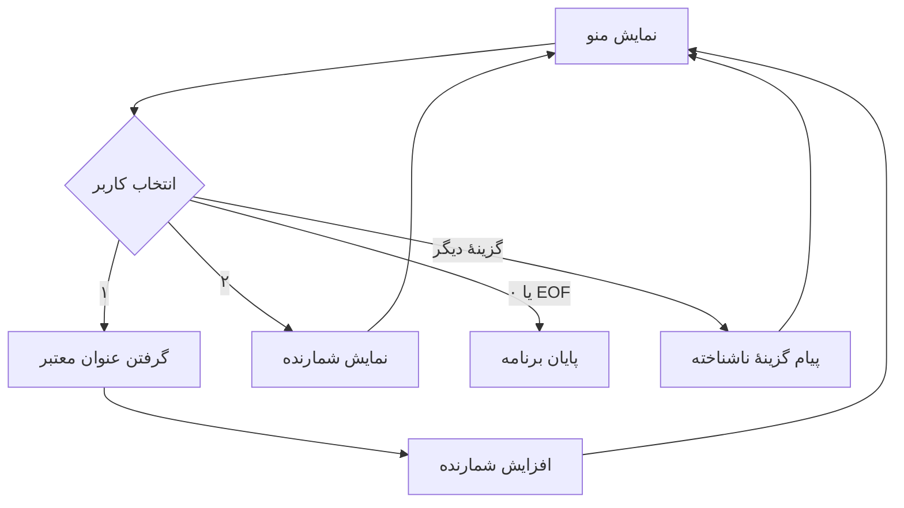

# درس ۰۰۴ — حلقه‌ها و منوی کنسول

[قبلی](../003-input-validation/README.md) · [خانه](../../../README.md) · [بعدی](../005-methods/README.md)

## خروجی درس

برنامه دیگر بعد از یک عملیات بسته نمی‌شود.
کاربر از منو انتخاب می‌کند، عنوان ثبت می‌کند و تعداد ثبت‌های موفق را می‌بیند.
ورودی خراب باعث تکرار دریافت می‌شود؛ پایان جریان ورودی باعث خروج می‌شود.

## پیش‌نیاز

درس ۰۰۳، if، Trim، null و اعتبارسنجی عنوان.
نام switch و حلقه‌ها را اینجا با مثال معرفی می‌کنیم.

## نیازمندی

منو سه گزینه دارد: ۱ ثبت، ۲ گزارش، ۰ خروج.
عنوان پس از Trim بین ۳ و ۱۲۰ واحد UTF-16 است.
ثبت ناموفق نباید شمارنده را افزایش بدهد.
این مرحله فقط تعداد ثبت‌ها را نگه می‌دارد؛ عنوان‌های قبلی هنوز ذخیره نمی‌شوند.

## ۱. چرا تکرار لازم است؟

اگر برای هر ثبت، برنامه را ببندی و دوباره اجرا کنی، شمارندهٔ داخل حافظه از نو مقداردهی می‌شود. حلقه اجازه می‌دهد به منو برگردی و ثبت بعدی را در همان اجرا انجام بدهی؛ بنابراین مقدار قبلی شمارنده باقی می‌ماند. فعلاً فقط یک مسیر اجرای دستورها یا `thread` داریم. نگه‌داری داده پس از بسته‌شدن برنامه، موضوع درس ذخیره‌سازی است.

## یک نگاه: یک دور در منو

هر بازگشت به منو، ادامهٔ همان اجرای برنامه است؛ شمارنده از نو ساخته نمی‌شود. پایان ورودی نیز مانند خروج، حلقه را تمام می‌کند.



**مکث کوتاه:** اگر عنوان اول خراب و عنوان دوم درست باشد، شمارنده چند بار زیاد می‌شود؟

<details>
<summary>پاسخ را ببین</summary>
<p>یک بار؛ حلقهٔ دریافت عنوان باید تا ورودی معتبر صبر کند و فقط بعد از آن ثبت انجام شود. EOF هنگام دریافت عنوان نیز باید بدون ثبت خارج شود.</p>
</details>

## ۲. while

```csharp
bool running = true;
while (running)
{
    Console.WriteLine("Menu is running.");
    running = false;
}
```

شرط پیش از هر دور بررسی می‌شود.
این مثال فقط یک بار چاپ می‌کند، چون running داخل بدنه false می‌شود.
اگر شرط از ابتدا false باشد، بدنه حتی یک بار اجرا نمی‌شود.
اگر شرط هیچ‌وقت false نشود و خروج دیگری نباشد، حلقه ادامه می‌یابد.

ورودی ReadLine منتظر کاربر می‌ماند؛ حلقه‌ای که پشت سر هم چاپ می‌کند چنین انتظاری ندارد.
حلقهٔ بی‌پایان همراه چاپ مداوم می‌تواند CPU و خروجی زیادی مصرف کند.
Sleep درمان طراحی غلط شرط پایان نیست.

## ۳. خواندن انتخاب و تشخیص EOF

```csharp
string? choice = Console.ReadLine();
if (choice is null)
{
    Console.WriteLine("Input ended.");
    break;
}
```

مقدار `null` در اینجا خبر می‌دهد جریان ورودی تمام شده است؛ به آن `EOF` یا پایان فایل/ورودی می‌گوییم. اگر آن را مثل یک پاسخ خالی رد کنیم و دوباره بخوانیم، خواندن بعدی هم ممکن است فوری `null` بدهد و حلقه بی‌وقفه تکرار شود. پس با `break` از نزدیک‌ترین حلقه خارج می‌شویم. این رفتار در اجرای خودکار یا وقتی خروجی برنامهٔ دیگری با `pipe` ورودی این برنامه می‌شود نیز لازم است.

## ۴. switch برای انتخاب عملیات

```csharp
switch (choice.Trim())
{
    case "1":
        Console.WriteLine("Registration selected.");
        break;
    case "0":
        running = false;
        break;
    default:
        Console.WriteLine("Unknown option.");
        break;
}
```

دستور `switch` مقدار انتخاب کاربر را با هر `case` مقایسه می‌کند؛ شاخهٔ `default` برای انتخاب‌هایی است که با هیچ گزینه‌ای برابر نیستند. نکتهٔ این نمونه محل `break` است: وقتی داخل `switch` قرار دارد، فقط همان انتخاب عملیات را تمام می‌کند. حلقهٔ منو همچنان برقرار است. برای گزینهٔ خروج، مقدار `running` را هم `false` می‌کنیم تا شرط حلقه در دور بعد نادرست شود.
در C# از fall-through غیرخالی مانند بعضی کدهای C++ استفاده نکن؛ قواعد کنترل انتقال فرق دارند.

## ۵. حلقهٔ داخلی اعتبارسنجی

```csharp
while (true)
{
    string? rawTitle = Console.ReadLine();
    if (rawTitle is null)
    {
        running = false;
        break;
    }
    string title = rawTitle.Trim();
    if (title.Length < 3 || title.Length > 120)
    {
        Console.WriteLine("Invalid title. Try again.");
        continue;
    }
    registeredTickets++;
    Console.WriteLine($"Registered: {title}");
    break;
}
```

برای عنوان نامعتبر، دستور `continue` باقی دستورهای همان دور را کنار می‌گذارد و دریافت عنوان را دوباره شروع می‌کند؛ بنابراین خط افزایش شمارنده اجرا نمی‌شود. پس از عنوان معتبر، شمارنده افزایش می‌یابد و `break` حلقهٔ داخلی دریافت عنوان را تمام می‌کند. متغیر `registeredTickets` بیرون حلقهٔ منو تعریف شده تا در بازگشت به منو دوباره صفر نشود.

++ مقدار شمارنده را یک واحد زیاد می‌کند.
برای ساده ماندن نمونه فرض می‌کنیم تعداد ثبت‌ها در محدودهٔ int است.
در درس مدل و قواعد، محدودیت ظرفیت را صریح‌تر بررسی می‌کنیم.

## ۶. سه نوع خروج را گم نکن

| دستور | اثر در این نمونه |
| --- | --- |
| continue در حلقهٔ عنوان | دریافت دوبارهٔ عنوان |
| break در حلقهٔ عنوان | پایان دریافت عنوان |
| break در switch | پایان انتخاب عملیات |
| running = false | توقف حلقهٔ منو در بررسی بعدی |
| return در top-level | پایان برنامه از همان نقطه |

اگر بعد از ثبت هنوز درخواست عنوان می‌بینی، محل break را بررسی کن.
اگر کل برنامه با عنوان خراب بسته می‌شود، احتمالاً return درس قبل را همان‌طور نگه داشته‌ای.

## ۷. for برای تکرار با شمارنده

```csharp
for (int attempt = 1; attempt <= 3; attempt++)
{
    Console.WriteLine($"Attempt {attempt}");
}
```

بخش اول یک بار انجام می‌شود.
بخش شرط قبل از هر دور بررسی می‌شود.
بخش آخر بعد از اجرای بدنه انجام می‌شود.
خروجی سه تلاش است؛ اگر <= را به < تبدیل کنی فقط دو تلاش چاپ می‌شود.
این نمونه برای یادگیری for است و در منوی مرجع استفاده نشده است.

## ۸. do/while

```csharp
int count = 0;
do
{
    count++;
} while (count < 1);
```

بدنه حداقل یک بار اجرا می‌شود؛ شرط پس از بدنه بررسی می‌شود.
برای همهٔ منوها مجبور به استفاده از do/while نیستیم.
انتخاب حلقه باید معنی شرط را روشن کند.

## ۹. اجرای نسخهٔ کامل

فایل [Program.cs](../../../samples/03-ticket-menu/Program.cs) را ببین.
از ریشهٔ دوره اجرا کن:

```powershell
dotnet run --project samples/03-ticket-menu/SupportDesk.csproj
```

به ترتیب وارد کن:

```text
1
ab
Network issue
2
0
```

باید یک پیام عنوان نامعتبر، یک ثبت موفق، شمارندهٔ ۱ و Goodbye ببینی.
همهٔ promptها نیز در خروجی وجود دارند.

## ۱۰. سناریوهای پذیرش

| ورودی یا عمل | انتظار |
| --- | --- |
| ۰ در اولین منو | خروج بدون ثبت |
| گزینهٔ ۹ سپس ۰ | پیام ناشناخته و بازگشت به منو |
| ثبت دو عنوان معتبر | شمارندهٔ ۲ |
| عنوان ab سپس عنوان معتبر | فقط یک ثبت |
| EOF در منو | خروج بدون چرخش بی‌پایان |
| EOF هنگام عنوان | خروج بدون افزایش شمارنده |

برای EOF در بررسی خودکار، ورودی محدود را با pipe بده یا از اسکریپت smoke استفاده کن.

## ۱۱. تصمیم طراحی

حلقهٔ داخلی داخل switch کد را تو در تو کرده است.
این هنوز برای نشان دادن کنترل جریان مفید است، اما با بزرگ شدن منو خواندن سخت می‌شود.
در درس بعد دریافت عنوان را به یک متد منتقل می‌کنیم.
نیازی نیست برای خود حلقه کلاس LoopManager یا interface بسازیم.

## تمرین مستقل

گزینهٔ ۳ را برای صفر کردن شمارنده اضافه کن.
قبل از صفر کردن، تأیید y یا n بگیر.
ورودی نامعتبر تأیید باید دوباره پرسیده شود.
EOF در تأیید باید برنامه را تمام کند.
پس از انتخاب n شمارنده ثابت بماند.
پس از انتخاب y شمارنده صفر شود.

## تمرین تکمیلی

برای دریافت عنوان حداکثر سه تلاش تعریف کن.
بعد از سه عنوان نامعتبر به منو برگرد، بدون افزایش شمارنده.
سه تلاش به معنی سه بار دریافت عنوان است، نه سه اجرای برنامه.

## سرنخ

برای تعداد تلاش محدود for را بررسی کن.
برای تأیید، یک حلقهٔ مستقل بساز و محل خروج هر مسیر را بنویس.
قبل از کدنویسی، مشخص کن break به کدام ساختار تعلق دارد.

## معیار عبور

- [ ] تفاوت break در switch و حلقه را توضیح می‌دهم.
- [ ] continue باعث ثبت ورودی خراب نمی‌شود.
- [ ] EOF برنامه را به حلقهٔ سریع بی‌پایان تبدیل نمی‌کند.
- [ ] شمارنده در بیرون حلقه تعریف شده است.
- [ ] تمرین تأیید y و n و ورودی خراب درست است.
- [ ] حد تلاش را بدون خطای یک واحدی پیاده کرده‌ام.

## منابع رسمی

- [Iteration statements](https://learn.microsoft.com/en-us/dotnet/csharp/language-reference/statements/iteration-statements)
- [Jump statements](https://learn.microsoft.com/en-us/dotnet/csharp/language-reference/statements/jump-statements)
- [Selection statements](https://learn.microsoft.com/en-us/dotnet/csharp/language-reference/statements/selection-statements)

## قدم بعد

همین رفتار را با متدها بازآرایی می‌کنیم و بین rule و تعامل کنسولی مرز می‌گذاریم.
