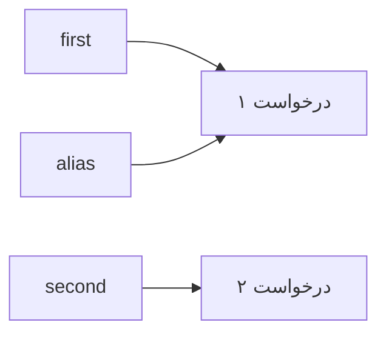

# درس ۰۰۷: کلاس، constructor و property

[قبلی](../006-collections/README.md) · [خانه](../../../README.md) · [بعدی](../008-nullability/README.md)

## خروجی درس

تا اینجا می‌شد برای نگه‌داری هر درخواست پشتیبانی فقط عنوان آن را ذخیره کرد. حالا هر درخواست علاوه بر عنوان، یک شناسه و یک وضعیت دارد. در این درس کلاسی به نام `Ticket` می‌سازی تا اطلاعات مربوط به یک درخواست کنار هم قرار بگیرند.

در پایان می‌توانی درخواست تازه بسازی، عنوانش را تغییر بدهی و آن را از وضعیت «باز» به «در حال انجام» و سپس «بسته» ببری. همچنین با یک آزمایش می‌بینی چرا دو متغیر گاهی به همان یک درخواست اشاره می‌کنند و تغییر یکی در دیگری هم دیده می‌شود.

## پیش‌نیاز و واژگان

درس ۰۰۶ را انجام داده باش؛ به‌ویژه کار با فهرست، دیکشنری و فراخوانی متد. اصطلاح‌های زیر در ادامه با کد توضیح داده می‌شوند؛ لازم نیست تعریفشان را پیشاپیش حفظ کنی.

| اصطلاح | معنی |
| --- | --- |
| کلاس (`class`) | تعریف مشترک درخواست‌ها؛ مشخص می‌کند هر درخواست چه اطلاعات و چه متدهایی دارد. |
| شیء یا نمونه (`instance`) | یک درخواست مشخص، مثلاً درخواست شمارهٔ ۱ با عنوان خرابی شبکه. |
| `constructor` | بخشی از کلاس که هنگام ساخت شیء، مقدارهای اولیهٔ آن را دریافت و بررسی می‌کند. |
| `property` | راه خواندن یا تغییر یک مقدار در شیء؛ مثلاً عنوان درخواست با `Title` خوانده می‌شود. |
| `enum` | نوعی با چند مقدار نام‌دار؛ مثلاً وضعیت باز، در حال انجام و بسته. |
| `namespace` | نامی برای گروه‌بندی کلاس‌ها و نوع‌های مرتبط و تشخیص آن‌ها از نام‌های مشابه. |

## مسئله

فرض کن عنوان درخواست شمارهٔ ۱ در یک دیکشنری و وضعیت آن در دیکشنری دیگری باشد. اگر هنگام ثبت درخواست فقط دیکشنری عنوان را به‌روز کنی، برنامه عنوان درخواست را می‌شناسد، اما وضعیتش را ندارد. هماهنگ نگه‌داشتن این مجموعه‌های جدا به عهدهٔ کدهای پراکنده می‌افتد.

کلاس `Ticket` اطلاعات یک درخواست و متدهای تغییر آن را کنار هم نگه می‌دارد. برای مثال، متد بستن درخواست می‌تواند پیش از تغییر وضعیت بررسی کند که رسیدگی به آن شروع شده باشد. افزودن اولویت را به تمرین پایان درس واگذار می‌کنیم.

## ۱. اولین کلاس ساده

```csharp
public class TicketDraft
{
    public string Title { get; set; } = string.Empty;
}
```

در این مثال، کلاس `TicketDraft` یک property به نام `Title` دارد. بخش `get` اجازهٔ خواندن عنوان را می‌دهد و بخش `set` اجازهٔ نوشتن عنوان را. چون property `public` است، کدی بیرون از کلاس هم می‌تواند آن را بخواند یا تغییر بدهد.

مقدار `string.Empty` یعنی عنوان در شروع رشتهٔ خالی است. این مقداردهی هشدار کامپایلر دربارهٔ مقدار اولیه را برطرف می‌کند، اما درخواست بدون عنوان را معتبر نمی‌کند. این کلاس ساده فقط شکل نوشتن property را نشان می‌دهد؛ در مدل نهایی، عنوان را هم بررسی می‌کنیم.

## ۲. وضعیت نام‌دار

```csharp
public enum TicketStatus { Open, InProgress, Closed }
```

نام `TicketStatus.Open` معنای وضعیت را روشن‌تر از عدد صفر بیان می‌کند. سه مقدار این نوع به‌ترتیب «باز»، «در حال انجام» و «بسته» هستند. چون عددی برایشان ننوشته‌ایم، به‌ترتیب مقدارهای عددی صفر، یک و دو را می‌گیرند.

داشتن این نام‌ها به‌تنهایی ترتیب مجاز تغییر وضعیت را تعیین نمی‌کند؛ برای آن متد می‌نویسیم. همچنین اگر بعداً عددی را از کاربر بگیری و به این نوع تبدیل کنی، باید مجازبودن آن را بررسی کنی: تبدیل عدد به `enum` لزوماً به یکی از همین سه نام ختم نمی‌شود.

## ۳. شناسه و عنوان

```csharp
public int Id { get; }
public string Title { get; private set; }
public TicketStatus Status { get; private set; } = TicketStatus.Open;
```

در property به نام `Id` فقط بخش خواندن تعریف شده است. شناسه را هنگام ساخت درخواست تعیین می‌کنیم و کد بیرون از کلاس نمی‌تواند بعداً آن را عوض کند.

دو property به نام‌های `Title` و `Status` بخش `private set` دارند؛ یعنی کد بیرون کلاس مقدارشان را می‌خواند، اما تغییر آن‌ها فقط از داخل کلاس ممکن است. در نتیجه، برنامه برای تغییر عنوان باید متد `Rename` را صدا بزند. آن متد عنوان تازه را بررسی می‌کند و اجازه نمی‌دهد درخواست با عنوان خالی باقی بماند. پس هم محدودکردن دسترسی لازم است و هم درست‌بودن کدی که تغییر را انجام می‌دهد.

## ۴. constructor

```csharp
public Ticket(int id, string title)
{
    if (id <= 0) throw new ArgumentOutOfRangeException(nameof(id));
    Id = id;
    Title = NormalizeTitle(title);
}
```

نام constructor با نام کلاس یکی است و برخلاف متدهای معمول، نوع خروجی برایش نمی‌نویسیم. با اجرای `new Ticket(1, "Network issue")`، عدد یک و عنوان درخواست به همین constructor فرستاده می‌شوند.

ابتدا شناسه بررسی می‌شود. اگر صفر یا منفی باشد، دستور `throw` ساخت درخواست را با خطا متوقف می‌کند. عبارت `nameof(id)` نام پارامتر، یعنی متن `id`، را برای پیام خطا فراهم می‌کند. جزئیات مدیریت این خطاها را در درس ۰۰۹ می‌خوانی؛ فعلاً نکته این است که درخواست نامعتبر نباید با موفقیت ساخته شود.

عنوان در یک نقطه Trim و بررسی می‌شود:

```csharp
private static string NormalizeTitle(string title)
{
    ArgumentNullException.ThrowIfNull(title);
    string normalized = title.Trim();
    if (normalized.Length < 3 || normalized.Length > 120)
        throw new ArgumentException("Title must contain 3-120 characters.", nameof(title));
    return normalized;
}
```

متد `NormalizeTitle` فاصله‌های ابتدا و انتهای عنوان را حذف می‌کند و طول آن را می‌سنجد. اگر عنوان پس از این کار کمتر از ۳ یا بیشتر از ۱۲۰ واحد طول داشته باشد، خطا می‌دهد؛ در غیر این صورت عنوان آماده را برمی‌گرداند. عبارت `ThrowIfNull` هم دریافت مقدار `null` را رد می‌کند.

این متد `private` است، چون فقط کد داخل کلاس به آن نیاز دارد. همچنین `static` است، چون برای انجام کارش فقط از پارامتر `title` استفاده می‌کند و به اطلاعات یک درخواست مشخص وابسته نیست. طول در این نمونه با `string.Length` سنجیده می‌شود؛ همان واحد UTF-16 درس‌های قبل، که برای بعضی نشانه‌ها مثل ایموجی با تعداد نشانه‌های قابل مشاهده برابر نیست.

## ۵. متد تغییر عنوان

```csharp
public void Rename(string title) => Title = NormalizeTitle(title);
```

علامت `=>` در اینجا شکل کوتاه نوشتن بدنهٔ متد است. هنگام فراخوانی `Rename`، ابتدا `NormalizeTitle` اجرا می‌شود؛ فقط اگر عنوان تازه معتبر باشد، نتیجه در `Title` قرار می‌گیرد. اگر بررسی عنوان خطا بدهد، انتساب انجام نمی‌شود و عنوان قبلی باقی می‌ماند.

هم constructor و هم متد تغییر عنوان از همین بررسی استفاده می‌کنند. بنابراین قانونی که موقع ساخت درخواست رعایت شده، هنگام تغییر عنوان هم حفظ می‌شود. اگر نوشتن مستقیم در `Title` برای همه مجاز بود، کد بیرون کلاس می‌توانست این بررسی را دور بزند.

## ۶. رفتار وضعیت

```csharp
public void Start()
{
    if (Status != TicketStatus.Open)
        throw new InvalidOperationException("Only open tickets can be started.");
    Status = TicketStatus.InProgress;
}
```

متد `Start` فقط درخواست باز را به وضعیت در حال انجام می‌برد. برای درخواست بسته یا در حال انجام، خطا می‌دهد و وضعیت را تغییر نمی‌دهد. متد `Close` در فایل کامل نیز فقط درخواست در حال انجام را می‌بندد؛ در این نسخه، بستن مستقیم درخواست باز مجاز نیست.

این ترتیب، قانون همین برنامه است. اگر نیاز پروژه تغییر کند، لازم است کد تغییر وضعیت و بررسی‌های مربوط به آن با هم اصلاح شوند. کلاس `Ticket` خودش پیامی در کنسول چاپ نمی‌کند و فایلی نمی‌نویسد؛ کارش حفظ اطلاعات و قوانین درخواست است. نمایش نتیجه به کاربر، مسئولیت برنامهٔ کنسولی است.

## یک نگاه: دو نام، یک شیء

هر فلش نشان می‌دهد یک متغیر به کدام شیء اشاره می‌کند. دو متغیر `first` و `alias` به همان درخواست شمارهٔ ۱ اشاره دارند؛ متغیر `second` به درخواست جداگانه‌ای اشاره می‌کند. قطعه‌کد بخش بعد، این تفاوت را در عمل نشان می‌دهد.



**مکث کوتاه:** اگر عنوان را از طریق متغیر `alias` تغییر بدهی، هنگام خواندن عنوان از `first` و `second` چه می‌بینی؟

<details>
<summary>پاسخ را ببین</summary>
<p>متغیر first به همان شیئی اشاره می‌کند که عنوانش تغییر کرده است؛ پس عنوان تازه را نشان می‌دهد. متغیر second به شیء دیگری اشاره می‌کند و عنوان آن ثابت می‌ماند.</p>
</details>

## ۷. reference چیست؟

```csharp
Ticket first = new(1, "Network issue");
Ticket alias = first;
alias.Rename("Router issue");
Console.WriteLine(first.Title);
```

خروجی این قطعه `Router issue` است، با اینکه تغییر عنوان را از طریق `alias` انجام داده‌ایم و عنوان را از `first` می‌خوانیم. علت این است که در خط دوم، خود درخواست را کپی نکرده‌ایم؛ فقط راه دسترسی به آن را در متغیر دیگری قرار داده‌ایم. نام این راه دسترسی در برنامه‌نویسی `reference` است.

بنابراین هر دو متغیر به یک شیء اشاره می‌کنند. این رفتار را با انتساب یک مقدار `int` مقایسه کن: تغییر متغیر عددی دوم، مقدار متغیر اول را عوض نمی‌کند. در درس LINQ نیز می‌بینی که ساختن فهرست تازه با `ToList` به‌تنهایی از تک‌تک درخواست‌های داخل فهرست، شیء تازه نمی‌سازد.

## ۸. شیء مستقل

```csharp
Ticket second = new(2, "Printer issue");
```

این بار از `new` استفاده کرده‌ایم؛ پس درخواست دیگری ساخته می‌شود. تغییر عنوان یا وضعیت درخواست اول روی این درخواست اثر ندارد. در برنامهٔ کامل، متد `ReferenceEquals` بررسی می‌کند که دو متغیر به همان یک شیء اشاره می‌کنند یا نه. این بررسی با مقایسهٔ عنوان یا شناسهٔ دو درخواست فرق دارد؛ دربارهٔ معنای برابری در بخش طراحی بیشتر می‌خوانی.

در فایل کامل، کنار تعریف کلاس واژهٔ `sealed` هم آمده است. این واژه اجازه نمی‌دهد کلاس دیگری با ارث‌بری از `Ticket` ساخته شود. برای دنبال‌کردن این درس نیازی به پیاده‌سازی ارث‌بری نداری.

## ۹. چیدمان فایل واقعی

| فایل | مسئولیت |
| --- | --- |
| Program.cs | سناریو و نمایش نتیجه |
| Domain/Ticket.cs | نوع Ticket، وضعیت و قواعد تغییر |
| SupportDesk.csproj | ساخت پروژه |

در فایل مدل، namespace `SupportDesk.Domain` نوشته شده است. فایل `Program.cs` با دستور `using SupportDesk.Domain` می‌تواند نام `Ticket` را بدون پیشوند کامل آن به کار ببرد. ساخت پوشه‌ای با نام `Domain` به‌تنهایی این namespace را تعریف نمی‌کند؛ اعلان داخل کد هم لازم است.

همهٔ این فایل‌ها در یک پروژه قرار دارند و ابزار ساخت SDK معمولاً فایل‌های `.cs` داخل آن را خودکار پیدا می‌کند. برای جداکردن کلاس از `Program.cs` لازم نیست پروژهٔ تازه‌ای بسازی.

## ۱۰. اجرا

[کد مدل](../../../samples/06-ticket-model/Domain/Ticket.cs) · [Program](../../../samples/06-ticket-model/Program.cs)

```powershell
dotnet run --project samples/06-ticket-model/SupportDesk.csproj
```

خروجی:

```text
First: #1 Router issue Closed
Alias is first: True
Second: #2 Printer issue Open
```

## تمرین مستقل

مدل این درس را به منوی درس ۰۰۶ اضافه کن. به‌جای نگه‌داری عنوان به‌تنهایی، از `Dictionary<int, Ticket>` استفاده کن؛ کلید هر ورودی شناسه و مقدار آن شیء درخواست است.

گزینهٔ ثبت، یک درخواست تازه بسازد؛ گزینهٔ جست‌وجو عنوان و وضعیت را نمایش بدهد؛ و گزینهٔ تغییر عنوان، متد `Rename` را فراخوانی کند. سپس گزینه‌های شروع رسیدگی و بستن را با متدهای `Start` و `Close` اضافه کن. فعلاً پیش از تغییر وضعیت، مجازبودن آن را در منو هم بررسی کن؛ مدیریت خطاهای پرتاب‌شده را در درس ۰۰۹ کامل می‌کنیم.

## تمرین تکمیلی

نوع enum اولویت را با مقدارهای `Low`، `Normal` و `High` بساز. اولویت را به خود کلاس درخواست اضافه کن؛ مقدار اولیهٔ آن `Normal` باشد و تغییرش از طریق یک متد انجام شود. برای نگه‌داری اولویت، دیکشنری جداگانه نساز.

اگر اولویت را از ورودی کاربر می‌گیری، فقط همین مقدارهای مجاز را بپذیر. تبدیل موفق یک عدد به نوع enum، به‌تنهایی کافی نیست.

## سناریوهای پذیرش

| عمل | انتظار |
| --- | --- |
| ساخت با عنوان دارای فاصله | عنوان Trim شده |
| تغییر عنوان شیء اول | شیء دوم ثابت |
| Start سپس Close | Closed |
| Close مستقیم از Open | رد تغییر؛ Open باقی بماند |
| عنوان دوکاراکتری در Rename | عنوان قبلی حفظ شود |

## سرنخ

اول مدل را بدون منو اجرا کن و آزمایش دو متغیر و یک شیء را تکرار کن. پس از فهم نتیجه، نوع مقدار دیکشنری منو را عوض کن و هر گزینه را جداگانه بررسی کن. برای ساده‌ترشدن کد منو، نوشتن مستقیم در `Title` را عمومی نکن؛ تغییر عنوان باید از همان متدی بگذرد که اعتبار آن را بررسی می‌کند.

## معیار عبور

- [ ] فرق تعریف کلاس و ساخت یک شیء مشخص را با مثال توضیح می‌دهم.
- [ ] می‌توانم بگویم خواندن property و تغییر آن در کدام بخش‌ها مجاز است.
- [ ] توضیح می‌دهم چرا انتساب `alias = first` شیء تازه نمی‌سازد.
- [ ] مدل درخواست بدون چاپ در کنسول یا دسترسی به فایل کار می‌کند.
- [ ] داده و قواعد یک Ticket در یک محل‌اند.
- [ ] مسیر فایل و namespace را مستقل توضیح می‌دهم.

## منابع رسمی

- [Classes](https://learn.microsoft.com/en-us/dotnet/csharp/fundamentals/types/classes)
- [Properties](https://learn.microsoft.com/en-us/dotnet/csharp/programming-guide/classes-and-structs/properties)
- [Constructors](https://learn.microsoft.com/en-us/dotnet/csharp/programming-guide/classes-and-structs/constructors)
- [Enums](https://learn.microsoft.com/en-us/dotnet/csharp/language-reference/builtin-types/enum)

## قدم بعد

در جست‌وجوی شناسهٔ ناموجود، null چه قراردادی دارد؟ این سؤال درس ۰۰۸ است.
