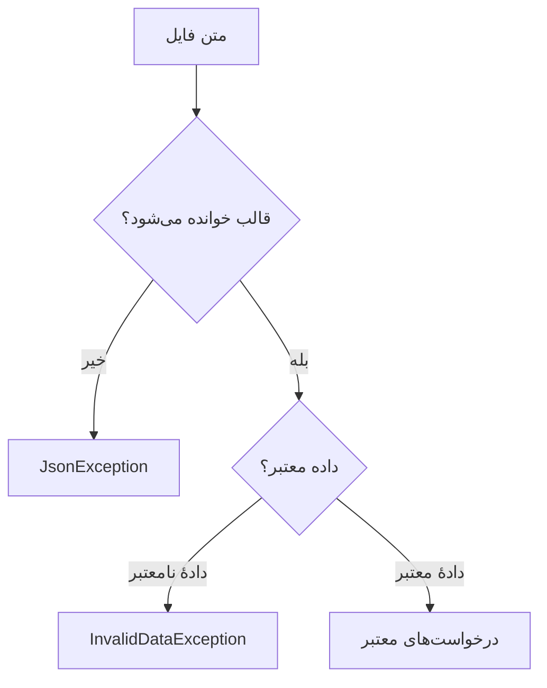

# درس ۰۱۱ — فایل، JSON و بازیابی معتبر داده

[قبلی](../010-linq/README.md) · [خانه](../../../README.md) · [بعدی](../012-async/README.md)

## خروجی درس

درخواست‌ها را در JSON ذخیره و در اجرای بعدی بارگذاری می‌کنی.
بین فایل غایب، JSON خراب و دادهٔ نامعتبر فرق می‌گذاری.
دادهٔ خارجی را پیش از تبدیل به Ticket بررسی می‌کنی.

## پیش‌نیاز

کلاس، nullable، exception، resource و LINQ.
کتابخانهٔ این درس System.Text.Json خود .NET است؛ NuGet خارجی لازم نیست.

## مسئله

با بستن برنامه، فهرست درخواست‌های داخل حافظه از بین می‌رود. می‌خواهیم اجرای بعدی همان درخواست‌ها را دوباره بخواند؛ نگه‌داری داده بیرون از عمر اجرای برنامه را `persistence` می‌نامند. برای این پروژهٔ کوچک و تک‌کاربره، فایل JSON انتخاب آموزشی ساده‌ای است. باید شکل فایل و رفتار هنگام خرابی را هم مشخص کنیم؛ این روش، همهٔ تضمین‌های PostgreSQL برای سرویس چندکاربره را ندارد.

## ۱. قرارداد storage

از TicketSnapshot برای هر رکورد و StoreSnapshot برای فایل استفاده می‌کنیم.

```csharp
public sealed class StoreSnapshot
{
    public int Version { get; init; }
    public List<TicketSnapshot?>? Tickets { get; init; }
}
```

کلیدواژهٔ `init` اجازه می‌دهد property هنگام ساخت و مقداردهی اولیه تنظیم شود، اما بعداً مانند یک `set` عمومی آزادانه تغییر نکند. این کلاس دادهٔ فایل را دریافت می‌کند؛ بنابراین ممکن است فیلدی غایب یا `null` باشد. کد تبدیل داده یا `mapper` باید آن را بررسی کند. اعلان nullable فقط این احتمال را نشان می‌دهد، نه اینکه مقدار نامعتبر را بپذیریم. فیلد `Version` نیز نسخهٔ قالب فایل است و برای این نمونه باید یک باشد.

کلاس TicketSnapshot شامل Id، Title و Status است.
Title از نوع string? است تا نبود فیلد یا null را تشخیص دهیم.
نبود Status طبق مقدار پیش‌فرض enum به Open تعبیر می‌شود؛ قرارداد فعلی این رفتار را می‌پذیرد.
اگر تمام فیلدها باید اجباری باشند، سیاست required و validation جداگانه لازم است.

## ۲. چرا domain را مستقیم deserialize نمی‌کنیم؟

در مدل `Ticket` نمی‌توان هر مقداری را مستقیم در `Status` نوشت؛ تغییر وضعیت از مسیر متدهای مدل می‌گذرد. پس برای راحت‌ترخواندن JSON، setter آن را عمومی نمی‌کنیم. ابتدا دادهٔ فایل را در `snapshot` می‌خوانیم؛ یعنی شکل مستقل و قابل بررسیِ دادهٔ ذخیره‌شده. سپس هنگام `import`، constructor و متدهای مدل را فراخوانی می‌کنیم تا درخواست معتبر بازسازی شود. در نتیجه، تغییر قالب فایل با تغییر قوانین درخواست یکی نمی‌شود.

## ۳. serialize

```csharp
string json = JsonSerializer.Serialize(snapshot, options);
```

متد Serialize نمایش JSON از داده می‌سازد.
WriteIndented خواندن فایل را آسان می‌کند؛ برای اعتبار داده نیست.
به صورت پیش‌فرض propertyها در این نمونه با همان نام C# نوشته می‌شوند.
Status با options فعلی به صورت عددی ذخیره می‌شود.
اگر ترتیب عددهای enum را در آینده عوض کنی، فایل قبلی نیاز به migration دارد.

## ۴. نمونهٔ فایل

```json
{
  "Version": 1,
  "Tickets": [
    { "Id": 1, "Title": "Network issue", "Status": 0 }
  ]
}
```

کلید Title متن Unicode می‌پذیرد.
serializer ممکن است بعضی نویسه‌ها را با escape بنویسد؛ این به معنی از دست رفتن متن فارسی نیست.
خروجی واقعی را با deserialize و نمایش متن بررسی کن.
JSON به تنهایی زمان، مالکیت یا صلاحیت داده را اثبات نمی‌کند.

## یک نگاه: فایل درست، دادهٔ درست؟

متد Deserialize فقط خواندن قالب JSON است. Import جداگانه بررسی می‌کند که داده بتواند یک Ticket معتبر بسازد؛ فایل خراب با لیست خالی جایگزین نمی‌شود.



**مکث کوتاه:** فایل با Version برابر ۲ ولی JSON سالم، از کدام دروازه رد می‌شود؟

<details>
<summary>پاسخ را ببین</summary>
<p>JSON خوانده می‌شود، اما Import نسخهٔ ناشناخته را رد می‌کند. سالم بودن نحو فایل، مجوز تفسیر قالب ناشناخته نیست.</p>
</details>

## ۵. deserialize و validate

```csharp
StoreSnapshot? snapshot = JsonSerializer.Deserialize<StoreSnapshot>(json, options);
List<Ticket> tickets = SnapshotMapper.Import(snapshot);
```

متد Deserialize ممکن است برای متن JSON خراب JsonException بدهد.
برای متن قانونی JSON برابر null، نتیجه null می‌شود.
برای schema ناقص یا دادهٔ نامعتبر، Import خطای InvalidDataException می‌دهد.
JSON معتبر نحوی الزاماً Ticket معتبر نیست.

## ۶. بررسی‌های mapper

| بررسی | دلیل |
| --- | --- |
| snapshot و Tickets null نباشند | فایل ناقص پذیرفته نشود |
| Version برابر ۱ | قالب ناشناخته بی‌صدا تفسیر نشود |
| رکورد null نباشد | عنصر غایب به Ticket جعلی تبدیل نشود |
| Title null نباشد | قرارداد عنوان ضروری است |
| Status تعریف‌شده باشد | عدد enum نامعتبر پذیرفته نشود |
| Idها یکتا باشند | lookup مبهم نشود |
| constructor کلاس Ticket موفق باشد | شناسه و طول عنوان درست باشند |

نوع HashSet<int> در mapper برای تشخیص شناسهٔ تکراری استفاده شده است.
HashSet مجموعهٔ مقدارهای یکتاست؛ Add در صورت تکرار false می‌دهد.
لازم نیست برای این بررسی dictionary مقدارهای اضافی نگه داریم.

## ۷. بازسازی وضعیت

برای وضعیت InProgress ابتدا Ticket ساخته و Start می‌شود.
برای Closed، Start و سپس Close اجرا می‌شوند.
setter Status برای آسان شدن import عمومی نشده است.
در یک domain پیچیده، replay متدها ممکن است side effect داشته باشد؛ این مدل ساده چنین side effectی ندارد.
روش بازسازی دقیق مدل‌های بزرگ را در فصل معماری بررسی می‌کنیم.

## ۸. حفظ علت خطا

اگر constructor عنوان فایل را رد کند، `mapper` با گرفتن `ArgumentException` یک `InvalidDataException` می‌سازد و exception اصلی را در `inner exception` نگه می‌دارد. با این تبدیل، برنامه می‌فهمد مشکل از دادهٔ ذخیره‌شده است و نباید از کاربر بخواهد ورودی همین جلسه را دوباره تایپ کند. علت اولیه نیز برای عیب‌یابی همراه خطای تازه باقی می‌ماند.

## ۹. فایل غایب و خطای مسیر

متد Load فقط FileNotFoundException را به لیست خالی تبدیل می‌کند.
نبود پوشه، permission یا خرابی فایل به لیست خالی تبدیل نمی‌شود.
اگر از File.Exists به تنهایی برای همهٔ حالت‌ها استفاده کنیم، ممکن است بعضی خطاهای دسترسی شبیه نبود فایل دیده شوند.
متن فایل باید واقعاً خوانده شود و خطای واقعی بررسی شود.

## ۱۰. ذخیرهٔ مرحله‌ای

متد Save ابتدا JSON را در یک فایل موقت کنار فایل اصلی می‌نویسد.
نام موقت با Guid ساخته می‌شود تا با فایل موقت اجرای قبلی برخورد نکند.
پس از نوشتن موفق، File.Move با overwrite فایل مقصد را جایگزین می‌کند.
در بخش `finally` برای پاک‌کردن فایل موقت تلاش می‌شود. اینجا `best effort` یعنی پاک‌سازی ممکن است خودش شکست بخورد و تضمین موفقیت ندارد؛ کد مراقب است خطای پاک‌کردن، علت اصلی شکست ذخیره را پنهان نکند.

این روش خطر truncate شدن مستقیم فایل اصلی را کم می‌کند.
تضمین transaction، تحمل قطع برق یا durability دیتابیس نیست.
هم‌زمان نوشتن دو process می‌تواند تغییرهای یکی را از بین ببرد.
قرارداد نمونه: یک process مالک فایل، دادهٔ کوچک و پوشهٔ موجود.

## ۱۱. شناسه پس از راه‌اندازی مجدد

برای افزودن، بزرگ‌ترین Id بارگذاری‌شده به علاوهٔ یک استفاده می‌شود.
Count + 1 پس از حذف مناسب نیست.
این روش در نمونهٔ تک‌نویسنده و بدون قابلیت حذفِ رکورد آخر کافی است.
اگر تاریخچهٔ یکتایی شناسه پس از حذف و restart لازم باشد، باید NextId پایدار یا generator دیگری ذخیره شود.
برای int.MaxValue ثبت تازه رد می‌شود.

## ۱۲. چیدمان فایل‌ها

| مسیر | مسئولیت |
| --- | --- |
| Domain/Ticket.cs | مدل و قواعد |
| Storage/Snapshot.cs | قرارداد فایل و mapping |
| Storage/JsonTicketStore.cs | خواندن و نوشتن فایل |
| Program.cs | انتخاب دستور و نمایش پیام |

در این مرحله Store یک کلاس concrete است؛ interface را بدون نیاز فعلی اضافه نکرده‌ایم.
Program می‌تواند store را بسازد، اما Ticket نباید از مسیر فایل خبر داشته باشد.

## ۱۳. اجرا از ریشه

```powershell
New-Item -ItemType Directory -Force exercises | Out-Null
dotnet run --project samples/10-ticket-json/SupportDesk.csproj -- exercises/tickets.json add "Network issue"
dotnet run --project samples/10-ticket-json/SupportDesk.csproj -- exercises/tickets.json list
```

اجرای دوم باید همان درخواست و Count: 1 را نشان بدهد.
مسیر نسبی نسبت به پوشهٔ کاری process تفسیر می‌شود، نه محل csproj.
برای حذف ابهام می‌توانی مسیر مطلق بدهی.
قبل از آزمایش فایل خراب، فقط از فایل آزمایشی کپی بگیر.

## ۱۴. آزمایش خرابی

در یک فایل آزمایشی متن `{broken` بنویس و دستور add را با همان مسیر اجرا کن.
انتظار پیام Invalid JSON و کد خروج ۱ است.
بایت‌های فایل اصلی نباید بازنویسی شوند.
سپس JSON معتبر با Version: 2 یا Id تکراری بساز؛ باید پیام Invalid stored data بگیری.
این دو شکست جداگانه‌اند.

## تمرین مستقل

منوی خودت را به JsonTicketStore متصل کن.
در شروع Load کن و پس از تغییر موفق Save کن.
اگر Load خراب بود، برنامه را متوقف کن؛ با لیست خالی شروع و فایل اصلی را overwrite نکن.
اگر Save شکست خورد، پیام و سیاست ادامهٔ اجرای برنامه را مستند کن.
در مرجع نهایی درس بعد، شکست storage باعث توقف می‌شود تا state تغییرکرده و ذخیره‌نشده بی‌صدا ادامه نیابد.

## تمرین تکمیلی

برای یک قابلیت Export، یک فایل مستقل با نام انتخابی کاربر بساز.
Version و enumهای ذخیره‌شده را در README شرح بده.
سناریوی فایل بیش‌ازحد بزرگ را تحلیل کن؛ نمونهٔ این درس کل JSON را در حافظه می‌خواند و برای فایل نامحدود مناسب نیست.

## معیار عبور

- [ ] اجرای دوم دادهٔ قبلی را می‌بیند.
- [ ] فایل خراب به لیست خالی تبدیل نمی‌شود.
- [ ] JSON معتبر با رکورد نامعتبر رد می‌شود.
- [ ] duplicate Id و status نامعتبر رد می‌شوند.
- [ ] domain و storage فایل‌های جدا دارند.
- [ ] محدودیت تک‌نویسنده و نبود durability تضمین‌شده را می‌دانم.

## منابع رسمی

- [System.Text.Json overview](https://learn.microsoft.com/en-us/dotnet/standard/serialization/system-text-json/overview)
- [Serialization and deserialization](https://learn.microsoft.com/en-us/dotnet/standard/serialization/system-text-json/how-to)
- [File.Move](https://learn.microsoft.com/en-us/dotnet/api/system.io.file.move?view=net-10.0)

## قدم بعد

خواندن و نوشتن را asynchronous می‌کنیم و لغو را تا لایهٔ I/O منتقل می‌کنیم.
