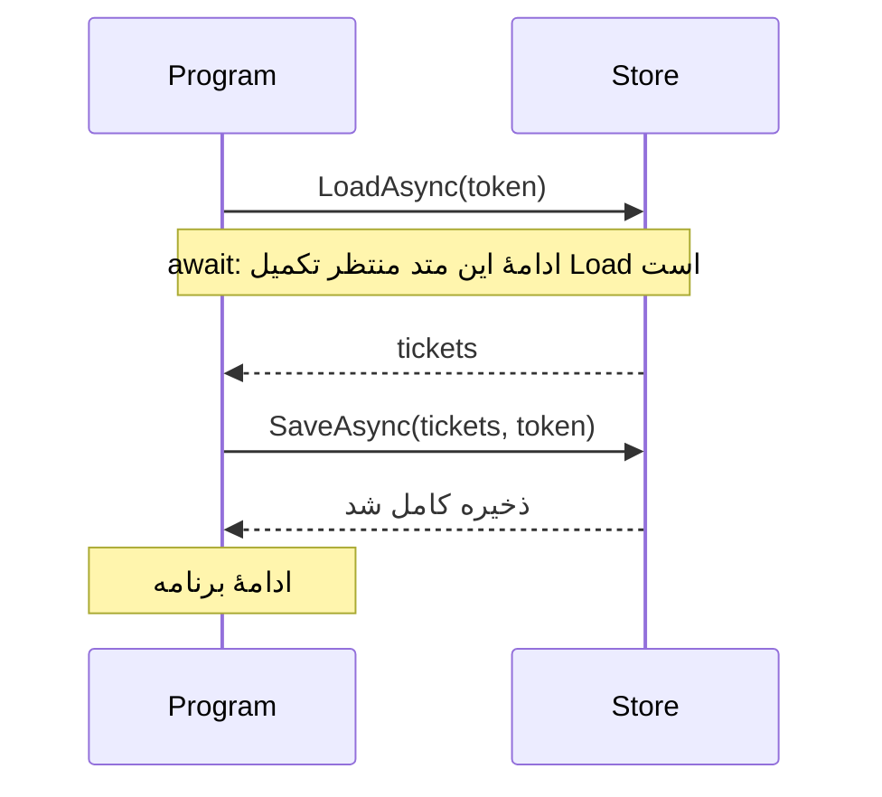

# درس ۰۱۲: انتظار برای پایان عملیات با async و await

[قبلی](../011-files-json/README.md) · [خانه](../../../README.md) · [ارزیابی بخش اول](../README.md)

## خروجی درس

برنامهٔ کنسولی درس‌های قبل را کامل می‌کنی: درخواست‌ها هنگام شروع از فایل JSON خوانده می‌شوند و پس از هر تغییر موفق دوباره در فایل ذخیره می‌شوند. خواندن و نوشتن را با `await` دنبال می‌کنی تا برنامه پیش از تمام‌شدن ذخیره، آن را موفق اعلام نکند.

سپس امکان درخواست لغو را اضافه می‌کنی. در پایان باید بتوانی از روی کد توضیح بدهی که لغو چه زمانی پذیرفته می‌شود و چرا تغییرِ ازقبل‌ذخیره‌شده را به عقب برنمی‌گرداند.

## پیش‌نیاز

درس‌های ۰۰۱ تا ۰۱۱، به‌ویژه مدیریت خطا در درس ۰۰۹ و ذخیره‌سازی فایل در درس ۰۱۱ را انجام داده باش. نمونه از امکانات خود.NET استفاده می‌کند و برای اجرای ناهمگام به کتابخانهٔ دیگری نیاز ندارد. این درس پایان بخش مبانی است؛ طراحی برنامهٔ خط فرمان در بخش دوم ادامه دارد.

موضوع درس دو قسمت دارد. ابتدا تا پایان بخش ۷، معنی `Task` و `await` و ترتیب خواندن و نوشتن را دنبال کن. بعد به لغو عملیات بپرداز. بخش‌های پایانی به آزمایش برنامه و محدودیت‌های آن اختصاص دارند؛ قرار نیست همهٔ اصطلاح‌ها را در اولین خواندن حفظ کنی.

## ۱. مسئلهٔ انتظار

وقتی برنامه فایلی را می‌خواند، بخشی از زمان صرف انتظار برای آماده‌شدن داده می‌شود. این کار با محاسبه‌ای مثل جمع‌زدن عددها فرق دارد: در زمان انتظار، لزوماً محاسبه‌ای برای انجام‌دادن وجود ندارد. به کارهایی مانند خواندن فایل یا دریافت پاسخ شبکه، عملیات ورودی/خروجی یا `I/O` می‌گوییم.

هر «رشتهٔ اجرا» یا `thread` می‌تواند دستورهای برنامه را اجرا کند. اگر آن را فقط برای انتظارِ ورودی/خروجی مسدود کنیم، در آن مدت نمی‌تواند کار دیگری انجام بدهد. این هزینه در سروری با درخواست‌های زیاد مهم‌تر می‌شود. امکانات `async` و `await` کمک می‌کنند ادامهٔ کار را به آماده‌شدن نتیجه وابسته کنیم، بدون اینکه انتظار را به‌صورت مسدودکننده بنویسیم. ممکن است در این کنسول کوچک افزایش سرعتی نبینی؛ هدف درس یادگرفتن شیوهٔ درست انتظار و دریافت نتیجه است.

## ۲. Task

وقتی خواندن ناهمگام فایل را شروع می‌کنی، نتیجه ممکن است هنوز آماده نباشد. متد به‌جای تحویل فوری متن فایل، شیئی از نوع `Task` برمی‌گرداند. از طریق این شیء می‌توان پایان کار، خطای آن یا لغوشدن آن را دنبال کرد.

اگر عملیات نتیجه‌ای هم داشته باشد، نوع آن نتیجه در `Task<T>` مشخص می‌شود. برای مثال، `Task<string>` مربوط به عملیاتی است که در صورت موفقیت یک رشته می‌دهد. متد خواندن درخواست‌های ما نیز `Task<List<Ticket>>` برمی‌گرداند، چون نتیجهٔ موفقش فهرستی از درخواست‌هاست.

سه مفهوم را جدا نگه دار: عملیات، خودِ کار خواندن فایل است؛ شیء `Task` راه دنبال‌کردن پایان آن کار است؛ و رشتهٔ اجرا دستورهای برنامه را اجرا می‌کند. ساخته‌شدن یک `Task` به این معنی نیست که حتماً رشتهٔ اجرای تازه‌ای هم ساخته شده است.

## ۳. async و await

```csharp
public async Task<List<Ticket>> LoadAsync(CancellationToken cancellationToken)
{
    string json = await File.ReadAllTextAsync(path, cancellationToken);
    return SnapshotMapper.Import(JsonSerializer.Deserialize<StoreSnapshot>(json, Options));
}
```

این قطعه نسخهٔ ساده‌شدهٔ متد خواندن است. کد مربوط به فایل ناموجود و بررسی لغو را در فایل کامل می‌بینی. واژهٔ `async` اجازه می‌دهد در بدنهٔ متد از `await` استفاده کنیم.

مسیر اجرای همین قطعه را دنبال کن:

۱. متد `ReadAllTextAsync` خواندن فایل را شروع می‌کند و شیء پیگیری نتیجهٔ متنی را برمی‌گرداند.
۲. اگر نتیجه هنوز آماده نباشد، دستور `await` ادامهٔ همین متد را موقتاً متوقف می‌کند. خط `return` فعلاً اجرا نمی‌شود، اما این انتظار، رشتهٔ اجرا را مسدود نگه نمی‌دارد.
۳. با پایان موفق خواندن، متن فایل در متغیر `json` قرار می‌گیرد. سپس `Deserialize` متن JSON را به داده تبدیل می‌کند و `Import` درخواست‌ها را بازسازی می‌کند.
۴. اگر خواندن فایل خطا بدهد، دستور `await` همان خطا را به این مسیر می‌آورد. در نتیجه، خط `return` عادی اجرا نمی‌شود و کد مدیریت خطا می‌تواند آن را بگیرد.

اگر نتیجه از قبل آماده باشد، ادامهٔ متد بدون آن توقف موقت اجرا می‌شود. همچنین نوشتن `async` ترتیب خط‌ها را عوض نمی‌کند و کد پیش از اولین انتظار، به‌طور عادی اجرا می‌شود.

## یک نگاه: await ترتیب را حفظ می‌کند

در نمودار، برنامه ابتدا خواندن را فراخوانی می‌کند و تا پایان موفق آن به خط ذخیره نمی‌رسد. فلش برگشت، رسیدن نتیجه را نشان می‌دهد؛ هر ستون به معنی یک رشتهٔ اجرای جداگانه نیست.



**مکث کوتاه:** آیا خواندن و ذخیره‌کردن در این نمودار هم‌زمان شروع می‌شوند؟

<details>
<summary>پاسخ را ببین</summary>
<p>خیر. برنامه ابتدا پایان خواندن را دنبال می‌کند و فقط پس از موفقیت آن، ذخیره را شروع می‌کند. استفاده از await به‌تنهایی دو کار را هم‌زمان شروع نمی‌کند.</p>
</details>

## ۴. زنجیرهٔ async

```csharp
List<Ticket> tickets = await store.LoadAsync(token);
await store.SaveAsync(tickets, token);
```

خط اول، فهرست درخواست‌ها را پس از پایان خواندن دریافت می‌کند. خط دوم سپس ذخیره‌کردن همان فهرست را شروع می‌کند و تا پایان آن پیش نمی‌رود. پس این دو عملیات پشت سر هم انجام می‌شوند.

کدی که `SaveAsync` را فراخوانی می‌کند نیز باید پایان آن را با `await` دنبال کند. وگرنه ممکن است پیش از تمام‌شدن ذخیره، پیام موفقیت بدهد یا از برنامه خارج شود؛ همچنین خطای ذخیره از مسیر معمول مدیریت خطا بیرون می‌ماند.

در فایل `Program.cs` این نمونه می‌توانی مستقیم از `await` استفاده کنی؛ کامپایلر نقطهٔ شروع مناسب برنامه را می‌سازد. پسوند `Async` در نام متد هم یک قرارداد نام‌گذاری است تا ناهمگام‌بودن آن برای خواننده روشن باشد؛ خودِ نام، رفتار متد را تغییر نمی‌دهد.

## ۵. Result و Wait

اگر نتیجه آماده نباشد، خواندن ویژگی `Result` یا فراخوانی متد `Wait` رشتهٔ اجرا را تا پایان کار مسدود می‌کند. این با انتظارِ `await` فرق دارد. در سرور، تعداد زیاد چنین انتظارهایی می‌تواند رشته‌های اجرا را اشغال کند. در بعضی محیط‌ها هم ممکن است ادامهٔ کار منتظر همان رشتهٔ مسدودشده بماند و برنامه دیگر جلو نرود؛ به این وضعیت بن‌بست یا `deadlock` می‌گویند.

در این نمونه، مسیر فراخوانی را با `await` ادامه بده و وسط آن سراغ `Result` یا `Wait` نرو. گزینهٔ `ConfigureAwait` تنظیم جداگانه‌ای برای نحوهٔ ادامهٔ اجراست؛ در این درس به آن نیاز نداریم و آن را بدون دلیل به متدها اضافه نمی‌کنیم.

## ۶. async void

متدی که کاری ناهمگام انجام می‌دهد، معمولاً باید `Task` برگرداند تا کد فراخواننده بتواند منتظر پایانش بماند و خطایش را بگیرد. با خروجی `void` چنین شیئی در اختیار فراخواننده قرار نمی‌گیرد.

کاربرد رایج `async void` رسیدگی به رویدادهایی است که امضای آن‌ها خروجی `void` می‌خواهد. متد ذخیرهٔ این برنامه چنین موردی نیست. حتی کد مربوط به رویداد `Ctrl+C` نیز در این نمونه ناهمگام نیست؛ فقط درخواست لغو می‌دهد و خودش ذخیره‌سازی انجام نمی‌دهد.

## ۷. I/O و CPU

در متد ذخیره دو کار متفاوت داریم. تبدیل درخواست‌ها به متن JSON با `Serialize` محاسبه‌ای است که پردازنده انجام می‌دهد. نوشتن متن با `WriteAllTextAsync` نیز ممکن است منتظر دیسک بماند. استفاده از `async` باعث نمی‌شود محاسبهٔ JSON خودکار روی رشتهٔ اجرای دیگری انجام شود.

ابزار `Task.Run` می‌تواند برای سپردن محاسبه به رشته‌های اجرای موجود به کار برود، اما لازم نیست هر متد یا هر عملیات ورودی/خروجی را داخل آن بپیچی. برای فایل‌های بزرگ، اندازهٔ داده، هزینهٔ تبدیل و امکان پردازش تدریجی باید جداگانه بررسی شوند؛ ناهمگام‌کردن نوشتن، همهٔ این هزینه‌ها را برطرف نمی‌کند.

## ۸. token و source

```csharp
using CancellationTokenSource shutdown = new();
CancellationToken token = shutdown.Token;
shutdown.Cancel();
```

شیء `shutdown` از نوع `CancellationTokenSource` محل صدور درخواست لغو است. مقدار `shutdown.Token` را به متدهایی می‌دهیم که باید بتوانند این درخواست را مشاهده کنند. با فراخوانی `shutdown.Cancel()`، درخواست لغو ثبت می‌شود.

لغو در این روش به همکاری عملیات بستگی دارد: کد باید توکن را دریافت کند و در زمان مناسب آن را بررسی کند. اگر متدی اصلاً توکن را نخواند، فراخوانی `Cancel` به اجبار اجرای آن را قطع نمی‌کند. به همین دلیل توکن را از برنامه تا متد ذخیره و سپس تا عملیات نوشتن فایل می‌فرستیم. بستن منبع با `Dispose` نیز جای ثبت درخواست لغو با `Cancel` را نمی‌گیرد.

| زمان مشاهدهٔ لغو در ذخیرهٔ همین نمونه | نتیجه |
| --- | --- |
| پیش از نوشتن فایل موقت | مقصد عوض نشده است |
| هنگام نوشتن فایل موقت | مسیر خطا و cleanup اجرا می‌شود؛ مقصد جایگزین نشده است |
| پس از جایگزینی مقصد با Move | لغو، ذخیرهٔ انجام‌شده را به عقب برنمی‌گرداند |

در این درس، «نهایی‌شدن ذخیره» یا `commit` لحظه‌ای است که فایل موقت جای فایل مقصد قرار می‌گیرد. هنوز دربارهٔ تراکنش دیتابیس صحبت نمی‌کنیم. پیش از اجرای آزمایش لغو، از روی جدول بگو در کدام مرحله فایل مقصد هنوز دست‌نخورده است.

## ۹. انتشار لغو

```csharp
cancellationToken.ThrowIfCancellationRequested();
await File.WriteAllTextAsync(temporary, json, cancellationToken);
cancellationToken.ThrowIfCancellationRequested();
File.Move(temporary, path, overwrite: true);
```

دستور `ThrowIfCancellationRequested` اگر درخواست لغو ثبت شده باشد، با خطای مخصوص لغو ادامهٔ کار را متوقف می‌کند. این بررسی پیش از شروع نوشتن و بار دیگر پیش از جایگزینی فایل مقصد انجام می‌شود. خودِ متد `WriteAllTextAsync` هم توکن را دریافت می‌کند تا هنگام نوشتن امکان مشاهدهٔ لغو را داشته باشد.

اگر نوشتن نیمه‌کاره بماند، کد پاک‌سازی در فایل کامل برای حذف فایل موقت تلاش می‌کند و فایل مقصد هنوز جایگزین نشده است. اما متد `Move` در این نمونه همگام است و توکن نمی‌گیرد. اگر لغو پس از آخرین بررسی برسد، ممکن است جایگزینی فایل انجام شود. بنابراین درخواست لغو تضمین نمی‌کند تغییری که نهایی شده، به حالت قبلی برگردد.

## ۱۰. OperationCanceledException

```csharp
catch (OperationCanceledException) when (shutdown.IsCancellationRequested)
{
    Console.WriteLine("Cancelled.");
}
```

بخش `when` شرط گرفتن خطا را مشخص می‌کند. اینجا فقط وقتی پیام `Cancelled.` چاپ می‌شود که هم خطای لغو رخ داده باشد و هم منبع `shutdown` درخواست لغو داشته باشد.

خطای دسترسی به فایل یا خراب‌بودن JSON، لغو محسوب نمی‌شود و پیام جداگانه دارد. در سرویس واقعی ممکن است پایان مهلت زمانی و انصراف کاربر هر دو باعث لغو شوند، اما لازم باشد پیام و نحوهٔ رسیدگی به آن‌ها متفاوت باشد.

## ۱۱. درخواست لغو با Ctrl+C و محدودیت کنسول

کد رسیدگی به `Ctrl+C` مقدار `e.Cancel` را برابر `true` می‌گذارد تا برنامه بلافاصله بسته نشود؛ سپس درخواست لغو را با `Cancel` ثبت می‌کند. هنگام خروج نیز در بخش `finally` این کد از رویداد `Console.CancelKeyPress` جدا می‌شود.

یک محدودیت را هنگام آزمایش در نظر بگیر: متد `Console.ReadLine` در این نمونه همگام است و توکن لغو نمی‌گیرد. اگر برنامه منتظر ورود متن باشد، ممکن است پس از `Ctrl+C` لازم باشد `Enter` بزنی تا خواندن تمام شود و بررسی بعدی، درخواست لغو را ببیند. اجرای `ReadLine` داخل `Task.Run` هم خودِ خواندنی را که شروع شده به‌اجبار قطع نمی‌کند.

## ۱۲. اجرای نمونهٔ یکپارچه

[Program](../../../samples/11-ticket-async/Program.cs) · [Store](../../../samples/11-ticket-async/Storage/JsonTicketStore.cs)

```powershell
New-Item -ItemType Directory -Force exercises | Out-Null
dotnet run --project samples/11-ticket-async/SupportDesk.csproj -- exercises/foundation.json
```

منو امکان افزودن، نمایش فهرست، شروع رسیدگی، بستن، گزارش و خروج را دارد. برنامه در شروع درخواست‌ها را می‌خواند و پس از هر تغییر موفق منتظر پایان ذخیره می‌ماند. بنابراین هنگام خروج عادی، تغییری در صف ذخیره باقی نمانده است.

اگر ذخیره خطا بدهد، برنامه با کد خروج ۱ متوقف می‌شود. ادامه‌دادن منو در آن وضعیت می‌توانست باعث شود کاربر داده‌ای را در حافظه ببیند که در فایل ثبت نشده است.

## ۱۳. مسیر عملی مرحله‌به‌مرحله

۱. گزینهٔ ۱ و عنوان Network issue را وارد کن؛ شناسهٔ ۱ بگیر.
۲. گزینهٔ ۴ با شناسهٔ ۱ را بزن؛ تغییر مستقیم باید رد شود.
۳. گزینهٔ ۳ با شناسهٔ ۱ را بزن؛ InProgress ذخیره شود.
۴. گزینهٔ ۴ با همان شناسه را بزن؛ Closed ذخیره شود.
۵. گزینهٔ ۵ باید Open: ۰، InProgress: ۰ و Closed: ۱ بدهد.
۶. خارج شو و برنامه را دوباره با همان path اجرا کن.
۷. گزینهٔ ۲ باید همان Ticket با وضعیت Closed را نشان بدهد.

اگر فایل از قبل داده دارد، شناسهٔ تازه ممکن است ۱ نباشد؛ در مسیر آزمایشی تازه شروع کن.

## ۱۴. آزمایش لغو تکرارپذیر

```powershell
dotnet run --project samples/11-ticket-async/SupportDesk.csproj -- exercises/cancel-check.json --cancel-demo
```

گزینهٔ `--cancel-demo` پیش از شروع ذخیره درخواست لغو می‌دهد. انتظار داری پیام `Cancelled.` چاپ شود و فایل جدیدی ساخته نشود. اگر فایل مقصد از قبل وجود داشته، محتوایش باید دقیقاً همان قبلی بماند.

این آزمایش فقط لغوِ ازقبل‌درخواست‌شده را می‌سنجد؛ نشان نمی‌دهد اگر درست وسط نوشتن لغو کنی چه زمانی متوقف می‌شود. در بخش تست، برای آزمایش حالت میانی از وابستگی قابل کنترل استفاده می‌کنیم تا نتیجه به سرعت دستگاه وابسته نباشد.

## ۱۵. هم‌زمانی با WhenAll

```csharp
Task<string> first = File.ReadAllTextAsync(firstPath, token);
Task<string> second = File.ReadAllTextAsync(secondPath, token);
string[] results = await Task.WhenAll(first, second);
```

این قطعه مثال مستقلی است؛ مسیرهای `firstPath` و `secondPath` باید پیش از آن تعریف شده باشند. در دو خط اول، هر دو خواندن را شروع کرده‌ایم و سپس با `WhenAll` پایان هر دو را دنبال می‌کنیم. چون خواندن دوم منتظر پایان اولی نمانده، دو عملیات می‌توانند هم‌زمان در جریان باشند.

متد `WhenAll` خودش تعداد عملیات هم‌زمان را محدود نمی‌کند. همچنین این شیوه را برای دو ذخیره روی همان فایل به کار نبر؛ ذخیره‌ساز این درس برای یک نویسنده طراحی شده است. خواندن و نوشتن هم‌زمان روی فایل مشترک به هماهنگی جداگانه نیاز دارد.

## ۱۶. خطاهای async

اگر عملیات خطا بدهد، کدی که آن را با `await` دنبال می‌کند می‌تواند خطا را با `catch` بگیرد. اگر فقط عملیات را شروع کنی و شیء `Task` آن را کنار بگذاری، دیگر در همان مسیر نمی‌فهمی کار چه زمانی تمام شده یا چه خطایی داده است. برای ذخیرهٔ درخواست‌ها، شروع‌کردن کار و رهاکردن آن قابل قبول نیست.

پایان موفق `await` برای متد ذخیرهٔ این نمونه یعنی جایگزینی فایل مقصد انجام شده است. این نتیجه به‌تنهایی تضمین نمی‌کند داده در برابر قطع ناگهانی برق هم محفوظ بماند؛ آن مسئله به تضمین‌های ذخیره‌سازی نیاز دارد.

## ۱۷. نقش فایل‌ها

| فایل | نقش |
| --- | --- |
| Program | تعامل، هماهنگی و مرز پیام خطا |
| Domain/Ticket | قوانین عنوان و وضعیت |
| Storage/Snapshot | شکل دادهٔ داخل فایل و تبدیل آن به درخواست‌های برنامه |
| Storage/JsonTicketStore | خواندن و نوشتن فایل و رساندن درخواست لغو به عملیات مربوط |

در این مرحله، هر فایل برای کاری که واقعاً انجام می‌دهد جدا شده است. در بخش دوم، روش جداکردن عملیات برنامه، تعریف قرارداد بین کلاس‌ها و فراهم‌کردن وابستگی‌ها را قدم‌به‌قدم بررسی می‌کنیم. هنوز لازم نیست برای مفاهیمی که نیاموخته‌ای، پوشه و کلاس خالی بسازی.

## تمرین مستقل

منوی خودت را به متدهای `LoadAsync` و `SaveAsync` وصل کن و پایان هر دو را با `await` دنبال کن. توکن لغو را تا عملیات خواندن و نوشتن فایل بفرست. برای خطای ذخیره هم تصمیم مشخصی داشته باش: کاربر باید بداند تغییرش ذخیره نشده و برنامه ادامه می‌دهد یا متوقف می‌شود.

گزینه‌های تغییر عنوان و جست‌وجو را از تمرین‌های قبل نگه دار. اگر عنوان یا تغییر وضعیت معتبر نبود، همان درخواست را رد کن و ذخیرهٔ تازه‌ای انجام نده.

## تمرین تکمیلی

با `CancellationTokenSource` یک منبع لغو بساز و با `CancelAfter` درخواست لغو را برای زمانی مشخص تنظیم کن. توکن آن را به یک `Task.Delay` طولانی‌تر بده؛ این متد فقط انتظار را شبیه‌سازی می‌کند. خطای لغو را بگیر و نتیجه را با حالتی مقایسه کن که انتظار کامل می‌شود. این تمرین سرعت دیسک را اندازه نمی‌گیرد.

سپس دو فایل مستقل را با `WhenAll` بخوان و ترتیب مقدارهای آرایهٔ `results` را بررسی کن.

## سناریوهای پذیرش

| حالت | انتظار |
| --- | --- |
| ثبت و restart | همان داده و وضعیت |
| بستن مستقیم درخواست باز | تغییر رد شود و فایل ثابت بماند |
| فایل JSON خراب | خروج با کد ۱؛ فایل بازنویسی نشود |
| درخواست لغو پیش از ذخیره | پیام Cancelled؛ فایل مقصد ثابت بماند |
| شناسهٔ ناموجود | پیام ناموجود؛ منو ادامه داشته باشد |
| پایان ورودی هنگام دریافت متن | برنامه خارج شود و در حلقهٔ دریافت ورودی نماند |

## معیار عبور

- [ ] فرق عملیات، شیء `Task` و رشتهٔ اجرا را با مثال خواندن فایل توضیح می‌دهم.
- [ ] برنامه پیش از پیام موفقیت، پایان ذخیره را با `await` دنبال می‌کند.
- [ ] برای گرفتن نتیجهٔ ناهمگام در مسیر برنامه از `Result` یا `Wait` استفاده نکرده‌ام.
- [ ] توکن لغو از منو تا عملیات خواندن و نوشتن فایل فرستاده می‌شود.
- [ ] توضیح می‌دهم چرا لغو پس از جایگزینی فایل، تغییر را به عقب برنمی‌گرداند.
- [ ] محدودیت لغو هنگام انتظار `ReadLine` را در آزمایش دیده‌ام.
- [ ] ارزیابی پایان بخش مبانی را مستقل انجام می‌دهم.

## منابع رسمی

- [Async programming](https://learn.microsoft.com/en-us/dotnet/csharp/asynchronous-programming/)
- [Task cancellation](https://learn.microsoft.com/en-us/dotnet/standard/parallel-programming/task-cancellation)
- [Asynchronous file access](https://learn.microsoft.com/en-us/dotnet/csharp/programming-guide/concepts/async/using-async-for-file-access)

## پایان بخش اول

بخش مبانی شامل ۱۲ درس است. پیش از ادامه، تمرین پایان بخش را انجام بده و توضیح بده هر کلاس چه کاری را بر عهده دارد. سپس با [درس ۰۱۳: کنترل تغییر داده و حفظ قواعد شیء](../../02-design/013-encapsulation/README.md) وارد بخش طراحی شو.
