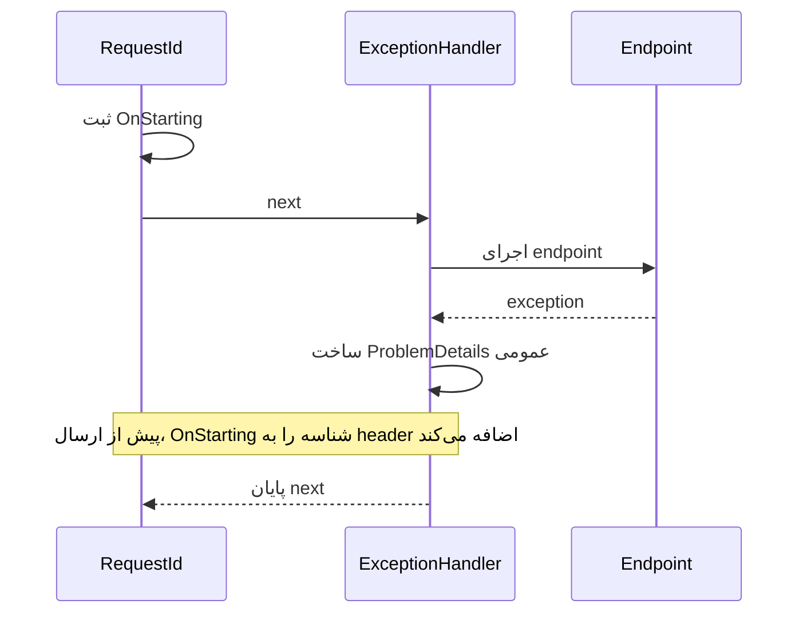

# درس ۰۲۹ — middleware و مدیریت خطا

[قبلی](../028-validation/README.md) · [خانه](../../../README.md) · [بعدی](../030-configuration/README.md)

## مسئله و خروجی

یک exception غیرمنتظره نباید متن داخلی، مسیر فایل یا stack trace را به client بدهد.
در این درس مدیریت مرکزی خطا، response عمومی و شناسهٔ درخواست را اضافه می‌کنیم.
یک endpoint خطای عمدی فقط در Development داریم تا مسیر failure قابل آزمایش باشد.
این endpoint جزء قابلیت تجاری محصول نیست.

## ۱. middleware چه چیزی را احاطه می‌کند؟

وقتی یک middleware اجرای `next` را با `await` دنبال می‌کند، مراحل بعدی در محدودهٔ اجرای آن قرار می‌گیرند. می‌تواند پیش از next کاری انجام بدهد و پس از برگشت آن ادامه بدهد؛ اگر exception از مراحل بعد منتشر شود، handlerِ بالادست امکان رسیدگی دارد. به همین دلیل exception handler باید پیش از endpointهایی قرار بگیرد که قرار است خطایشان را بگیرد. پاسخ معمول ۴۰۴ لزوماً exception ندارد و نباید صرفاً به‌خاطر ناموفق‌بودن پاسخ به ۵۰۰ تبدیل شود.

## یک نگاه: خطا در کدام محدوده گرفته می‌شود؟

در مسیر خطای این نمونه، exception از endpoint به handler برمی‌گردد. ثبت callback شناسه پیش از handler انجام شده تا پاسخ خطا هم request ID داشته باشد.



**مکث کوتاه:** خطایی که پیش از رسیدن به ExceptionHandler، در خود RequestId رخ دهد، داخل این محدوده است؟

<details>
<summary>پاسخ را ببین</summary>
<p>نه؛ handler اجرای پایین‌دست خودش را احاطه می‌کند. middleware پیش از آن، در محدودهٔ همین handler قرار ندارد.</p>
</details>

## ۲. ترتیب واقعی این نمونه

```csharp
app.UseMiddleware<RequestIdMiddleware>();
app.UseExceptionHandler();
app.UseStatusCodePages();
app.MapControllers();
```

کد callback شناسه پیش از endpoint ثبت می‌شود تا پاسخ خطا هم header را داشته باشد.
exception handler اجرای پایین‌دست را احاطه می‌کند.
status code pages برای body خطاهای بدون body به کار می‌رود.
خطای داخل RequestIdMiddleware که پیش از handler قرار دارد، تحت پوشش همین handler نیست؛ ترتیب را با محدودهٔ مسئولیت بخوان.
این middleware کوچک پیش از next فقط callback نوشتن header را ثبت می‌کند.

## ۳. کلاس middleware

```csharp
public async Task InvokeAsync(HttpContext context)
{
    context.Response.OnStarting(() =>
    {
        context.Response.Headers["X-Request-ID"] = context.TraceIdentifier;
        return Task.CompletedTask;
    });
    await next(context);
}
```

پارامتر `RequestDelegate next` راه فراخوانی ادامهٔ pipeline است و از constructor می‌آید. متد `InvokeAsync` برای هر درخواست context همان درخواست را می‌گیرد. با `OnStarting` تابعی ثبت می‌کنیم که بعداً، درست پیش از ارسال headerها، اجرا شود؛ چنین تابعی `callback` نام دارد.

علت این زمان‌بندی مسیر خطاست: exception handler ممکن است برای ساخت پاسخ ۵۰۰، headerهای قبلی را پاک کند. اگر فقط پیش از next شناسه را در header نوشته باشیم، ممکن است از پاسخ خطا حذف شود. callback ثبت‌شده آن را در زمان شروع ارسال پاسخ قرار می‌دهد.
به همین دلیل برابری requestId در body و header روی مسیر ۵۰۰ هم تست می‌شود.
در conventional middleware نباید scoped dependency را در constructor بلندعمر اسیر کنی؛ درس scope این نکته را باز می‌کند.

## ۴. شناسه از کجا می‌آید؟

این نمونه از TraceIdentifier ساخته‌شده در سرور استفاده می‌کند.
مقدار X-Request-ID ورودی client را به عنوان هویت قابل اعتماد قبول نمی‌کند.
شناسه برای تطبیق گزارش خطای client با log همان درخواست است.
شناسهٔ درخواست توکن دسترسی یا شناسهٔ کاربر نیست.
بعداً trace توزیع‌شده و OpenTelemetry مفهوم گسترده‌تری خواهند داشت.

## ۵. ثبت exception handler

```csharp
builder.Services.AddProblemDetails();
builder.Services.AddExceptionHandler<ApiExceptionHandler>();
```

کلاس ApiExceptionHandler قرارداد IExceptionHandler را پیاده می‌کند.
ValueTask<bool> خروجی asynchronous همین قرارداد framework است؛ [مرجع syntax](../../../handbook/csharp-syntax.md) فرق کاربرد آن و Task و callback را توضیح می‌دهد.
این handler می‌تواند با true اعلام کند exception را پاسخ داده است.
اگر false برگرداند، handlerهای بعدی یا رفتار middleware تصمیم می‌گیرند.
در این نمونه تمام exceptionهای غیرمنتظرهٔ قابل رسیدن به این handler به یک ۵۰۰ عمومی تبدیل می‌شوند.
exception ناشی از abort درخواست ممکن است رفتار ویژهٔ framework داشته باشد؛ آن را قرارداد ۵۰۰ قطعی برای client قطع‌شده فرض نکن.

## ۶. مسیر نوشتن پاسخ

```csharp
context.Response.StatusCode = StatusCodes.Status500InternalServerError;
await problems.WriteAsync(new ProblemDetailsContext
{
    HttpContext = context,
    ProblemDetails = new ProblemDetails
    {
        Status = 500, Title = "Unexpected server error",
        Extensions = { ["requestId"] = context.TraceIdentifier }
    }
});
```

کد client پیام عمومی می‌گیرد و requestId را برای پیگیری نگه می‌دارد.
exception.Message در body عمومی قرار نگرفته است.
این کد برای مسیر معمول JSON همین دوره است و writer باید Accept درخواست را پشتیبانی کند.
پاسخی که قبلاً شروع شده را نمی‌توان همیشه با یک JSON تازه جایگزین کرد.
streaming و response شروع‌شده به طراحی خطای متناسب نیاز دارند.

## ۷. log سمت سرور

```csharp
logger.LogError(exception, "Unhandled failure for request {RequestId}", context.TraceIdentifier);
```

نام داخل آکولاد یک `placeholder` است و مقدار شناسه با همان نام در log ثبت می‌شود. در `structured logging` مقدارها جدا از متن پیام هم قابل جست‌وجو هستند؛ بنابراین می‌توان رویدادهای همان `RequestId` را پیدا کرد.
exception کامل در log سرور است و body کامل request یا secret را log نمی‌کنیم.
handler با ILogger کار می‌کند؛ افزودن Serilog برای این مسیر الزامی نیست.
در .NET 10 سیاست diagnostics برای exceptionهای handled تغییر کرده است؛ sample لاگ صریح خودش را ثبت می‌کند.
یک رویداد را بدون نیاز در چند لایه با همان سطح Error تکرار نکن.

## ۸. endpoint خطای عمدی

در Development مسیر /diagnostics/failure یک InvalidOperationException ایجاد می‌کند.
یک متن آزمایشی مشخص یا `sentinel` داخل exception گذاشته شده است. تست می‌داند دنبال چه متنی بگردد و بررسی می‌کند همین جزئیات داخلی وارد پاسخ عمومی نشده باشد.
پاسخ باید ۵۰۰، application/problem+json و requestId داشته باشد.
همان رشتهٔ داخلی نباید در body دیده شود.
در Production این مسیر اصلاً map نمی‌شود و ۴۰۴ می‌گیرد.

## ۹. Development و پاسخ استاندارد

این نمونه حتی در Development handler مشخص خودمان را ثبت و استفاده می‌کند.
در نتیجه برای این endpoint عمداً پاسخ عمومی داریم، نه صفحهٔ خطای توسعه.
از این مشاهده نتیجه نگیر که همهٔ templateها و ترتیب‌های middleware همین رفتار را دارند.
DeveloperExceptionPage ابزار debugging محلی است و تصمیم نمایش آن جدا از قرارداد عمومی خطا است.

## ۱۰. خطاهای مورد انتظار را throw نکن

برای Ticket ناموجود، پاسخ همان ۴۰۴ معمول controller باقی می‌ماند.
عنوان خراب همان ۴۰۰ validation است.
وجود این handler مجوز تبدیل تمام نتیجه‌های business به exception عمومی نیست.
در پایان بخش conflict تغییر وضعیت با ۴۰۹ برمی‌گردد و از مسیر ۵۰۰ عبور نمی‌کند.

## ۱۱. سناریوی بازیابی

ابتدا /health را بخوان و سپس endpoint خطای عمدی را بزن.
شناسهٔ header و requestId body را مقایسه کن.
دوباره /health را بخوان؛ یک request ناموفق نباید process را نابود کرده باشد.
log را با شناسهٔ همان request پیدا کن.
restart یا crash واقعی را با exception مدیریت‌شده یکی نگیر.


## نمونهٔ قابل اجرا و ابزارهای لازم

پیش‌نیاز: درس‌های قبلی بخش سوم، SDK 10 و یک ترمینال دوم برای requestها.
از ریشهٔ repository:

```powershell
dotnet run --project samples/28-error-pipeline/SupportDesk.csproj --no-launch-profile -- --urls http://127.0.0.1:5290
```

ترمینال server را باز نگه دار؛ در ترمینال دوم:

```powershell
curl.exe -i http://127.0.0.1:5290/health
$body = @{ title = "Network issue" } | ConvertTo-Json
Invoke-RestMethod -Method Post -Uri http://127.0.0.1:5290/api/tickets -ContentType application/json -Body $body
curl.exe -i http://127.0.0.1:5290/api/tickets/1
```

اگر process تازه باشد Id نخست ۱ است.
دادهٔ هر نمونه مستقل و در حافظهٔ همان process است.
[فایل‌ها و تغییر مرحلهٔ نمونه](../../../samples/28-error-pipeline/README.md) را کنار این درس باز کن.
فرمان `python scripts/controller_smoke.py` همهٔ snapshotهای controller این بخش را بررسی می‌کند.
برای توقف server از Ctrl+C استفاده کن.

## تمرین مستقل

یک middleware دیگر بساز که مدت درخواست را با `Stopwatch` اندازه بگیرد.
مقدار زمان را پس از await next محاسبه و با placeholder مناسب log کن.
اگر header مدت لازم داری، OnStarting و محدودیت شروع response را بررسی کن؛ پس از نوشتن body header را بی‌قید تغییر نده.
برای درخواست موفق، validation و exception رفتار middleware را مقایسه کن.

## تمرین تکمیلی

یک handler اختصاصی برای یک failure مورد انتظارِ ساختگی طراحی کن و ترتیب handlerها را توضیح بده.
دلیل انتخاب status را بنویس و مراقب باش خطای bug برنامه را با failure متداول یکسان نکنی.
رفتار request قطع‌شده را به عنوان سناریوی مستقل تحقیق و ثبت کن.

## معیار عبور

- [ ] ترتیب pipeline و محدودهٔ catch آن را توضیح می‌دهم.
- [ ] failure غیرمنتظره در body جزئیات داخلی ندارد.
- [ ] requestId در پاسخ ۵۰۰ با header همان درخواست منطبق است.
- [ ] مسیر diagnostics در Production وجود ندارد.
- [ ] یک failure مدیریت‌شده سرویس را از پاسخ‌گویی بعدی نمی‌اندازد.

## منابع رسمی

- [ASP.NET Core error handling](https://learn.microsoft.com/en-us/aspnet/core/fundamentals/error-handling?view=aspnetcore-10.0)
- [IExceptionHandler](https://learn.microsoft.com/en-us/dotnet/api/microsoft.aspnetcore.diagnostics.iexceptionhandler?view=aspnetcore-10.0)
