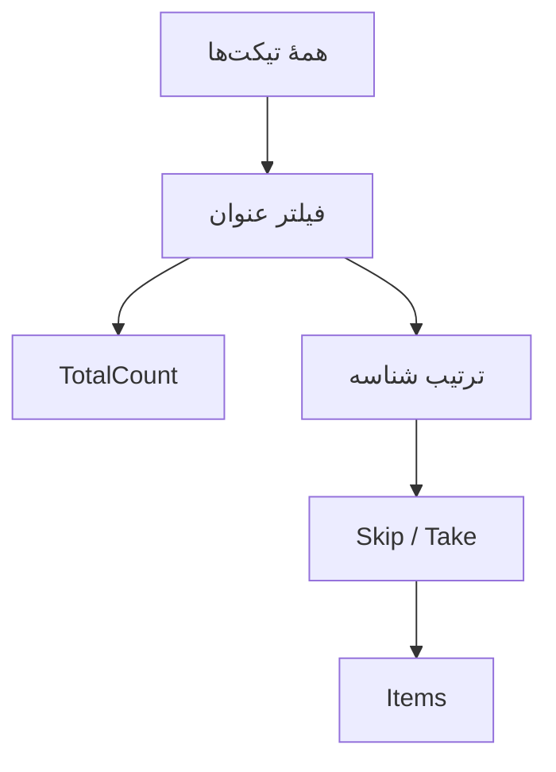

# درس ۰۳۲ — طراحی REST و pagination

[قبلی](../031-di-scopes/README.md) · [خانه](../../../README.md) · [بعدی](../033-openapi/README.md)

## مسئله و خروجی

اگر هر بار فهرست کامل درخواست‌ها را بفرستیم، با رشد داده حجم پاسخ هم بیشتر می‌شود. این بار client شمارهٔ صفحه و اندازهٔ صفحه را می‌فرستد و فقط همان بخش را می‌گیرد. به این تقسیم نتیجه `pagination` می‌گویند. برای اینکه client تعداد کل را هم بداند، آرایه را داخل یک شیء شامل `Items` و `TotalCount` قرار می‌دهیم؛ این ظرف اطلاعات و داده، `response envelope` نام دارد.
این یک API حافظه‌ای برای فهم قرارداد است؛ کارایی query دیتابیس را ادعا نمی‌کند.

## ۱. نام‌گذاری منبع و عملیات

مسیر /api/tickets مجموعه و /api/tickets/{id} یک عضو است.
زیرمنبع /title نمایش قابل جایگزینی عنوان را دارد.
در URL نام همهٔ متدهای C# مانند GetAllTickets را وارد نمی‌کنیم.
فقط جمع بستن اسم‌ها یک API را به تمام معنا RESTful نمی‌کند؛ قرارداد method، representation و failure هم مهم است.
این بخش یک قرارداد HTTP منظم می‌سازد و همهٔ قیود REST یا hypermedia را پیاده نکرده است.

## ۲. قرارداد query

| کلید | default | محدوده / رفتار |
| --- | --- | --- |
| q | غایب | فیلتر عنوان، حداکثر raw ۱۲۰ |
| page | ۱ | عدد صحیح مثبت |
| pageSize | DefaultPageSize | ۱ تا MaxPageSize |

این filter بدون حساسیت به بزرگی حروف و با OrdinalIgnoreCase است.
whitespace به معنی بدون فیلتر است.
pageSize نامعتبر را در این قرارداد رد می‌کنیم، نه اینکه بی‌خبر به max کاهش دهیم.
می‌توان سیاست `clamp` داشت؛ یعنی مقدار بیرون محدوده را به نزدیک‌ترین حد مجاز تبدیل کرد. این API چنین کاری نمی‌کند و مقدار نامعتبر را رد می‌کند تا client از تغییر بی‌خبرِ درخواستش غافلگیر نشود.

## یک نگاه: اول فیلتر؛ بعد شمارش و صفحه

مقدار TotalCount از نتیجهٔ فیلترشده و پیش از صفحه‌بندی به دست می‌آید. Items فقط صفحهٔ انتخابی از همان مجموعه است.



**مکث کوتاه:** اگر ۲۳ نتیجه و pageSize برابر ۱۰ باشد، صفحهٔ دوم چه تعداد Items و چه TotalCount دارد؟

<details>
<summary>پاسخ را ببین</summary>
<p>ده Items و TotalCount برابر ۲۳. تعداد کل با جابه‌جایی صفحه عوض نمی‌شود؛ صفحهٔ سوم سه مورد دارد.</p>
</details>

## ۳. پاسخ envelope

```csharp
public sealed record PageResponse<T>(
    IReadOnlyList<T> Items, int Page, int PageSize, int TotalCount);
```

```json
{
  "items":[{"id":1,"title":"Network issue"}],
  "page":1,"pageSize":2,"totalCount":1
}
```

مقدار TotalCount تعداد کل نتیجه‌های filter قبل از page است.
Items فقط دادهٔ همان صفحه است.
این تغییر نسبت به array خالیِ درس قبل تغییر قرارداد است و client قدیمی را می‌تواند بشکند.
در snapshot آموزشی نسخه‌ها جدا هستند؛ در محصول به برنامهٔ migration یا versioning نیاز داریم.

## ۴. ترتیب عملیات

ابتدا snapshot داده با ترتیب Id گرفته می‌شود.
بعد filter روی آن اعمال می‌شود.
TotalCount از همان snapshot فیلترشده حساب می‌شود.
در پایان Skip و Take صفحه را انتخاب می‌کنند.
اگر `Take` را پیش از filter اجرا کنی، ابتدا چند عضو از کل فهرست انتخاب می‌شوند و سپس بخشی از همان‌ها حذف می‌شوند؛ ممکن است صفحه کم‌عضو شود در حالی که نتیجهٔ مرتبط در ادامهٔ فهرست وجود دارد. همچنین `TotalCount` باید تعداد همهٔ نتیجه‌های فیلترشده را بگوید، نه فقط اعضای صفحه.

## ۵. ترتیب قطعی

کد store در All بر اساس Id صعودی مرتب می‌کند.
pagination بدون ترتیب قطعی می‌تواند بین اجراها جابه‌جایی تصادفی بدهد.
مرتب‌سازی بر اساس فیلد غیر یکتا به tie-breaker مثل Id نیاز دارد.
این قرارداد فعلاً sort دلخواه نمی‌پذیرد.
در دیتابیس باید همین ترتیب به query واقعی منتقل شود.

## ۶. overflow و صفحهٔ خیلی بزرگ

```csharp
long skip = ((long)page - 1) * size;
TicketResponse[] items = skip >= filtered.Length
    ? []
    : filtered.Skip((int)skip).Take(size).Select(t => t.ToResponse()).ToArray();
```

تبدیل به long پیش از ضرب جلوی overflow محاسبهٔ offset برای intهای بزرگ را می‌گیرد.
اگر offset از تعداد داده بیشتر باشد، پاسخ ۲۰۰ با Items خالی است.
فقط وقتی offset از طول آرایه کمتر است آن را به int برمی‌گردانیم.
page منفی یا صفر پیش‌تر ۴۰۰ شده است.
اینجا cap مصنوعی برای شمارهٔ صفحه نداریم؛ هزینهٔ snapshot مستقل از بزرگی شمارهٔ صفحه است.

## ۷. مرز validation

مقدار page=abc خطای تبدیل است و ApiController آن را ۴۰۰ می‌کند.
page=0 تبدیل موفق دارد ولی policy نمونه آن را رد می‌کند.
pageSize بیشتر از MaxPageSize خطای ورودی است.
q خیلی بلند هم ۴۰۰ است و داده را تغییر نمی‌دهد.
صفحهٔ معتبرِ بدون نتیجه ۴۰۴ نیست.

## ۸. snapshot یک درخواست

دو مقدار `Count` و `Items` از یک آرایهٔ snapshot ساخته می‌شوند.
درخواست create هم‌زمان نمی‌تواند وسط enumeration dictionary را خراب کند.
اما درخواست صفحهٔ اول و صفحهٔ دوم snapshot مشترک تاریخی ندارند.
برای مثال، اگر پس از خواندن صفحهٔ اول، عضوی از ابتدای فهرست حذف شود، جای عضوهای بعدی جابه‌جا می‌شود؛ ردکردن همان تعداد قبلی ممکن است یک عضو را جا بیندازد. اضافه‌شدن عضو نیز می‌تواند باعث تکرار شود. ترتیب قطعی لازم است، اما برای ثابت‌نگه‌داشتن دو صفحه در دو زمان کافی نیست.
این محدودیت را با «مرتب‌سازی قطعی همهٔ مسائل را حل کرد» اشتباه نگیر.

## ۹. offset در برابر cursor

| روش | مزیت | محدودیت |
| --- | --- | --- |
| page / offset | ساده و مناسب پرش صفحه | هزینهٔ offset بزرگ در دیتابیس و جابه‌جایی با mutation |
| cursor / keyset | ادامه دادن بر اساس کلید ترتیب | قرارداد cursor و ترتیب پیچیده‌تر، پرش دلخواه دشوارتر |

روش `offset` می‌گوید چند عضو اول را رد کن؛ مثلاً صفحهٔ دوم با اندازهٔ ده از عضو یازدهم شروع می‌شود. روش `cursor` یا `keyset` به‌جای شمارش اعضای ردشده می‌گوید از بعدِ کلید آخرِ صفحهٔ قبل ادامه بده. در این درس فقط offset پیاده شده است؛ طراحی cursor به ترتیب و فیلتر روشن نیاز دارد.
pagination permission filtering را حذف نمی‌کند؛ بعداً فقط دادهٔ مجاز باید وارد count و page شود.

## ۱۰. چرا فعلاً query در controller است؟

برای دیدن قرارداد HTTP، query کوچک روی snapshot در action آمده است.
این به معنی توصیهٔ بارگیری کل جدول PostgreSQL در controller نیست.
در بخش data، filter و projection و limit باید به query قابل اجرا در دیتابیس منتقل شوند.
اگر شکل خروجی یا قواعد query پیچیده شد، application query service مرز مناسب‌تری می‌شود.
abstraction فعلی نباید مانع query کارآمد بعدی شود.

## ۱۱. سناریوی عددی

چهار Ticket با عنوان‌های Network alpha، Printer beta، Network gamma و Network delta بساز.
با q=network و pageSize=2 باید totalCount=3 باشد.
page اول Idهای ۱ و ۳ و page دوم Id=4 را می‌گیرد.
page خیلی بزرگ Items خالی و همان totalCount می‌دهد.
با q=absent totalCount=0 است.

## ۱۲. مصرف پاسخ

کد client نباید length صفحه را همیشه تعداد کل داده بداند.
pageSize واقعی پاسخ را بخوان؛ default محیط ممکن است متفاوت باشد.
برای نمایش «صفحهٔ بعد» می‌توان از page، pageSize و totalCount استفاده کرد، با توجه به تغییر هم‌زمان داده.
برای product با دادهٔ پرنوسان، قرارداد cursor را جدا ارزیابی کن.


## نمونهٔ قابل اجرا و ابزارهای لازم

پیش‌نیاز: درس‌های قبلی بخش سوم، SDK 10 و یک ترمینال دوم برای requestها.
از ریشهٔ repository:

```powershell
dotnet run --project samples/31-rest-pagination/SupportDesk.csproj --no-launch-profile -- --urls http://127.0.0.1:5320
```

ترمینال server را باز نگه دار؛ در ترمینال دوم:

```powershell
curl.exe -i http://127.0.0.1:5320/health
$body = @{ title = "Network issue" } | ConvertTo-Json
Invoke-RestMethod -Method Post -Uri http://127.0.0.1:5320/api/tickets -ContentType application/json -Body $body
curl.exe -i http://127.0.0.1:5320/api/tickets/1
```

اگر process تازه باشد Id نخست ۱ است.
دادهٔ هر نمونه مستقل و در حافظهٔ همان process است.
[فایل‌ها و تغییر مرحلهٔ نمونه](../../../samples/31-rest-pagination/README.md) را کنار این درس باز کن.
فرمان `python scripts/controller_smoke.py` همهٔ snapshotهای controller این بخش را بررسی می‌کند.
برای توقف server از Ctrl+C استفاده کن.

## تمرین مستقل

یک query اختیاری برای sort محدود به id و title طراحی کن.
نام fieldهای دلخواه client را مستقیم به SQL آینده نچسبان؛ allowlist لازم است.
برای title برابر tie-breaker مشخص کن و چند صفحه را با دادهٔ تکراری تست کن.
پاسخ خطای sort نامعتبر را مستند کن.

## تمرین تکمیلی

نسخهٔ cursor بر اساس آخرین Id را روی کاغذ طراحی کن.
حذف یک رکورد بین دو درخواست را با offset و cursor مقایسه کن.
مشخص کن totalCount همچنان لازم است یا می‌تواند هزینهٔ اضافه باشد.

## معیار عبور

- [ ] filter پیش از count و page اعمال می‌شود.
- [ ] ترتیب قطعی و tie-breaker را می‌شناسم.
- [ ] صفحهٔ خالی با پارامتر نامعتبر فرق دارد.
- [ ] page خیلی بزرگ overflow نمی‌کند.
- [ ] محدودیت snapshot بین دو request را توضیح می‌دهم.

## منابع رسمی

- [HTTP Semantics — RFC 9110](https://www.rfc-editor.org/rfc/rfc9110.html)
- [Pagination and keyset comparison](https://learn.microsoft.com/en-us/ef/core/querying/pagination)
