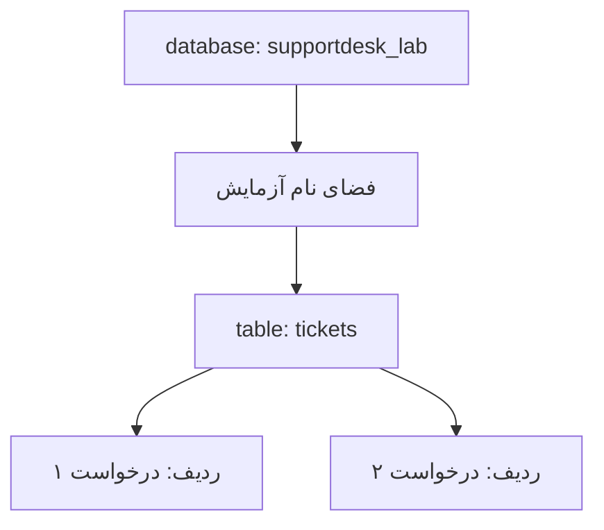

# درس ۰۳۵ — مدل رابطه‌ای و کلید و constraint

[قبلی](../../03-web/034-api-delivery/README.md) · [خانه](../../../README.md) · [بعدی](../036-sql-basics/README.md)

## خروجی و پیش‌نیاز

با table، row، column، key و constraint دادهٔ درخواست را مدل می‌کنی.
تفاوت قاعدهٔ مدل C# و تضمین دیتابیس را می‌بینی.
پیش‌نیاز: سه بخش قبلی و [آماده‌سازی PostgreSQL](../../../handbook/postgresql-lab.md).
این درس شروع persistence API نیست؛ یک آزمایش مستقل روی دیتابیس است.

## ۱. چرا از حافظه به مدل رابطه‌ای می‌رویم؟

در store حافظه‌ای، بستن process داده را از بین می‌برد و process دیگری هم همان مجموعه را نمی‌بیند. فایل JSON داده را نگه می‌دارد، اما هماهنگ‌کردن چند نویسنده و جست‌وجوی حجم زیاد را باید خودمان طراحی کنیم. دیتابیس رابطه‌ای این قابلیت‌ها را با ابزارهایی مانند SQL، `constraint` و `transaction` فراهم می‌کند. constraint شرطی است که خودِ دیتابیس هنگام ذخیره بررسی می‌کند؛ مثلاً شناسه تکراری نباشد. transaction چند تغییر را در یک واحد نهایی‌شدن قرار می‌دهد؛ آن را در درس ۳۹ آزمایش می‌کنیم.
صرف ذخیره در PostgreSQL به معنی طراحی درست schema یا امنیت کامل نیست.

## یک نگاه: هر مفهوم در کدام ظرف است؟

این تصویر فقط جای داده‌ها را نشان می‌دهد: database شامل schema است، schema جدول دارد و جدول از ردیف‌های هم‌شکل تشکیل می‌شود. فایل JSON این ساختار مدیریتی را ایجاد نمی‌کند.



**مکث کوتاه:** title یک table است یا column؟

<details>
<summary>پاسخ را ببین</summary>
<p>در این مدل یک column از جدول tickets است. هر row مقدار title خودش را دارد؛ خود title جدول جداگانه‌ای نیست.</p>
</details>

## ۲. مفاهیم پایه

| مفهوم | مثال |
| --- | --- |
| database | supportdesk_lab، مرز اتصال و مدیریت |
| schema | namespace آزمایش جاری داخل database |
| table | tickets، مجموعهٔ ردیف‌ها با ساختار مشترک |
| row | یک Ticket مشخص |
| column | title یا status |
| primary key | id یکتا و غیر null |

ساختار schema با database یکی نیست و schema فایل JSON هم معنی دیگری دارد.
نام column با property C# الزاماً یکسان نیست؛ mapping باید آگاهانه باشد.
وجود table به تنهایی entity domain را با تمام متدهایش ذخیره نمی‌کند.

## ۳. اولین DDL

```sql
CREATE TABLE tickets (
    id integer GENERATED ALWAYS AS IDENTITY PRIMARY KEY CHECK (id > 0),
    title text NOT NULL CHECK (title = btrim(title) AND char_length(title) BETWEEN 1 AND 120),
    status text NOT NULL DEFAULT 'Open' CHECK (status IN ('Open', 'InProgress', 'Closed')),
    created_at timestamptz NOT NULL DEFAULT CURRENT_TIMESTAMP
);
```

نام `DDL` مخفف `Data Definition Language` است؛ دستورهایی مانند `CREATE TABLE` که شکل جدول، نوع columnها و constraintها را تعریف می‌کنند. این دستور هنوز خودِ درخواست پشتیبانی را درج نمی‌کند؛ ساختار نگه‌داری آن را آماده می‌کند.
فایل واقعی این statement در Sql/01-schema.sql نمونه است.
کلمه‌های کلیدی را می‌توان با حروف کوچک نوشت؛ در متن برای خوانایی بزرگ نوشته‌ایم.
نام‌های بدون quote در PostgreSQL به lowercase تبدیل می‌شوند؛ در این دوره snake_case را بدون quote انتخاب می‌کنیم.

## ۴. نوع column

نوع integer عدد صحیح ۳۲بیتی است و با Id فعلی نمونه سازگار است.
text متن Unicode ذخیره می‌کند؛ اگر database با UTF-8 ساخته شده باشد، عنوان فارسی نیز حفظ می‌شود.
timestamptz لحظهٔ زمانی را نگه می‌دارد و نمایش آن با timezone session فرق می‌کند؛ نام timezone اولیه را ذخیره نمی‌کند.
برای مبلغ می‌توان `numeric` با `precision` و `scale` مشخص انتخاب کرد: precision سقف رقم‌ها و scale تعداد رقم‌های اعشار را مشخص می‌کند. انتخاب خودکار `float` بدون تصمیم دربارهٔ دقت و گردکردن کافی نیست.
در این schema مبلغ نداریم و column اضافهٔ بدون نیاز نمی‌سازیم.

## ۵. هویت و تولید Id

ویژگی `IDENTITY` از یک `sequence`، یعنی مولد مقدارهای عددی متوالی، برای تولید شناسه استفاده می‌کند. اما تولید عدد و جلوگیری از تکرار دو کار جدا هستند. constraint برابر `PRIMARY KEY` یکتا و غیرnull بودن شناسهٔ ذخیره‌شده را تضمین می‌کند؛ وجود identity به‌تنهایی جای آن نیست.
ALWAYS ارسال دستی مقدار را در مسیر معمول محدود می‌کند؛ override مدیریتی همچنان وجود دارد.
CHECK مثبت بودن، عدد منفی overrideشده را هم رد می‌کند.
sequence ممکن است پس از rollback یا INSERT ناموفق فاصله داشته باشد.
Id را شمارهٔ بدون فاصلهٔ فاکتور یا Count+1 فرض نکن.

## ۶. عنوان و دو لایهٔ validation

در SQL فعلاً guard ذخیره‌سازی انتخاب کرده‌ایم: عنوان خالی نباشد، طول code point بیشتر از ۱۲۰ نشود و فاصلهٔ معمول بیرونی نداشته باشد.
این guard تمام invariantهای API را بیان نمی‌کند.
قانون C# عنوان همچنان حداقل سه و حداکثر ۱۲۰ واحد UTF-16 و Trim است.
char_length و string.Length برای emoji لزوماً برابر نیستند و btrim پیش‌فرض فقط space معمول را حذف می‌کند.
به همین دلیل CHECK ساده را «همان validation C#» معرفی نمی‌کنیم.
در درس ۳۶ ابتدا از TicketTitle معتبر عبور می‌کنیم؛ تغییر واحد طول باید در کل قرارداد و دادهٔ قبلی بررسی شود.

## ۷. NULL با رشتهٔ خالی فرق دارد

مقدار `NULL` در SQL یعنی مقدار معلوم در اختیار نداریم؛ با متن خالی یا عدد صفر فرق دارد. مقایسهٔ معمول با آن می‌تواند به‌جای `true` یا `false`، نتیجهٔ `UNKNOWN` بدهد؛ این همان منطق سه‌ارزشی است. برای پیداکردن nullها از `IS NULL` استفاده کن، نه `title = NULL`.

از این تفاوت، یک نکتهٔ ذخیره‌سازی نتیجه می‌شود: `CHECK` فقط نتیجهٔ false را رد می‌کند. اگر عنوان null باشد، شرط طول ممکن است UNKNOWN شود و خودِ CHECK مانع آن نشود. بنابراین برای عنوان ضروری هم محدودیت طول لازم داریم و هم `NOT NULL`.

## ۸. DEFAULT اعتبارسنجی نیست

اگر status را نفرستی DEFAULT مقدار Open می‌دهد.
اگر صریحاً NULL بفرستی NOT NULL آن را رد می‌کند.
اگر Unknown بفرستی CHECK آن را رد می‌کند.
default مقدار نامعتبر ارسال‌شده را خودکار به مقدار درست تبدیل نمی‌کند.
همچنین CHECK مجموعهٔ نام‌ها مسیر مجاز Open به Closed را enforce نمی‌کند.

## ۹. درج و خواندن اولیه

```sql
INSERT INTO tickets(title) VALUES ('Network issue');
SELECT id, title, status FROM tickets ORDER BY id;
```

درج با نام column روشن است و به ترتیب همهٔ columnهای table وابسته نیست.
بدون ORDER BY ترتیب نمایش قرارداد قابل اتکا ندارد.
متن داخل کوتیشن تکی literal SQL است؛ متن کاربر در کد C# باید parameter شود که درس بعد انجام می‌دهیم.
در این آزمایش literalها دادهٔ ثابت آموزشی‌اند.

## ۱۰. database از تمام business policy خبر ندارد

در این table هنوز Notes وجود ندارد و transitionها ذخیره نشده‌اند.
SQL دستی می‌تواند status شناخته‌شده ولی خارج از گردش workflow بنویسد.
این محدودیت صریح نمونه است؛ در بخش transaction و طراحی schema آن را تحلیل می‌کنیم.
Domain و application همچنان مسئول invariantها و مجوزهای خود هستند.
اعتبارسنجی UI به تنهایی حتی جای CHECK ساده را هم نمی‌گیرد، چون writerهای دیگر ممکن است وجود داشته باشند.

## ۱۱. اجرای مستقل

کد runner آماده برای ساخت schema و اجرای SQL از Npgsql استفاده می‌کند.
در این درس تمرکز روی فایل‌های SQL است؛ خطوط driver و connection در درس ۳۶ باز می‌شوند.
هر اجرا schema تازهٔ خودش را دارد و با جدول‌های تمرین دیگر تداخل ندارد.
دو Ticket seed، عنوان فارسی در نمونهٔ CRUD بعدی، و چند constraint failure قابل بررسی‌اند.

## ۱۲. SQLSTATE و بررسی شکست

کدهای PostgreSQL برای تشخیص نوع خطا از متن ترجمه‌شونده مطمئن‌ترند.
23502 برای NOT NULL، 23514 برای CHECK و 23505 برای UNIQUE از نمونه‌های این درس‌اند.
فایل 04-checks.sql خطاهای مورد انتظار را داخل blockهای مستقل می‌گیرد و نبود خطا را failure اعلام می‌کند.
این DO block ابزار بررسی است؛ برای ایجاد table معمول نیازی به نوشتن PL/pgSQL نیست.
صرف موفق شدن build C# اجرای constraint را ثابت نمی‌کند.

## اجرای نمونه و بازرسی

ابتدا [محیط PostgreSQL](../../../handbook/postgresql-lab.md) و متغیر SUPPORTDESK_PG را آماده کن.
از ریشهٔ دوره:

```powershell
dotnet run --project samples/34-relational/SupportDesk.csproj
```

باید نتیجهٔ سناریو و PASS را ببینی؛ نبود connection string کد خروج ۲ و failure دیتابیس یا سناریو کد ۱ می‌دهد.
برای نگه داشتن schema همین اجرا:

```powershell
dotnet run --project samples/34-relational/SupportDesk.csproj -- --keep
```

نام schema در خروجی چاپ می‌شود و می‌توانی آن را در psql بررسی کنی.
بدون --keep فقط schema تولیدشدهٔ همان اجرا پس از آزمایش پاک می‌شود.
[فهرست فایل‌ها و محدودهٔ نمونه](../../../samples/34-relational/README.md) کنار همین درس است.
فرمان `python scripts/postgres_smoke.py` کل شش نمونه را روی server واقعی بررسی می‌کند.
موفقیت `--build-only` را اجرای SQL حساب نکن.

## تمرین مستقل

ساختار table کوچکی برای دسته‌بندی درخواست با Id، نام ضروری و نام یکتا طراحی کن.
NULL، نام خالی، نام تکراری و Id تکراری را جدا آزمایش کن.
مشخص کن کدام شرط از نوع داده می‌آید و کدام از constraint.
برای دادهٔ معتبر SELECT با ترتیب مشخص بنویس.

## تمرین تکمیلی

یک description اختیاری اضافه کن و NULL و متن خالی را مقایسه کن.
در README سیاست نبود description را ثبت کن.
برای عنوان emoji بررسی کن string.Length و char_length چه عددی می‌دهند؛ نگوییم دو معیار یکی‌اند.

## معیار عبور

- [ ] database و schema و table را تفکیک می‌کنم.
- [ ] identity و primary key یک وظیفه ندارند.
- [ ] NULL و CHECK و NOT NULL را جدا توضیح می‌دهم.
- [ ] SQL بدون ORDER BY را مرتب فرض نمی‌کنم.
- [ ] CHECK نام status را با قانون transition یکی نمی‌دانم.
- [ ] آزمون منفی constraint واقعاً روی PostgreSQL اجرا شده است.

## منابع رسمی

- [PostgreSQL data definition](https://www.postgresql.org/docs/18/ddl.html)
- [Constraints](https://www.postgresql.org/docs/18/ddl-constraints.html)
- [Identity columns](https://www.postgresql.org/docs/18/ddl-identity-columns.html)
