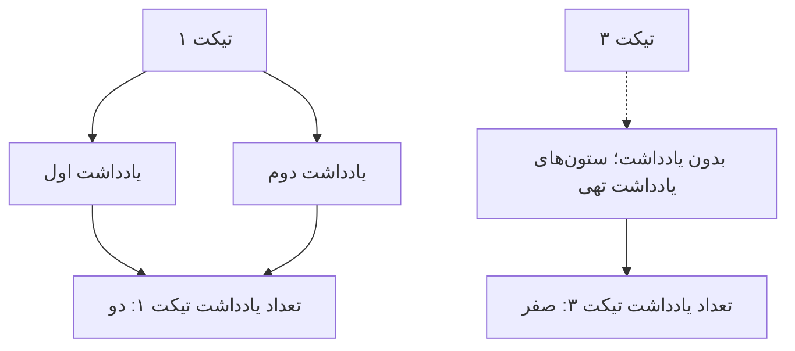

# درس ۰۳۷ — JOIN و aggregation

[قبلی](../036-sql-basics/README.md) · [خانه](../../../README.md) · [بعدی](../038-indexes/README.md)

## خروجی و پیش‌نیاز

اطلاعات درخواست و یادداشت‌ها در دو table جدا هستند. با `JOIN` آن‌ها را بر اساس شناسهٔ درخواست کنار هم می‌خوانی و سپس تعداد یادداشت‌های هر درخواست را گزارش می‌کنی. به محاسبه‌ای مثل شمارش یا جمع روی گروهی از rowها، `aggregation` می‌گویند. با همین دادهٔ کوچک می‌بینی چرا تعداد rowهای نتیجه لزوماً تعداد درخواست‌ها نیست.
پیش‌نیاز: SELECT، WHERE، primary key و اجرای SQL درس‌های ۳۵ و ۳۶.
نمونه SQL است و runner فقط خروجی queryها را چاپ و assertionها را اجرا می‌کند.

## یک نگاه: چرا LEFT JOIN ردیف خالی می‌سازد؟

یک تیکت دو یادداشت دارد و تیکت سوم هیچ یادداشتی ندارد. LEFT JOIN تیکت سوم را هم نگه می‌دارد؛ ستون‌های یادداشت در ردیف متناظر آن null هستند.



**مکث کوتاه:** برای تیکت بدون یادداشت، COUNT(*) روی LEFT JOIN هم صفر می‌شود؟

<details>
<summary>پاسخ را ببین</summary>
<p>نه؛ ردیف حفظ‌شده را می‌شمارد و یک می‌دهد. شمارش شناسهٔ non-null یادداشت، برای آن تیکت صفر می‌دهد.</p>
</details>

## ۱. رابطهٔ یک به چند

هر Ticket می‌تواند صفر یا چند note داشته باشد.
هر note دقیقاً به یک Ticket تعلق دارد.
به جای columnهایی مثل note1 و note2 یک table جدا داریم.
ستون ticket_id در notes به tickets.id اشاره می‌کند.
در این رابطه، درخواست `parent` و یادداشت وابستهٔ آن `child` است. محدودیت `foreign key` یا `FK` نمی‌گذارد یادداشت به درخواست ناموجود اشاره کند؛ رفتار هنگام حذف parent را در درس ۴۰ بررسی می‌کنیم.

## ۲. دادهٔ کوچک و قابل شمارش

| Ticket | noteها |
| --- | --- |
| ۱: Network issue | دو note |
| ۲: Printer issue | یک note |
| ۳: Email issue | بدون note |

سه Ticket و سه note داریم.
قبل از اجرای query، تعداد row مورد انتظار را روی کاغذ بنویس.
اگر خروجی join را تعداد entityها بدانی، این dataset کوچک اشتباه را نشان می‌دهد.

## ۳. INNER JOIN

```sql
SELECT t.id, t.title, n.body
FROM tickets t
JOIN notes n ON n.ticket_id=t.id
ORDER BY t.id, n.id;
```

در `INNER JOIN` هر جفت row که شرط `ON` را برقرار کند یک row نتیجه می‌سازد. برای درخواست اول، دو یادداشت دو جفت متفاوت می‌سازند؛ پس عنوان درخواست دو بار دیده می‌شود، اما هنوز فقط یک درخواست در دیتابیس داریم. درخواست سوم چون هیچ یادداشتی ندارد در نتیجه نیست. نام‌های `t` و `n` هم `alias` یا نام کوتاه tableها در همین query هستند.

## ۴. LEFT JOIN

```sql
SELECT t.id, t.title, n.body
FROM tickets t
LEFT JOIN notes n ON n.ticket_id=t.id
ORDER BY t.id, n.id;
```

تمام Ticketهای سمت چپ حفظ می‌شوند.
برای Ticket سوم columnهای note در row نتیجه NULL هستند.
تعداد row این query چهار است: دو برای Ticket اول، یکی برای دوم و یکی برای سوم.
LEFT JOIN خودکار هر Ticket را به یک row همراه آرایهٔ notes تبدیل نمی‌کند.

## ۵. COUNT درست

```sql
SELECT t.id, t.title, count(n.id) AS note_count
FROM tickets t
LEFT JOIN notes n ON n.ticket_id=t.id
GROUP BY t.id, t.title
ORDER BY t.id;
```

تابع COUNT(n.id) فقط مقدارهای non-null را می‌شمارد.
برای Ticket سوم صفر نتیجه می‌دهد.
COUNT(*) row حاصل left join را می‌شمارد و برای همان Ticket یک می‌دهد.
انتخاب نام aggregate به تنهایی معنی داده را درست نمی‌کند؛ column و join را هم دنبال کن.

## ۶. GROUP BY و HAVING

بخش GROUP BY rowهای با کلید گروه یکسان را به گروه تبدیل می‌کند.
ستون غیرaggregate باید با grouping و قواعد SQL سازگار باشد.
در query بالا Id و title صریح group شده‌اند.
برای فیلتر روی تعداد note می‌توان بعد از GROUP BY شرط HAVING count(n.id) >= 2 نوشت.
فیلتر `WHERE` پیش از تشکیل گروه‌ها روی rowهای ورودی اعمال می‌شود. در مقابل، `HAVING` پس از شمارش گروه تصمیم می‌گیرد کدام گروه بماند؛ مثلاً شرط حداقل دو یادداشت، درخواست اول را نگه می‌دارد. پس شرط روی تعداد نهایی اعضا را نباید مانند شرط سادهٔ هر row پیش از گروه‌بندی گذاشت.

## ۷. ON در برابر WHERE در outer join

اگر روی n.body در WHERE شرط بگذاری، row دارای NULL ممکن است حذف شود.
در این صورت LEFT JOIN ظاهری دیگر تمام Ticketها را حفظ نمی‌کند.
اگر باید همهٔ Ticketها بمانند ولی فقط noteهای خاص match شوند، شرط child را آگاهانه در ON قرار بده.
این دو query هدف یکسانی ندارند و نباید بدون بررسی جای هم نوشته شوند.
برای هر کدام، Ticket سوم بدون note را تست کن.

## ۸. سؤال وجود داشتن با EXISTS

```sql
SELECT t.id, t.title
FROM tickets t
WHERE EXISTS (SELECT 1 FROM notes n WHERE n.ticket_id=t.id)
ORDER BY t.id;
```

اینجا سؤال فقط وجود حداقل یک note است.
Ticket اول بدون نیاز به DISTINCT فقط یک بار در نتیجهٔ outer query می‌آید.
نوشتن SELECT 1 داخل EXISTS یعنی مقدار row مهم نیست؛ وجود آن مهم است.
این انتخاب semantics را روشن می‌کند؛ دربارهٔ سرعت واقعی به plan رجوع می‌کنیم.

## ۹. پیدا کردن parent بدون child

```sql
SELECT t.id, t.title
FROM tickets t
WHERE NOT EXISTS (SELECT 1 FROM notes n WHERE n.ticket_id=t.id);
```

در نمونه از LEFT JOIN و n.id IS NULL نیز همان نیاز را نشان داده‌ایم.
چون n.id primary key و غیر null است، معیار خوبی برای نبود match است.
NOT IN با مجموعهٔ دارای NULL رفتار سه‌ارزشی متفاوت دارد؛ آن را بی‌بررسی جای NOT EXISTS نگذار.

## ۱۰. fan-out با دو collection

اگر notes و attachments هر دو چند row داشته باشند، join هر دو می‌تواند تعداد ترکیبی بسازد.
برای دو note و سه attachment ممکن است شش row ببینی.
COUNT(note.id) در همان query می‌تواند noteها را بیش از واقع بشمارد.
یکی از راه‌ها aggregate هر child قبل از join است؛ گاهی queryهای جدا و projection مناسب خواناترند.
DISTINCT را بدون فهم علت تکرار به همهٔ SELECTها اضافه نکن.

## ۱۱. گزارش وضعیت و صفرها

بخش GROUP BY status فقط statusهایی را که در داده حضور دارند می‌دهد.
در seed فعلی فقط Open داریم؛ InProgress و Closed صفر خودکار ساخته نمی‌شوند.
برای گزارش کامل می‌توان مجموعهٔ ثابت وضعیت‌ها را با aggregate به صورت LEFT JOIN وصل و COALESCE(count,0) کرد.
این همان مسئلهٔ صفرهای LINQ در بخش اول است، با اجرای SQL سمت server.

## ۱۲. aggregate قبل از pagination

اگر قرار است مجموعهٔ Ticketها صفحه‌بندی شود، rowهای joinشده را بی‌بررسی LIMIT نکن.
LIMIT 20 روی یک query با چند note می‌تواند کمتر از بیست Ticket بدهد.
ابتدا parentهای صفحه را با ترتیب قطعی انتخاب و سپس childهای همان صفحه را بخوان یا aggregate کن.
انتقال query به ORM این اشتباه معنایی را خودکار حل نمی‌کند.

## ۱۳. سناریوهای مرجع

| بررسی | انتظار |
| --- | --- |
| INNER JOIN در dataset فعلی | سه row |
| LEFT JOIN | چهار row |
| note_count برای Ticket سوم | صفر |
| EXISTS | Ticketهای ۱ و ۲ |
| بدون child | فقط Ticket ۳ |

فایل 04-checks.sql این انتظارها را روی server بررسی می‌کند.
خروجی خواندنی 03-queries.sql برای مقایسهٔ دستی است.
تعدادها برای seed همین snapshot‌اند و به dataset بزرگ قبلی وابسته نیستند.

## اجرای نمونه و بازرسی

ابتدا [محیط PostgreSQL](../../../handbook/postgresql-lab.md) و متغیر SUPPORTDESK_PG را آماده کن.
از ریشهٔ دوره:

```powershell
dotnet run --project samples/36-joins/SupportDesk.csproj
```

باید نتیجهٔ سناریو و PASS را ببینی؛ نبود connection string کد خروج ۲ و failure دیتابیس یا سناریو کد ۱ می‌دهد.
برای نگه داشتن schema همین اجرا:

```powershell
dotnet run --project samples/36-joins/SupportDesk.csproj -- --keep
```

نام schema در خروجی چاپ می‌شود و می‌توانی آن را در psql بررسی کنی.
بدون --keep فقط schema تولیدشدهٔ همان اجرا پس از آزمایش پاک می‌شود.
[فهرست فایل‌ها و محدودهٔ نمونه](../../../samples/36-joins/README.md) کنار همین درس است.
فرمان `python scripts/postgres_smoke.py` کل شش نمونه را روی server واقعی بررسی می‌کند.
موفقیت `--build-only` را اجرای SQL حساب نکن.

## تمرین مستقل

یک query تمام Ticketها و تعداد note را طوری بنویس که موارد بدون note هم باقی بمانند.
سپس فقط Ticket دارای حداقل دو note را با HAVING نمایش بده.
قبل از اجرا تعداد و Id نتیجه را پیش‌بینی کن.
نسخهٔ ON و WHERE فیلتر child را با یک parent بدون child مقایسه کن.

## تمرین تکمیلی

ساختار table آزمایشی attachments با دو row برای Ticket اول اضافه کن.
query شمارش هم‌زمان notes و attachments را بنویس و fan-out را مشاهده کن.
با aggregate جدا یا query مناسب، شمارش صحیح را برگردان.
توضیح بده چرا DISTINCT روی title راه‌حل مناسبی برای دو Ticket با عنوان برابر نیست.

## معیار عبور

- [ ] تعداد row join را تعداد entity فرض نمی‌کنم.
- [ ] COUNT(*) و COUNT(n.id) روی left join را جدا می‌دانم.
- [ ] فیلتر WHERE ناخواسته parent بدون child را حذف نمی‌کند.
- [ ] EXISTS را برای سؤال وجود داشتن می‌شناسم.
- [ ] اثر دو رابطهٔ چندتایی و pagination را توضیح می‌دهم.

## منابع رسمی

- [Joins](https://www.postgresql.org/docs/18/tutorial-join.html)
- [Table expressions](https://www.postgresql.org/docs/18/queries-table-expressions.html)
- [Aggregate functions](https://www.postgresql.org/docs/18/functions-aggregate.html)
