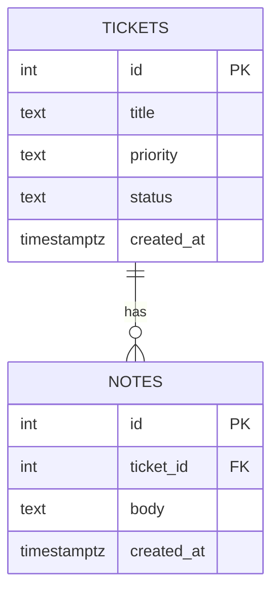

# درس ۰۴۰ — طراحی schema برای درخواست و پیام

[قبلی](../039-transactions/README.md) · [خانه](../../../README.md)

## خروجی و پیش‌نیاز

schema اولیهٔ ذخیرهٔ Ticket و note را با کلید، رابطه، policy حذف و index طراحی می‌کنی.
برای هر invariant مشخص می‌کنی چه بخشی در database enforce شده و چه بخشی هنوز نیازمند use case و transaction است.
پیش‌نیاز: درس‌های ۳۵ تا ۳۹ و قرارداد CLI و API پایان بخش‌های قبل.
این درس schema است؛ اتصال API و EF Core و migration در درس‌های بعد می‌آیند.

## ۱. نیازمندی را پیش از table بنویس

هر Ticket یک عنوان، اولویت، وضعیت و زمان ایجاد دارد.
هر note یک متن وابسته به یک Ticket است و اینجا همان یادداشت حل مسئلهٔ پروژه است.
برای note فعلاً کاربر نویسنده و نوع پیام نداریم؛ این نسخه chat کامل یا audit امنیتی نیست.
notes را به شکل متن comma-separated یا ستون note1 تا note5 ذخیره نمی‌کنیم.
قانون حداکثر پنج note دلیل ساخت پنج column مستقل نیست.

## ۲. رابطهٔ داده



سمت Ticket می‌تواند صفر child داشته باشد و note بدون parent مجاز نیست.
نمودار typeهای دقیق C# یا تمام invariantها را بیان نمی‌کند؛ DDL و use case همچنان لازم‌اند.

## نرمال‌سازی رابطه‌ای و جلوگیری از تکرار ناسازگار

این normalization با Trim و Unicode normalization متن یکی نیست.
نام و وضعیت Ticket را در هر note دوباره ذخیره نمی‌کنیم؛ ticket_id رابطه را نگه می‌دارد و عنوان از parent خوانده می‌شود.
اگر عنوان در ده note کپی شود، rename می‌تواند چند نسخهٔ ناسازگار باقی بگذارد.
در این مسئله یک row برای Ticket و چند row مرتبط برای note شکل منسجم‌تری است.

1NF را با مقدار متناسب و منفرد در قرارداد هر column و پرهیز از noteهای comma-separated تمرین می‌کنیم.
2NF می‌خواهد attribute غیرکلیدی به بخشی از کلید مرکب وابسته نباشد؛ داشتن PK surrogate به تنهایی همهٔ طراحی را درست نمی‌کند.
3NF وابستگی تعدی attribute غیرکلیدی به attribute غیرکلیدی دیگر را بررسی می‌کند؛ مثلاً نام نویسنده را بدون نیاز در هر note کپی نمی‌کنیم.
جدول users آینده باید با نیاز identity و مالکیت طراحی شود، نه صرفاً برای زیاد شدن tableها.
این قواعد راه تحلیل وابستگی‌اند؛ هر JSON یا array PostgreSQL را بدون توجه به معنی column خودکار خطای طراحی اعلام نمی‌کنیم.
read model یا denormalization هدفمند بعداً با نیاز query، اندازه‌گیری و سیاست همگام‌سازی قابل ارزیابی است.

## ۳. مرز columnهای Ticket

id کلید اصلی مثبت و identity است.
title متن ذخیره‌شده با guard عمومی و بدون space بیرونی معمول است.
priority نام محدود Low، Normal یا High و default برابر Normal دارد.
status نام محدود Open، InProgress یا Closed و default برابر Open دارد.
created_at زمان ایجاد است؛ ترتیب قطعی را فقط به آن وابسته نمی‌کنیم چون دو row می‌توانند زمان یکسان داشته باشند.

## ۴. مرز note

```sql
CREATE TABLE notes (
    id integer GENERATED ALWAYS AS IDENTITY PRIMARY KEY CHECK (id > 0),
    ticket_id integer NOT NULL REFERENCES tickets(id) ON DELETE RESTRICT,
    body text COLLATE "C" NOT NULL
        CHECK (body=btrim(body) AND char_length(body) BETWEEN 1 AND 500),
    created_at timestamptz NOT NULL DEFAULT CURRENT_TIMESTAMP,
    CONSTRAINT uq_notes_ticket_body UNIQUE (ticket_id,body)
);
```

متن واقعی schema در فایل Sql/01-schema.sql کنار tickets آمده است.
UNIQUE مرکب یعنی یک متن روی همان Ticket تکراری نیست؛ همان متن روی Ticket دیگر مجاز است.
COLLATE C این تصمیم equality را از collation زبانی دلخواه database جدا می‌کند؛ Unicode normalization خودکار انجام نمی‌شود.
در application هنوز Trim و طول سه تا پانصد واحد UTF-16 لازم است.

## ۵. تضمین دقیق هر لایه

| قاعده | تضمین این DDL | کار باقی‌مانده در برنامه |
| --- | --- | --- |
| Id یکتا، مثبت و غیر null | PK و CHECK | input و mapping Id درست |
| note بدون Ticket | FK رد می‌کند | تبدیل failure به قرارداد مناسب |
| نام status و priority | CHECK رد می‌کند | parsing و پیام ورودی |
| note تکراری همان Ticket | UNIQUE رد می‌کند | normalization یکسان و mapping conflict |
| متن غیرخالی و حد بالای عمومی | CHECK و NOT NULL | معیار UTF-16 و حداقل سه و Trim کامل |
| حداکثر پنج note | در این DDL نیست | transaction هماهنگ با parent lock یا طراحی دیگر |
| منع ویرایش Closed | در این DDL نیست | Domain و use case با concurrency درست |
| Close فقط با note از InProgress | در این DDL نیست | قانون و بررسی transaction |
| مالکیت و مجوز کاربر | در این DDL نیست | authentication و authorization بخش امنیت |

CHECK سادهٔ status فقط نام معتبر را می‌شناسد، نه تاریخچهٔ transition.
CHECK را به یک SELECT پنهان روی جدول دیگر برای قواعد چندردیفی تبدیل نمی‌کنیم.
SQL مستقیم با دسترسی کافی می‌تواند policyهایی را که این DDL ندارد دور بزند؛ این نسخه خلاف آن ادعا نمی‌کند.
اگر همهٔ writerها قابل کنترل نیستند، مرز مجوز، trigger یا procedure معتبر را باید جدا طراحی کرد.

## ۶. policy حذف

ON DELETE RESTRICT حذف Ticket دارای note را رد می‌کند.
این انتخاب جلوی حذف تصادفی childها را در همان operation می‌گیرد.
با CASCADE، حذف parent می‌تواند noteها را هم پاک کند؛ این تصمیم فقط راحتی کد نیست و اثر روی نگهداری داده دارد.
در این مرحله حذف آموزشی CLI با دادهٔ حافظه‌ای را مستقیماً قرارداد دیتابیس جدید معرفی نمی‌کنیم.
API آینده باید تعارض حذف را به نتیجهٔ مستند تبدیل کند یا policy دیگری با نیاز محصول انتخاب شود.

## ۷. چرا body را UNIQUE عمومی نکردیم؟

دو درخواست ممکن است هر دو note «Resolved configuration» داشته باشند.
یک unique فقط روی body چنین دادهٔ مجازی را رد می‌کند.
کلید مرکب (ticket_id,body) محدودهٔ تکرار را مطابق entity مشخص می‌کند.
Id note همچنان کلید surrogate برای مراجعهٔ پایدار است؛ متن شناسهٔ note نیست.
حد اندازهٔ متن فعلی index را کوچک نگه می‌دارد؛ برای متن‌های بلندتر طراحی uniqueness و هزینه باید بازبینی شود.

## ۸. index از روی query

status,id برای فهرست وضعیت‌محور و ترتیب Id اضافه شده است.
PK و UNIQUE نیز index پشتیبان دارند.
index یکتای (ticket_id,body) با ticket_id شروع می‌شود و برای برخی lookupهای noteهای یک Ticket قابل استفاده است.
قبل از افزودن index تک‌ستونی مشابه، plan و نیاز را بررسی کن.
FK در PostgreSQL خودکار در سمت child برای هر نیاز تو index تازه نمی‌سازد.

## ۹. زمان و timezone

timestamptz لحظه را نگه می‌دارد و session در نمایش آن نقش دارد.
در mapping معمول Npgsql، timestamp with time zone با DateTime دارای Kind=Utc کار می‌کند.
تبدیل ساعت محلی و timezone نامشخص را به دیتابیس نسپار تا حدس بزند.
برای زمان appointment محلی و منطقهٔ زمانی کاربر، مدل جدا با نیاز صریح لازم است؛ created_at همان مسئله نیست.

## ۱۰. normalization و مفهوم نام تکراری

case-sensitive بودن note در این قرارداد عمدی است.
متن‌های Unicode با شکل متفاوت و ظاهر شبیه ممکن است در این policy برابر نباشند.
normalization C# و SQL را بدون migration تغییر نده؛ ممکن است داده‌های قبلی ناگهان با UNIQUE برخورد کنند.
coarse guard SQL از درس ۳۵ با invariant کامل C# یکسان معرفی نشده است.
مقدار معتبر برنامه ابتدا در Domain ساخته و سپس persist می‌شود.

## ۱۱. مرز پایداری و migration

schema تازه با CREATE TABLE یک آزمایش است، نه migration نسخهٔ قبلی production.
runner schema اختصاصی می‌سازد تا اجرای درس نیازمند DROP جدول موجود نباشد.
با --keep می‌توان داده و DDL را در psql بررسی کرد، اما اجرای بعدی همچنان آزمایش تازه است.
تکامل schema و migration قابل review در درس ۴۲ آموزش داده می‌شود.
فایل JSON CLI خودکار import نشده است و نیاز به mapping و validation مستقل دارد.

## ۱۲. تست یکپارچگی

| سناریو | انتظار |
| --- | --- |
| note با Ticket ناموجود | 23503 و بدون row تازه |
| متن note تکراری همان Ticket | 23505 |
| حذف Ticket دارای note | FK failure و حفظ هر دو |
| priority ناشناخته | 23514 |
| query Ticket و note_count | دو Ticket و یک note اولیه |

فایل checks هم خطا و هم شمارش نهایی داده را بررسی می‌کند.
ساخته شدن table بدون اجرای failureها برای ادعای integrity کافی نیست.
این تست‌ها کامل بودن workflow application را ثابت نمی‌کنند؛ جدول مرزها را حفظ کن.

## ۱۳. قدم بعد EF Core

ORM قرار است mapping و تغییرات داده را ساده کند، نه اینکه SQL و schema را حذف کند.
قبل از DbContext باید بدانی table، FK، index، NULL و transaction چه معنی دارند.
در درس ۴۱ provider متناسب و DbContext را به همین مفاهیم وصل می‌کنیم.
تا درس تحویل data، API قبلی همچنان حافظه‌ای است و نباید آن را پایدار معرفی کنیم.

## اجرای نمونه و بازرسی

ابتدا [محیط PostgreSQL](../../../handbook/postgresql-lab.md) و متغیر SUPPORTDESK_PG را آماده کن.
از ریشهٔ دوره:

```powershell
dotnet run --project samples/39-ticket-schema/SupportDesk.csproj
```

باید نتیجهٔ سناریو و PASS را ببینی؛ نبود connection string کد خروج ۲ و failure دیتابیس یا سناریو کد ۱ می‌دهد.
برای نگه داشتن schema همین اجرا:

```powershell
dotnet run --project samples/39-ticket-schema/SupportDesk.csproj -- --keep
```

نام schema در خروجی چاپ می‌شود و می‌توانی آن را در psql بررسی کنی.
بدون --keep فقط schema تولیدشدهٔ همان اجرا پس از آزمایش پاک می‌شود.
[فهرست فایل‌ها و محدودهٔ نمونه](../../../samples/39-ticket-schema/README.md) کنار همین درس است.
فرمان `python scripts/postgres_smoke.py` کل شش نمونه را روی server واقعی بررسی می‌کند.
موفقیت `--build-only` را اجرای SQL حساب نکن.

## تمرین مستقل

schema خودت را با سه query اصلی بنویس: جزئیات Ticket، noteهای یک Ticket و فهرست وضعیت‌محور.
برای هر query index احتمالی و دلیلش را ثبت کن.
delete policy و محدودهٔ UNIQUE را انتخاب و سناریوی منفی واقعی اجرا کن.
برای هر invariant در جدول مشخص کن database آن را enforce می‌کند یا use case.

## تمرین تکمیلی

برای author_id آینده طرح رابطه را روی کاغذ اضافه کن.
مشخص کن حذف کاربر چه اثری روی پیام‌های قبلی باید داشته باشد.
بدون نیاز فعلی جدول‌های identity کامل یا ذخیرهٔ رمز را اختراع نکن؛ طراحی امنیت بخش جدا دارد.
سناریوی مهاجرت از دادهٔ قبلی دارای note تکراری را بدون پاک کردن بی‌صدای داده شرح بده.

## معیار عبور

- [ ] PK، FK، CHECK و UNIQUE محدودهٔ روشن دارند.
- [ ] schema، domain invariant و authorization را یکی نمی‌گیرم.
- [ ] policy حذف و index را با نیاز توجیه می‌کنم.
- [ ] rule چندردیفی را با CHECK ساده تضمین‌شده معرفی نمی‌کنم.
- [ ] خطای constraint دادهٔ قبلی را بی‌صدا تغییر نمی‌دهد.
- [ ] می‌دانم این مرحله API پایدار و migration production نیست.

## منابع رسمی

- [Constraints and foreign keys](https://www.postgresql.org/docs/18/ddl-constraints.html)
- [Date/time types](https://www.postgresql.org/docs/18/datatype-datetime.html)
- [Npgsql date/time mapping](https://www.npgsql.org/doc/types/datetime.html)

## ادامهٔ بخش چهارم

شش درس ۳۵ تا ۴۰ آماده‌اند؛ درس ۴۱ دربارهٔ EF Core و DbContext هنوز برنامه‌ریزی‌شده است.
این بخش چهارده‌درسی هنوز کامل نشده و تحویل API پایدار هنوز انجام نشده است.
