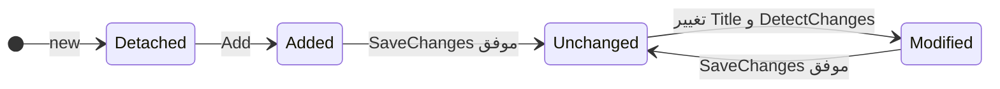

# درس 041 — EF Core و DbContext و provider

پیش‌نیاز: درس 040 و [محیط PostgreSQL](../../../handbook/postgresql-lab.md).
در پایان، یک تیکت را با EF ذخیره می‌کنی، عنوانش را تغییر می‌دهی و با context تازه ماندن تغییر در دیتابیس را بررسی می‌کنی.

بعد از اجرای SQL خام، همان ذخیره و بازیابی را با یک mapper انجام می‌دهیم.
EF Core داده را به object تبدیل می‌کند، تغییرها را دنبال می‌کند و SQL مناسب provider را می‌سازد.
دانستن SQL همچنان لازم است: latency، constraint و transaction پشت abstraction ناپدید نمی‌شوند.

ابزار EF Core یک ORM است: ابزاری برای نگاشت objectها به دادهٔ رابطه‌ای. در این نمونه، TicketRow شیء متناظر داده، DbSet نقطهٔ شروع خواندن/تغییر آن نوع، و DbContext محدودهٔ هماهنگی این کارهاست. provider هم قسمت مخصوص دیتابیس است؛ اینجا Npgsql ترجمه و اجرای متناسب با PostgreSQL را فراهم می‌کند.

تفاوت اصلی با SQL خام این است که بسیاری از فرمان‌ها را EF از روی مدل و تغییرهای objectها می‌سازد. این به معنی حذف دیتابیس، constraint یا هزینهٔ رفت‌وبرگشت شبکه نیست.

## اجزای نمونه

| جزء | مسئولیت | محل نمونه |
| --- | --- | --- |
| TicketRow | شکل دادهٔ قابل ذخیره و identity | Persistence/TicketRow.cs |
| DeskContext | mapping و واحد دنبال‌کردن تغییرها | Persistence/DeskContext.cs |
| Npgsql provider | ترجمه و اجرای عملیات برای PostgreSQL | UseNpgsql در Program.cs |
| Lab | مالک schema آزمایشی و پاک‌سازی | Infrastructure/Lab.cs |

کلاس TicketRow عمداً setter دارد؛ آن را به‌جای مدل دامنهٔ محافظت‌شده به Controller نده.
مدل قابل materialize شدن لزوماً مدل مناسب اجرای قواعد کسب‌وکار نیست.
در درس تحویل، mapping بین این دو را می‌نویسیم.

## mapping را بخوان

```csharp
public sealed class DeskContext(DbContextOptions<DeskContext> options) : DbContext(options)
{
    public DbSet<TicketRow> Tickets => Set<TicketRow>();
    protected override void OnModelCreating(ModelBuilder model)
    {
        var ticket = model.Entity<TicketRow>();
        ticket.ToTable("tickets");
        ticket.HasKey(t => t.Id);
        ticket.Property(t => t.Title).IsRequired().HasMaxLength(120);
    }
}
```

نوع DbSet نمای یک query قابل ترکیب و ورودی عملیات تغییر است؛ همهٔ ردیف‌های جدول را در RAM نگه نمی‌دارد.
DbContextOptions وابستگی provider و اتصال را بیرون کلاس نگه می‌دارد.
روش `Fluent API` یعنی تنظیم مدل با زنجیرهٔ فراخوانی متدها، مانند `ToTable` و `HasMaxLength`، در `OnModelCreating`. این تنظیم‌ها نگاشت و schema را توصیف می‌کنند؛ setter عادی روی `TicketRow` هنوز نمی‌گوید عنوان از نظر domain معتبر است.
HasMaxLength حداکثر ستون را می‌سازد و جای Trim یا حداقل طول را نمی‌گیرد.
نام جدول صریح tickets است؛ نام ستون‌های این نمونه مانند Title به صورت quoted و با حرف بزرگ باقی می‌ماند.
در SQL دستی باید همین نام‌ها را رعایت کنی؛ درس ۴۰ schema مستقلی با نام‌های کوچک داشت.
این snapshot ادامهٔ migration آن schema نیست.

## یک نگاه: شیء تغییر کرد؛ دیتابیس هم تغییر کرد؟

این مسیر وضعیت entity در tracker را نشان می‌دهد. فلش‌های SaveChanges جایی هستند که تغییر برای ذخیره به دیتابیس فرستاده می‌شود.



**مکث کوتاه:** پس از Add و پیش از SaveChanges، آیا حتماً یک ردیف تازه در جدول داریم؟

<details>
<summary>پاسخ را ببین</summary>
<p>نه؛ Added وضعیت tracker است. درج در این نمونه با SaveChanges انجام می‌شود و نتیجه با context تازه بررسی می‌شود.</p>
</details>

## unit of work و وضعیت entity

| مرحله | وضعیت | اثر روی دیتابیس |
| --- | --- | --- |
| ساختن new TicketRow | Detached | هیچ |
| db.Tickets.Add(row) | Added | هنوز هیچ |
| await SaveChangesAsync(ct) | Unchanged | INSERT و دریافت Id |
| تغییر Title و DetectChanges | Modified | هنوز هیچ |
| SaveChangesAsync دوباره | Unchanged | UPDATE |

در نمونه، context تازه رکورد را می‌خواند تا موفقیت فقط اثر cache tracker نباشد.
DetectChanges صریح برای مشاهدهٔ آموزشی وضعیت است؛ SaveChanges در حالت عادی آن را انجام می‌دهد.
identity را از سرور بگیر؛ Max(Id)+1 زیر concurrency قرارداد امنی نیست.
خروجی Id قبل از ذخیره تضمین شناسهٔ نهایی ندارد.

بخش `change tracker` در `DbContext` شیءهای دنبال‌شده و تغییرشان را نگه می‌دارد. مفهوم `unit of work` در این درس یعنی چند تغییر مرتبط را در یک محدوده دنبال کنیم و با `SaveChanges` برای ذخیره به دیتابیس بفرستیم. تغییر یک property در حافظه، به‌تنهایی چنین ذخیره‌ای انجام نمی‌دهد.

فایل [Program مرجع](../../../samples/40-ef-core/Program.cs) را با این سؤال بخوان: «الان فقط شیء C# عوض شده یا SQL هم اجرا شده است؟»

1. new فقط شیء را می‌سازد؛ DB هنوز رکورد تازه ندارد.
2. Add به tracker می‌گوید آن را برای درج در نظر بگیر؛ هنوز INSERT اجرا نشده است.
3. SaveChangesAsync درج را می‌فرستد و Id تولیدشدهٔ server را می‌گیرد.
4. تغییر Title ابتدا روی همان شیء حافظه است؛ DetectChanges وضعیت تغییر را آشکار می‌کند.
5. SaveChanges بعدی UPDATE را می‌فرستد؛ context تازه نتیجه را مستقل می‌خواند.

اصطلاح materialize یعنی ساختن object از دادهٔ نتیجهٔ query. دیدن یک object با Title تازه در context اول، به‌تنهایی اثبات نمی‌کند که DB هم آن را ذخیره کرده است. برای همین بررسی context تازه مهم است.

## طول عمر و async

یک context برای یک واحد کار کوتاه بساز و dispose کن.
در الگوی این دوره، `AddDbContext` معمولاً context را Scoped ثبت می‌کند تا عمر کوتاه عملیات داشته باشد. آن را به‌عنوان singleton مشترکِ درخواست‌های وب ثبت نکن؛ دادهٔ tracker و استفادهٔ هم‌زمان باید در محدودهٔ واحد کار باقی بمانند.
دو عملیات async هم‌زمان را روی همان context اجرا نکن.
Task.WhenAll روی دو query با یک context، thread safety ایجاد نمی‌کند.
CancellationToken را تا ToListAsync و SaveChangesAsync بفرست، نه فقط تا Controller.
لغو هنگام commit می‌تواند نتیجهٔ نامعلوم داشته باشد؛ retry کور را به این مثال اضافه نکن.

## ایجاد schema در این آزمایش

کلاس آزمایشگاهی Lab یک schema خالی با نام تصادفی تحت مالکیت خودش می‌سازد.
سپس IRelationalDatabaseCreator.CreateTablesAsync جدول‌های مدل را فقط برای این آزمایش ایجاد می‌کند.
این API پایین‌سطح را در startup سرویس یا روی schema موجود صدا نزن.
از درس ۴۲، تکامل schema با migration انجام می‌شود.
EnsureCreated مسیر دیگری برای ساخت اولیه است و نباید با Migrate در یک دیتابیس مخلوط شود.
این درس ابزار بررسی واحد کار است، برنامهٔ ذخیره‌سازی پایدار نیست.

## اجرای مرجع

از ریشهٔ مخزن و پس از تنظیم SUPPORTDESK_PG اجرا کن:

```powershell
dotnet run --project samples/40-ef-core/SupportDesk.csproj
```

کلاس آزمایشگاهی Lab یک schema تصادفی تازه می‌سازد و در پایان همان schema را پاک می‌کند.
با --keep در انتهای فرمان می‌توانی آن را برای بازرسی نگه داری؛ نام schema در خروجی چاپ می‌شود.
این گزینه ابزار مشاهده است، نه ذخیره‌سازی پایدار برنامه.
کد خروج صفر و PASS: lesson scenario یعنی assertionهای همین سناریو عبور کرده‌اند.
برای بررسی همهٔ این درس‌ها، python scripts/ef_smoke.py را با دیتابیس آماده اجرا کن.

## تمرین و معیار عبور

1. پیش از Add، پس از Add و پس از Save وضعیت row را چاپ کن؛ دلیل هر وضعیت را بنویس.
2. یک ردیف را با context اول تغییر بده و با context دوم پیش از Save بخوان؛ نتیجه را پیش‌بینی کن.
3. Required را با یک ورودی null عمداً دور بزن و rejection دیتابیس را مشاهده کن؛ دیتای آزمایش را حذف کن.
4. نسخه‌ای بساز که query آن CancellationToken نگیرد؛ در review محل قطع زنجیرهٔ لغو را پیدا کن.

معیار عبور: بتوانی تفاوت Entity، DbSet، DbContext و provider را با همین فایل‌ها توضیح بدهی.
ذخیرهٔ موفق باید با context تازه دیده شود؛ فقط دیدن object تغییرکرده کافی نیست.

## منبع رسمی

[مستندات مرتبط](https://learn.microsoft.com/en-us/ef/core/dbcontext-configuration/)

[Npgsql EF provider](https://www.npgsql.org/efcore/)

[بخش چهارم](../README.md) · [نقشهٔ دوره](../../../ROADMAP.md) · [درس بعد](../042-migrations/README.md)
