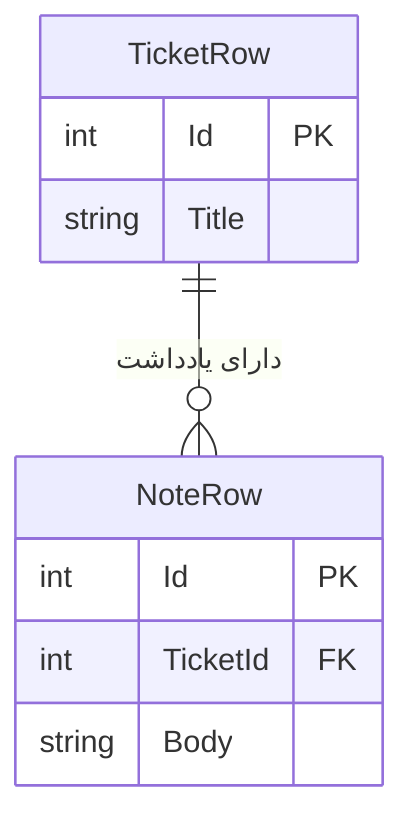

# درس 043 — relationship و delete behavior

پیش‌نیاز: درس 042 و [محیط PostgreSQL](../../../handbook/postgresql-lab.md).
در پایان، تیکت و یادداشت مرتبطش را ذخیره می‌کنی و می‌بینی چرا دیتابیس یادداشت بدون تیکت یا حذف تیکت دارای یادداشت را رد می‌کند.

در این رابطه، تیکت `parent` است و یادداشت‌هایش `child`های آن هستند. در C# با propertyهایی مثل `note.Ticket` و `ticket.Notes` به شیءهای مرتبط دسترسی داریم؛ این propertyها `navigation` نام دارند. در دیتابیس، مقدار `TicketId` و constraint مربوط به `foreign key` وجود رابطه را کنترل می‌کنند. بنابراین داشتن یک List در C# به‌تنهایی جلوی ثبت یادداشت برای تیکت ناموجود را نمی‌گیرد.

مثلاً یادداشت شمارهٔ ۷ می‌تواند متعلق به تیکت شمارهٔ ۲ باشد: Id یادداشت برابر ۷ و TicketId آن برابر ۲ است. `note.Ticket` و `ticket.Notes` راه دسترسی به اشیای مرتبط در C# هستند؛ کلید خارجی در دیتابیس بررسی می‌کند که تیکت شمارهٔ ۲ واقعاً وجود داشته باشد.

## یک نگاه: شناسهٔ یادداشت با شناسهٔ تیکت فرق دارد

خط اتصال در این نمودار رابطهٔ داده است: هر یادداشت دقیقاً به یک تیکت تعلق دارد و یک تیکت می‌تواند صفر تا چند یادداشت داشته باشد. فلش اجرای متد یا مجوز دسترسی نیست.



**مکث کوتاه:** یادداشت با Id برابر ۷ و TicketId برابر ۲ متعلق به کدام تیکت است؟

<details>
<summary>پاسخ را ببین</summary>
<p>تیکت شمارهٔ ۲. Id برابر ۷ هویت خود یادداشت است؛ TicketId کلید خارجیِ اشاره‌کننده به تیکت است.</p>
</details>

## رابطه را صریح بخوان

```csharp
note.HasOne(n => n.Ticket)
    .WithMany(t => t.Notes)
    .HasForeignKey(n => n.TicketId)
    .OnDelete(DeleteBehavior.Restrict);
```

متد HasOne سمت child و WithMany مجموعهٔ سمت parent را تعیین می‌کند.
TicketId از نوع int غیرnullable است؛ یادداشت بدون parent در این مدل معتبر نیست.
Id شناسهٔ خود یادداشت است؛ TicketId شناسهٔ تیکت مرتبط است.
این دو ممکن است اتفاقاً برابر باشند، ولی یک مفهوم نیستند.
عبارت `Ticket = null!` به کامپایلر می‌گوید دربارهٔ مقدار اولیه هشدار ندهد؛ نمونه انتظار دارد EF هنگام ساختن شیء از دادهٔ query، یعنی `materialization`، رابطه را تنظیم کند. این علامت خودش شیء Ticket را نمی‌سازد. اگر navigation بارگذاری نشده باشد، نباید از روی وجود `!` نتیجه بگیری خواندنش بی‌خطر است.
در Domain و قرارداد ورودی از آن برای پنهان کردن خطای طراحی استفاده نکن.

## ایجاد graph

```csharp
var ticket = new TicketRow
{
    Title = "Relationship",
    Notes = [new NoteRow { Body = "First note" }]
};
db.Add(ticket);
await db.SaveChangesAsync(ct);
```

ابزار EF ترتیب INSERT را با وابستگی FK هماهنگ می‌کند و identity parent را به child می‌رساند.
SaveChanges واحد این graph در یک transaction ذخیره می‌شود.
این atomicity فقط عملیات داخل همان SaveChanges است؛ چند Save جدا بدون transaction مشترک یکی نمی‌شوند.

## بارگذاری و fixup

با `Include(t => t.Notes)`، یادداشت‌ها را همراه درخواست می‌خوانیم. پیش از آزمایش، `ChangeTracker.Clear` اطلاعات دنبال‌شدهٔ قبلی را کنار می‌گذارد تا نتیجه صرفاً از شیءهای موجود در حافظه نیاید. وقتی EF دو entity مرتبط را دنبال می‌کند، navigationهایشان را بر اساس FK به هم وصل می‌کند؛ این رفتار `relationship fixup` است. fixup خودش query تازه نمی‌زند، پس خالی‌بودن یک مجموعهٔ بارگذاری‌نشده ثابت نمی‌کند در دیتابیس هم یادداشتی نیست.
برای تشخیص loading از APIهای Entry و Collection استفاده کن، نه حدس از Count.

## تصمیم حذف

| تصمیم | نتیجهٔ مورد انتظار | هزینه/خطر |
| --- | --- | --- |
| Cascade | حذف parent، حذف childها | حذف گستردهٔ ناخواسته |
| Restrict | رد حذف parent دارای child | نیاز به تصمیم صریح برنامه |
| SetNull | child باقی بماند و FK null شود | FK باید nullable و مفهوم orphan معتبر باشد |

در نمونهٔ همین درس Restrict انتخاب شده تا حذف فرزند اتفاق ضمنی نباشد.
وقتی childها tracked باشند، EF ممکن است پیش از SQL ناسازگاری رابطهٔ required را تشخیص دهد.
سناریوی rejection در نمونه از context تازه فقط parent را می‌خواند تا enforcement خود دیتابیس را بسنجد.
PostgreSQL ممکن است برای RESTRICT کد 23001 و برای بعضی نقض‌های FK کد 23503 برگرداند.
catch فقط این کدهای مورد انتظار را می‌پذیرد؛ هر DbUpdateException را موفقیت آزمایش حساب نمی‌کنیم.

## حذف صریح

نمونه ابتدا childها و سپس parent را حذف می‌کند.
در این آزمایش دو Save برای مشاهدهٔ مرحله‌ها داریم؛ پس کل حذف یک transaction مشترک ندارد.
در API نهایی، RemoveRange و Remove در یک SaveChanges قرار می‌گیرند تا شکست parent، حذف childها را هم برگرداند.
اگر حفظ تاریخچهٔ یادداشت الزام کسب‌وکار باشد، حذف سخت حتی به این شکل هم انتخاب درست نیست.
soft delete و retention به query و index و مجوز نیاز دارند؛ فقط افزودن IsDeleted کافی نیست.

## uniqueness و معنای متن

ساختار index یکتا روی TicketId و Body تکرار همان متن در همان تیکت را رد می‌کند.
همان Body برای دو تیکت متفاوت مجاز است.
collation برابر C برای مقایسهٔ دقیق ذخیره‌سازی انتخاب شده است.
normalization و Trim و سقف پنج یادداشت هنوز قواعد Domain هستند.
رابطه و unique index به‌تنهایی سقف تعداد فرزند را enforce نمی‌کنند.

## اجرای مرجع

از ریشهٔ مخزن و پس از تنظیم SUPPORTDESK_PG اجرا کن:

```powershell
dotnet run --project samples/42-relationships/SupportDesk.csproj
```

کلاس آزمایشگاهی Lab یک schema تصادفی تازه می‌سازد و در پایان همان schema را پاک می‌کند.
با --keep در انتهای فرمان می‌توانی آن را برای بازرسی نگه داری؛ نام schema در خروجی چاپ می‌شود.
این گزینه ابزار مشاهده است، نه ذخیره‌سازی پایدار برنامه.
کد خروج صفر و PASS: lesson scenario یعنی assertionهای همین سناریو عبور کرده‌اند.
برای بررسی همهٔ این درس‌ها، python scripts/ef_smoke.py را با دیتابیس آماده اجرا کن.

## تمرین و معیار عبور

1. پس از ذخیره، Id و TicketId را چاپ کن و تفاوتشان را توضیح بده.
2. child یتیم درج کن و SQLSTATE را ثبت کن؛ سپس state دیتابیس را با context تازه بررسی کن.
3. یک Body تکراری برای دو parent مختلف و برای همان parent امتحان کن.
4. حذف childها و parent را در یک Save انجام بده؛ با ایجاد شکست عمدی ثابت کن حذف ناقص نمی‌ماند.

معیار عبور: بتوانی تفاوت navigation، FK، loading و delete behavior را با یک خرابی واقعی نشان بدهی.

## منبع رسمی

[مستندات مرتبط](https://learn.microsoft.com/en-us/ef/core/modeling/relationships/)

[Npgsql EF provider](https://www.npgsql.org/efcore/)

[بخش چهارم](../README.md) · [نقشهٔ دوره](../../../ROADMAP.md) · [درس بعد](../044-tracking/README.md)
