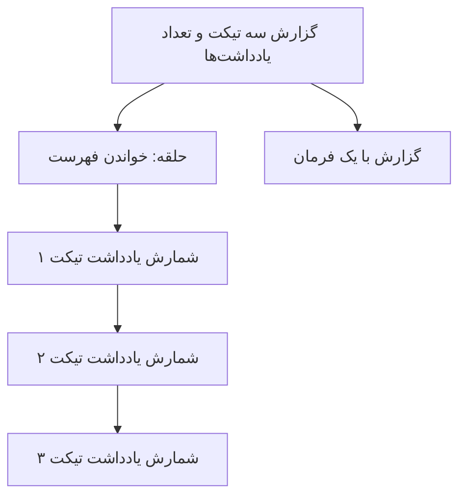

# درس 044 — tracking و projection و N+1

پیش‌نیاز: درس 043 و [محیط PostgreSQL](../../../handbook/postgresql-lab.md).
در پایان، تعداد SELECTها را برای سه تیکت می‌شماری و گزارش چهارفرمانی را با یک projection تک‌فرمانی مقایسه می‌کنی.

برای صفحهٔ فهرست به چند مقدار نیاز داریم، نه همهٔ entityها و graph کاملشان.
این درس تعداد فرمان‌های SELECT را اندازه می‌گیرد تا انتخاب projection بر اساس مشاهده باشد.
کم شدن تعداد query به‌تنهایی تضمین سرعت نیست؛ تعداد ردیف و ستون و plan هم مهم‌اند.

## tracker چه کاری انجام می‌دهد؟

در query معمولِ entity، context شیء و مقدارهایش را دنبال می‌کند؛ این رفتار `tracking` است تا تغییر بعدی با `SaveChanges` قابل ذخیره باشد. با `AsNoTracking` می‌گوییم این نتیجه فقط برای خواندن است و وارد tracker نشود. شیء خروجی هنوز می‌تواند در C# تغییر کند، اما همان تغییر خودبه‌خود برای ذخیره در این context شناخته نمی‌شود.
نمونه عنوان entity جداشده را تغییر می‌دهد و بررسی می‌کند SaveChanges صفر تغییر ذخیره می‌کند.
برای اصلاح داده، دوباره در واحد کار جدید load و validate کن؛ Attach/Update بی‌محابا روی DTO ورودی نزن.

## N+1 بدون جادو

ابتدا یک SELECT سه تیکت را می‌خواند. سپس حلقه برای هر تیکت یک `CountAsync` جدا می‌فرستد؛ پس سه فرمان دیگر داریم و مجموعاً چهار بار به دیتابیس مراجعه می‌کنیم. این الگو `N+1` نام دارد: یک query برای فهرست و N query برای اعضایش. لازم نیست `lazy loading`، یعنی بارگذاری خودکار رابطه هنگام استفاده، فعال باشد؛ همین حلقهٔ صریح هم N+1 می‌سازد.

```csharp
var tickets = await db.Tickets.AsNoTracking().ToListAsync(ct);
foreach (var ticket in tickets)
    _ = await db.Notes.CountAsync(n => n.TicketId == ticket.Id, ct);
```

این کد برای سه تیکت ظاهراً ساده است؛ برای صد تیکت صد و یک رفت‌وبرگشت دارد.
حل آن با Task.WhenAll روی همان context اشتباه است؛ context thread-safe نیست.

## یک نگاه: N+1 را با رفت‌وبرگشت بشمار

برای سه تیکت، نسخهٔ داخل حلقه چهار SELECT دارد. projection این گزارش را در یک SELECT می‌گیرد؛ این مقایسه دربارهٔ تعداد فرمان‌هاست، نه تضمین سرعت همهٔ queryها.



**مکث کوتاه:** با ده تیکت، نسخهٔ حلقه چند SELECT می‌زند؟

<details>
<summary>پاسخ را ببین</summary>
<p>یازده: یک بار فهرست و ده بار Count. استفاده از Task.WhenAll روی همان DbContext راه اصلاح این الگو نیست.</p>
</details>

## projection در سمت سرور

```csharp
var query = db.Tickets.AsNoTracking().OrderBy(t => t.Id)
    .Select(t => new TicketSummary(t.Id, t.Title, t.Notes.Count));
Console.WriteLine(query.ToQueryString());
var items = await query.ToArrayAsync(ct);
```

تا پیش از materialization، query یک expression قابل ترجمه است.
Count روی navigation در این projection توسط provider به SQL تبدیل می‌شود.
خروجی این query فقط مقدارهای ساده یا `scalar`، مثل شناسه، عنوان و تعداد، را در DTO قرار می‌دهد. چون خودِ `TicketRow` را برنمی‌گرداند، entityای از این نوع برای همین نتیجه وارد tracker نمی‌شود.
اگر projection خود entity را در DTO نگه دارد، آن entity می‌تواند tracked باشد؛ نام DTO مصونیت ایجاد نمی‌کند.
ToQueryString برای بررسی SQL است، نه اجرای query یا اندازه‌گیری latency واقعی.

## ابزار اندازه‌گیری همین نمونه

کلاس CommandCounter از DbCommandInterceptor ارث می‌برد و ReaderExecutingAsync را می‌شمارد.
counter پس از seed و پیش از query آزمایشی نصب می‌شود تا INSERTهای آماده‌سازی نتیجه را آلوده نکنند.
سناریو عمداً همهٔ queryهای خود را async اجرا می‌کند؛ شمارندهٔ این درس interceptor همگام را پوشش نمی‌دهد.
برای instrumentation عمومی باید مسیر sync و async، retries و commandهای دیگر را هم تعریف کنی.
این محدودیت را در تفسیر عددها رعایت کن.

## Include همیشه پاسخ نیست

اگر واقعاً graph را برای تغییر می‌خواهی Include مناسب است.
برای فهرست با عنوان و تعداد یادداشت، projection معمولاً حجم کمتری برمی‌گرداند.
چند collection در یک query join می‌تواند تکرار ردیف و رشد حاصل‌ضرب ایجاد کند.
AsSplitQuery رفت‌وبرگشت بیشتری دارد و consistency چند statement باید بررسی شود.
در مسیر تغییر aggregate درس ۴۸، AsSingleQuery parent و notes را از snapshot یک statement می‌خواند.
برای queryهای بزرگ، انتخاب را با SQL و دادهٔ نماینده و EXPLAIN بررسی کن.

## نقطهٔ materialization

اگر روی query دیتابیس اول `ToList` یا `ToArray` اجرا کنی، داده همان‌جا خوانده می‌شود و `Where` بعدی روی فهرست داخل حافظه کار می‌کند. برای فرستادن فیلتر، ترتیب و اندازهٔ صفحه به دیتابیس، این مراحل را روی query و پیش از materialization انجام بده. محل این مرز را از SQL تولیدشده بررسی کن.
مرتب‌سازی پایدار برای صفحه‌بندی لازم است؛ Id به‌عنوان tie-breaker مناسب است.
offset برای پرش‌های بزرگ هزینه دارد؛ keyset pagination را وقتی نیاز واقعی داری ارزیابی کن.
AsEnumerable مرز ادامهٔ محاسبه در .NET است؛ آن را برای پنهان کردن خطای ترجمه اضافه نکن.
filter با مقایسهٔ متنی دلخواه .NET لزوماً قابل ترجمه به provider نیست.

## اجرای مرجع

از ریشهٔ مخزن و پس از تنظیم SUPPORTDESK_PG اجرا کن:

```powershell
dotnet run --project samples/43-tracking/SupportDesk.csproj
```

کلاس آزمایشگاهی Lab یک schema تصادفی تازه می‌سازد و در پایان همان schema را پاک می‌کند.
با --keep در انتهای فرمان می‌توانی آن را برای بازرسی نگه داری؛ نام schema در خروجی چاپ می‌شود.
این گزینه ابزار مشاهده است، نه ذخیره‌سازی پایدار برنامه.
کد خروج صفر و PASS: lesson scenario یعنی assertionهای همین سناریو عبور کرده‌اند.
برای بررسی همهٔ این درس‌ها، python scripts/ef_smoke.py را با دیتابیس آماده اجرا کن.

## تمرین و معیار عبور

1. تعداد تیکت‌ها را از سه به ده تغییر بده؛ شمارندهٔ N+1 باید یازده و projection یک باشد.
2. SQL projection را بخوان و ستون‌های برگشتی را با entity query مقایسه کن.
3. projection را طوری تغییر بده که خود TicketRow را هم برگرداند؛ tracker را بررسی کن.
4. Take را پیش و پس از ToList بگذار و اختلاف SQL و مصرف داده را توضیح بده.

معیار عبور: قبل از پیشنهاد بهینه‌سازی، تعداد query و SQL واقعی را ارائه کنی و مرز اجرای server/client را بدانی.

## منبع رسمی

[مستندات مرتبط](https://learn.microsoft.com/en-us/ef/core/querying/tracking)

[Npgsql EF provider](https://www.npgsql.org/efcore/)

[بخش چهارم](../README.md) · [نقشهٔ دوره](../../../ROADMAP.md) · [درس بعد](../045-concurrency/README.md)
