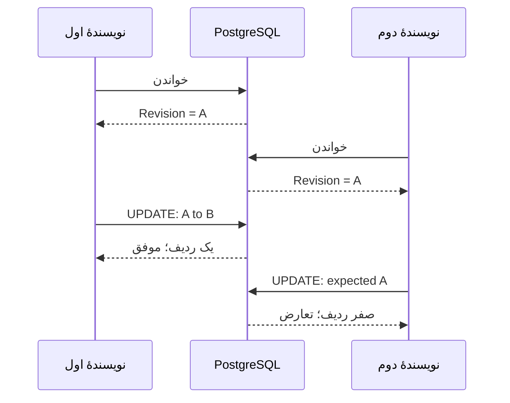

# درس 045 — هم‌زمانی و optimistic concurrency

پیش‌نیاز: درس 044 و [محیط PostgreSQL](../../../handbook/postgresql-lab.md).
در پایان، دو نویسنده از یک نسخه می‌خوانند؛ ذخیرهٔ نویسندهٔ دوم رد می‌شود و با context سوم بررسی می‌کنی که تغییر ناقصی باقی نمانده است.

دو context از یک ردیف نسخهٔ یکسان می‌خوانند.
نویسندهٔ اول ذخیره می‌کند؛ نویسندهٔ دوم نباید بی‌خبر تغییر اول را بازنویسی کند.
این مشکل lost update است و async بودن برنامه به‌تنهایی آن را حل نمی‌کند.

فرض کن دو نفر عنوان یک درخواست را Original می‌بینند. نفر اول آن را First writer ذخیره می‌کند. نفر دوم هنوز نسخهٔ قدیمی را دارد و ذخیرهٔ او می‌تواند تغییر نفر اول را بی‌خبر بپوشاند؛ این همان `lost update` است: ذخیرهٔ دوم، نتیجهٔ معتبر ذخیرهٔ اول را بی‌خبر از بین می‌برد.

اصطلاح optimistic یعنی هنگام خواندن، ردیف را برای کل زمان کار کاربر قفل نگه نداریم؛ هنگام ذخیره بررسی کنیم آیا نسخه هنوز همان است. رقابت ممکن است؛ هدف این است که آن را تشخیص بدهیم و طبق قرارداد تصمیم بگیریم. قفل‌های داخلی خود دیتابیس هنگام اجرای UPDATE موضوع جداگانه‌ای هستند.

## token تحت مدیریت برنامه

```csharp
b.Property(t => t.Revision).IsConcurrencyToken();
```

مقدار Revision در این نمونه Guid است. قبل از هر mutation یک Guid تازه می‌سازیم.
token شناسهٔ نسخه است؛ زمان، ترتیب نسخه‌ها یا مجوز کاربر را نشان نمی‌دهد.
Guid خالی یا تکراری را به‌عنوان مکانیزم timestamp به کار نبر.
در PostgreSQL گزینه‌های provider مانند xmin هم وجود دارند؛ در این دوره token برنامه‌ای برای خوانایی انتخاب شده است.
TimestampAttribute مخصوصاً معادل ساعت آخرین تغییر نیست؛ رفتار rowversion بین providerها یکسان نیست.

## UPDATE مشروط

شکل مفهومی فرمان ذخیره چنین است؛ SQL دقیق را از provider ببین:

```sql
UPDATE tickets
SET "Title" = @new_title, "Revision" = @new_revision
WHERE "Id" = @id AND "Revision" = @original_revision;
```

اگر ردیف با نسخهٔ قبلی دیگر وجود نداشته باشد، affected rows برابر صفر است.
EF در این حالت DbUpdateConcurrencyException می‌دهد.
حذف هم‌زمان ردیف هم می‌تواند همین نتیجه را بدهد؛ از exception به‌تنهایی وجود فعلی ردیف را حدس نزن.
Constraint violation با این exception یکی نیست؛ SQLSTATE و نوع خطا قرارداد متفاوتی دارند.

شرط WHERE دو سؤال دارد: «Id همان درخواست است؟» و «نسخه هنوز همان نسخهٔ خوانده‌شده است؟» فقط وقتی هر دو جواب مثبت باشد تغییر انجام می‌شود. affected rows یعنی تعداد ردیف‌های تغییرکرده، نه تعداد ردیف‌هایی که قبلاً خوانده بودیم.

برای جدول بعد، A و B نام سادهٔ دو Guid متفاوت‌اند. نویسندهٔ اول مقدار جدید B را ذخیره می‌کند؛ نویسندهٔ دوم همچنان A را در شرط می‌فرستد. شرط او دیگر با ردیف فعلی جور نیست، پس صفر ردیف تغییر می‌کند و EF تعارض را گزارش می‌کند. IsConcurrencyToken به‌تنهایی Guid تازه تولید نمی‌کند؛ در این نمونه کد برنامه مسئول تغییر Revision است.

این token با token ورود فرق دارد: یکی نسخهٔ داده را تشخیص می‌دهد، دیگری به احراز هویت مربوط است. برابر بودن Revision هیچ مجوزی برای کاربر ایجاد نمی‌کند.

## یک نگاه: دو نویسنده، یک نسخهٔ قدیمی

در این مثال، A و B دو مقدار متفاوتِ Revision را نشان می‌دهند. دیتابیس فقط UPDATE دارای نسخهٔ فعلی را می‌پذیرد؛ نویسندهٔ بازنده نباید تغییر برنده را بپوشاند.



**مکث کوتاه:** اگر نویسندهٔ دوم فقط SaveChanges را با همان نسخهٔ A تکرار کند، مشکل حل می‌شود؟

<details>
<summary>پاسخ را ببین</summary>
<p>نه؛ نسخهٔ فعلی B است. باید دادهٔ تازه خوانده شود و دربارهٔ رد یا ادغام آگاهانه تصمیم گرفته شود؛ جایگزین‌کردن کور نسخه می‌تواند همان تغییر برنده را از بین ببرد.</p>
</details>

## سناریوی قابل بازتولید

| گام | context اول | context دوم |
| --- | --- | --- |
| خواندن | Title=Original و Revision=A | همان نسخه A |
| ذخیرهٔ اول | Title=First writer و Revision=B | هنوز A را دارد |
| تلاش دوم | دادهٔ قبلی حفظ شده | UPDATE با شرط A و نتیجه صفر |
| بررسی مستقل | context سوم برنده را می‌بیند | یادداشتِ بازنده ذخیره نشده |

نمونه دو writer را به ترتیب کنترل‌شده جلو می‌برد تا race بدون اتکا به sleep بازتولید شود.
برای اثبات rollback، writer دوم علاوه بر parent، یک child هم اضافه می‌کند.
تمام عملیات همان SaveChanges در transaction اجرا می‌شوند.
اگر parent به تعارض بخورد، child احتمالی هم باید rollback شود.
این assertion مهم‌تر از صرفاً catch کردن exception است.

## aggregate فقط یک row نیست

در این مثال، Ticket و یادداشت‌هایش برای اعمال قانون «حداکثر پنج یادداشت» یک واحد تغییر می‌سازند؛ چنین مرزی را `aggregate` می‌نامیم. قانون به parent و childهایش با هم وابسته است، پس کنترل نسخه فقط هنگام تغییر عنوان کافی نیست.
اگر دو درخواست هرکدام چهار یادداشت ببینند و یکی اضافه کنند، count ساده شش یادداشت می‌سازد.
در پروتکل این نمونه، حتی افزودن یک یادداشت باید Revision مربوط به parent را هم تغییر بدهد. بنابراین دو نویسنده‌ای که هر دو چهار یادداشت دیده‌اند، برای ذخیره روی همان نسخهٔ parent رقابت می‌کنند و فقط یکی می‌تواند موفق شود.
در API درس ۴۸ دو درخواستِ خوانده‌شده از نسخهٔ یکسان نمی‌توانند هر دو commit شوند.
برنده commit می‌کند؛ بازنده 409 می‌گیرد و اضافه‌شدن یادداشتش rollback می‌شود.
این پروتکل باید توسط تمام writerها رعایت شود؛ SQL مستقیمِ خارج از پروتکل همچنان می‌تواند قواعد را دور بزند.
برای writerهای متعدد خارج از سرویس، قفل یا رویه/trigger یا پروتکل مشترک دیگری لازم است.

## بعد از تعارض چه کنیم؟

یک تصمیم کاربردی لازم است: رد تغییر، خواندن نسخهٔ تازه و نمایش اختلاف، یا ادغام آگاهانه.
در نمونهٔ API پاسخ 409 و درخواست reload داریم؛ retry خودکار انجام نمی‌شود.
SaveChanges دوباره روی همان state قدیمی راه‌حل نیست.

در تمرین، دو حالت را جدا توضیح بده: اگر همان شرط A را دوباره بفرستی، نسخهٔ ذخیره‌شده هنوز B است؛ اگر بدون تصمیم کاربر شرط را به B عوض کنی، ممکن است همان تغییر تازه‌ای را که می‌خواستیم حفاظت کنیم بازنویسی کنی. reload یعنی تازه‌ترین داده را بخوانیم و سپس آگاهانه دربارهٔ رد، تغییر دوباره یا ادغام تصمیم بگیریم.
بسته به سناریو، context را کنار بگذار یا مقادیر original/current/database را با سیاست مشخص reconcile کن.

## دو مرز مهم

این token تعارض میان unit of workهای سرور را هنگام ذخیره تشخیص می‌دهد. اما اگر کاربر صبح عنوان را دیده و عصر PUT تازه بفرستد، سرور ممکن است همان موقع نسخهٔ فعلی را بخواند. در این حالت token داخلی نمی‌داند تصمیم کاربر بر اساس دادهٔ صبح بوده است؛ به چنین مصرف‌کننده‌ای `stale client` می‌گوییم.
برای آن به نسخهٔ مورد انتظار در قرارداد یا ETag/If-Match و سیاست 412 نیاز داری.
این API فعلاً چنین قراردادی ندارد؛ تمرین اختیاری آن را اضافه می‌کند.
همچنین خطای اتصال هنگام commit نتیجهٔ نامعلوم می‌سازد، نه لزوماً rollback قطعی.
برای فرمانی مانند ایجاد سفارش، retry به idempotency و reconciliation نیاز دارد.

## اجرای مرجع

از ریشهٔ مخزن و پس از تنظیم SUPPORTDESK_PG اجرا کن:

```powershell
dotnet run --project samples/44-concurrency/SupportDesk.csproj
```

کلاس آزمایشگاهی Lab یک schema تصادفی تازه می‌سازد و در پایان همان schema را پاک می‌کند.
با --keep در انتهای فرمان می‌توانی آن را برای بازرسی نگه داری؛ نام schema در خروجی چاپ می‌شود.
این گزینه ابزار مشاهده است، نه ذخیره‌سازی پایدار برنامه.
کد خروج صفر و PASS: lesson scenario یعنی assertionهای همین سناریو عبور کرده‌اند.
برای بررسی همهٔ این درس‌ها، python scripts/ef_smoke.py را با دیتابیس آماده اجرا کن.

## تمرین و معیار عبور

1. تغییر Revision را از writer اول حذف کن و نشان بده چرا lost update قابل تشخیص نیست.
2. فقط child اضافه کن ولی token parent را عوض نکن؛ خطر را با سقف پنج یادداشت توضیح بده.
3. بررسی کن پس از تعارض، هم عنوان برنده و هم نبود child بازنده برقرار باشند.
4. اختیاری: نسخهٔ مورد انتظار client را وارد قرارداد کن و تفاوت 409 و 412 را مستند کن.

معیار عبور: تعارض را به‌صورت قطعی بازتولید کنی و با context سوم نشان بدهی هیچ تغییر ناقصی commit نشده است.

## منبع رسمی

[مستندات مرتبط](https://learn.microsoft.com/en-us/ef/core/saving/concurrency)

[Npgsql EF provider](https://www.npgsql.org/efcore/)

[بخش چهارم](../README.md) · [نقشهٔ دوره](../../../ROADMAP.md) · [درس بعد](../046-data-access/README.md)
