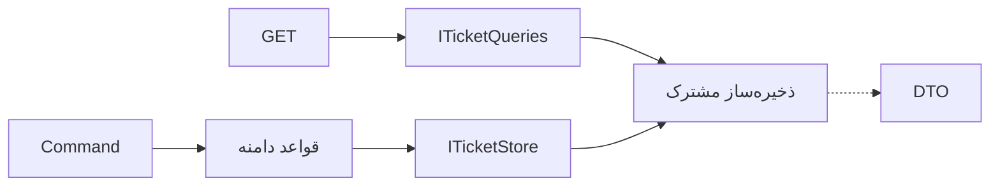

# درس 057 — تفکیک command و query بدون اجبار ابزار

## خروجی قابل مشاهده

درخواست‌های GET مربوط به جزئیات و فهرست را از مسیر تغییر Ticket جدا می‌کنی.
query پاسخ خلاصه و صفحهٔ مرتب می‌دهد و نه state و نه Version را تغییر می‌دهد.
هیچ mediator، صف یا دیتابیس جداگانه‌ای برای این تفکیک لازم نیست.

پیش‌نیاز: [درس 056](../056-vertical-slices/README.md)، DTO، port و pagination.
SDK 10 لازم است؛ این snapshot package خارجی تازه ندارد.

## مسئله

برای rename و resolve باید aggregate را بخوانیم تا رفتار Domain اجرا شود.
برای یک فهرست خلاصه، چنین تعهدی لازم نیست: caller فقط Id، عنوان، وضعیت و تعداد noteها را می‌خواهد.
اگر همهٔ خواندن‌ها از متد ویرایش عبور کنند، نیازهای report و mutation در یک قرارداد بزرگ مخلوط می‌شوند.
برای مثال، تغییر وضعیت باید قواعد و نسخهٔ Ticket را بررسی کند، اما گزارش خلاصه فقط شناسه، عنوان، وضعیت و تعداد noteها را می‌خواهد. از همین تفاوت، دو قرارداد می‌سازیم. این تصمیم دربارهٔ مسئولیت کد است و فعلاً نحوهٔ استقرار یا `topology` را عوض نمی‌کند.

## واژگان

| اصطلاح | معنای همین نمونه |
| --- | --- |
| Command | درخواست تغییر مانند ResolveTicketCommand |
| Query | درخواست مشاهده مانند TicketListQuery |
| Read model | TicketResponse و TicketPage |
| Write model | Ticket با قواعد و snapshot نسخه‌دار |
| CQRS: Command Query Responsibility Segregation | جداکردن قرارداد و مسیر انجام تغییر از قرارداد و مسیر خواندن |

این پیاده‌سازی شکل سادهٔ تفکیک در یک سرویس و یک storage است.
در این سطحِ CQRS، دادهٔ خواندن و نوشتن در همان storage است. اگر در طرح دیگری دیتابیس خواندن جدا باشد، باید تغییرها به آن منتقل شوند و ممکن است مدتی از نوشتن عقب بماند؛ این فاصلهٔ زمانی `lag` است. این نمونه چنین هماهنگی‌ای ندارد و برای آن Event Sourcing یا event bus اضافه نمی‌کند.
استفاده از نام Handler هم به‌تنهایی CQRS را ایجاد نمی‌کند.

## یک نگاه: خواندن و تغییر، دو مسیر در یک سرویس

هر دو مسیر از همان storage محلی استفاده می‌کنند. مسیر query فقط خروجی نمایشی می‌خواهد؛ مسیر command قواعد تغییر و نسخه را رعایت می‌کند.



**مکث کوتاه:** برای این جداسازی، حتماً دو دیتابیس و یک message bus لازم است؟

<details>
<summary>پاسخ را ببین</summary>
<p>نه؛ این نمونه دو قرارداد خواندن و نوشتن روی همان storage دارد. دیتابیس جدا، هماهنگی و تأخیر داده را هم به مسئله اضافه می‌کند.</p>
</details>

## port خواندن

src/Application/Shared/ITicketQueries.cs:

```csharp
public interface ITicketQueries
{
    Task<TicketResponse?> FindAsync(int id, CancellationToken ct);
    Task<TicketPage> ListAsync(TicketListQuery query, CancellationToken ct);
}
```

خروجی materialize شده و مستقل از EF یا JsonSerializer است.
IQueryable، entity tracked یا connection از این مرز بیرون نمی‌آید.
ITicketStore همچنان load نسخه‌دار و save aggregate را برای commandها دارد.
این تفکیک رابط‌ها، مجوز امنیتی «فقط خواندن» در دیتابیس ایجاد نمی‌کند؛ آن تعهد باید در adapter و حساب دیتابیس هم بررسی شود.

## مسیر query

| فایل | مسئولیت |
| --- | --- |
| Features/ListTickets/Endpoint.cs | binding پارامتر و ترجمهٔ HTTP |
| src/Application/Features/ListTickets/ListTickets.cs | بررسی ورودی و فراخوانی port |
| src/Application/Shared/ITicketQueries.cs | query و DTO صفحه |
| src/Infrastructure/QueryProjection.cs | فیلتر، ترتیب و انتخاب صفحهٔ adapter محلی |

خروجی `StoreFactory` دو راه استفاده از همان instance را فراهم می‌کند: یکی از نوع `ITicketStore` برای command و دیگری از نوع `ITicketQueries` برای query. پس storage دوباره ساخته نمی‌شود و host لازم نیست یک implementation نامعلوم را با cast به قرارداد دیگری تبدیل کند. use case خواندن فقط قرارداد query را می‌گیرد و متد save در اختیار ندارد.

## قرارداد فهرست

| پارامتر | قرارداد |
| --- | --- |
| page | مثبت، پیش‌فرض ۱ |
| pageSize | ۱ تا ۵۰، پیش‌فرض ۲۰ |
| status | null یا Open، InProgress، Closed |
| q | جست‌وجوی عنوان، پس از Trim حداکثر ۱۲۰ واحد طول string |
| ترتیب | Id صعودی |
| total | تعداد matching قبل از صفحه‌بندی |

کد adapter محلی برای search از OrdinalIgnoreCase استفاده می‌کند.
نتیجهٔ آن را با collation دلخواه PostgreSQL یکی فرض نکن.
برای provider آینده، semantics فیلتر و ترتیب باید در قرارداد و integration test ثبت شوند.
count و items در این adapter از یک تصویرِ زیر lock محاسبه می‌شوند؛ دو query مجزای دیتابیس ممکن است consistency متفاوتی داشته باشند.

## مرز overflow

```csharp
long skip = ((long)query.Page - 1) * query.PageSize;
```

محاسبه پیش از ضرب به long منتقل می‌شود.
اگر skip از تعداد matching بیشتر باشد، صفحه خالی با total صحیح برمی‌گردد.
تبدیل مستقیم ضرب int به Skip می‌تواند overflow بدهد.
صفحهٔ دور به معنی input نامعتبر نیست؛ page=0 نامعتبر است و 400 می‌گیرد.

## query نباید write پنهان داشته باشد

خواندن فهرست نباید Version را افزایش دهد یا فایل را بازنویسی کند.
اگر لازم است «آخرین مشاهده» ثبت شود، آن را نیاز مستقل با سیاست مشخص ببین.
در این درس چند بار GET می‌زنیم و snapshot و بعداً bytes فایل را ثابت نگه می‌داریم.
لاگ‌نویسی فنی با تغییر state کسب‌وکار یکی نیست.

## اجرا

```powershell
dotnet run --project samples/56-command-query/SupportDesk.csproj -- --check
dotnet run --project samples/56-command-query/SupportDesk.csproj -- --urls http://127.0.0.1:5057
```

در PowerShell جدا:

```powershell
Invoke-RestMethod 'http://127.0.0.1:5057/api/tickets?page=1&pageSize=10&status=InProgress'
Invoke-RestMethod 'http://127.0.0.1:5057/api/tickets/1'
```

برنامهٔ host با `Ctrl+C` متوقف می‌شود؛ پیش‌فرض حافظه‌ای و seed تازه است.
--check عبارت `PASS: command/query separation, stable pagination and pure reads` می‌دهد.
QueryChecks یک فهرست پنج‌تیکتی مستقل می‌سازد تا ترتیب صفحهٔ دوم واقعاً بررسی شود.

```powershell
python scripts/architecture_final_smoke.py
```

اسکریپت برای هر چهار snapshot پایانی queryهای HTTP و خطاهای ورودی را بررسی می‌کند.
اجرای کامل آن تا ساخت فایل‌های درس‌های ۵۸ تا ۶۰ نیز پیش می‌رود.
تست مستقل همین درس را با --check اجرا کن.

## تصمیم طراحی

کلاس QueryProjection داخل Infrastructure است چون semantics adapter محلی را اجرا می‌کند.
وقتی PostgreSQL پیاده شد، فیلتر و pagination باید پیش از materialization سمت server بروند.
آوردن کل جدول به حافظه و سپس Skip، راه‌حل مقیاس‌پذیر عمومی نیست.
اینجا سقف دادهٔ آزمایش کوچک است و محدودیت صریح است.
برای سه query ساده هنوز mediator یا GenericQueryHandler لازم نیست.

## تمرین مستقل

یک query گزارش شمارش تیکت‌ها به تفکیک وضعیت بساز.
DTO گزارش مستقل باشد و noteها را برنگرداند.
وضعیت بدون تیکت را با صفر نشان بده؛ ترتیب statusها در قرارداد معلوم باشد.
با دادهٔ خالی و پس از تغییر یک command، نتیجه را بررسی کن.

### راهنمای مرحله‌ای

1. JSON خروجی گزارش را پیش از کد بنویس.
2. تعیین کن port فعلی را گسترش می‌دهی یا نیاز مستقلی داری.
3. query را بدون دسترسی به save اجرا کن.
4. ورودی نامعتبر و cancellation را جدا آزمایش کن.

## معیار عبور

- چند بار query، state و Version را ثابت بگذارد.
- total و page با فیلتر و ترتیب مشخص درست باشند.
- page بزرگ overflow نکند.
- query port از provider مستقل بماند.
- بتوانی توضیح بدهی چرا این نمونه به دو دیتابیس و mediator نیاز ندارد.

## منابع رسمی

بررسی در 2026-10-17:

- [الگوی CQRS و هزینه‌های انتخاب آن](https://learn.microsoft.com/en-us/azure/architecture/patterns/cqrs)
- [مرزهای برنامه و Infrastructure](https://learn.microsoft.com/en-us/dotnet/architecture/modern-web-apps-azure/common-web-application-architectures)

[قبلی](../056-vertical-slices/README.md) · [بعدی](../058-validation-library/README.md)
