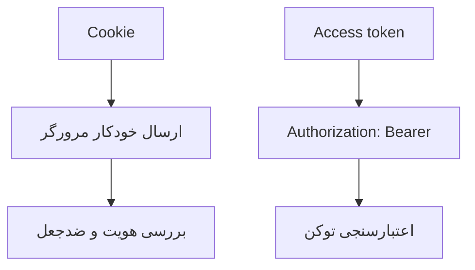

# درس 064 — cookie و bearer و انتخاب روش

## خروجی قابل مشاهده

ورود حساب ذخیره‌شده در PostgreSQL را با دو روش آزمایش می‌کنی: cookie مرورگر و protected bearer صادرشدهٔ Identity. سپس با همان credential به مسیرهای مختلف درخواست می‌فرستی تا ببینی هر مسیر کدام scheme را می‌پذیرد. جریان CSRF، refresh و logout و اثر نگه‌داری key ring در restart را جدا بررسی می‌کنی.
credential دست‌ساز، X-User و X-Role هیچ هویتی ایجاد نمی‌کنند.

پیش‌نیاز: [درس 063](../063-passwords/README.md)، Identity، middleware و مدل تهدید.
این snapshot آزمایش authentication است؛ هنوز سازمان، نقش، مالکیت تیکت و حساب self-service کامل ندارد.
هیچ مسیر تیکت ناامنِ نسخهٔ ۶۰ به‌صورت خودکار در آن باز نشده است.

## انتخاب بر اساس client

قبل از انتخاب روش، چهار اصطلاح را به همین سناریو وصل کنیم:

| اصطلاح | سؤال یا نقش آن |
| --- | --- |
| authentication / احراز هویت | این درخواست با credential معتبرِ کدام حساب آمده است؟ |
| authorization / مجوز | آیا آن حساب اجازهٔ همین عملیات روی همین منبع را دارد؟ |
| credential | چیزی که برای اثبات هویت ارائه می‌شود؛ مانند password موقع login یا cookie/token صادرشده بعد از آن |
| scheme | نام تنظیمات و handler مربوط به یک روش احراز هویت در برنامه |

چارچوب Identity امکانات حساب و ورود را فراهم می‌کند؛ به‌تنهایی نمی‌گوید هر کاربر کدام تیکت را می‌تواند تغییر بدهد. این موضوع در درس‌های نقش و مالکیت ادامه دارد. token هم نام عمومی یک دادهٔ صادرشده با کاربرد مشخص است؛ access token، refresh token و reset token وظیفهٔ یکسان ندارند.

| روش | رفتار client | تصمیم‌های مهم |
| --- | --- | --- |
| Cookie | مرورگر معمولاً خودکار می‌فرستد | HttpOnly، Secure، SameSite و CSRF |
| Bearer header | client صریحاً credential را می‌فرستد | نگهداری امن، عمر، دامنهٔ مصرف و refresh |
| OAuth/OIDC | قرارداد استاندارد با issuer مشخص | audience، issuer، policy و provider واقعی |

نام Bearer شکل حمل credential است؛ الزاماً JWT نیست.
گزینهٔ `HttpOnly` خواندن مستقیم cookie از JavaScript را محدود می‌کند، اما جلوی همهٔ کارهای کد مخرب داخل صفحه را نمی‌گیرد؛ این نوع اجرای کد در صفحه را `XSS` می‌نامند. گزینهٔ `SameSite` هم در ارسال cookie بین سایت‌ها نقش دارد و به‌تنهایی جای کل طراحی CSRF را نمی‌گیرد. جریان ضد CSRF همین نمونه را در بخش مربوط دنبال می‌کنیم.
نگهداری token در localStorage راه‌حل پیش‌فرضِ بی‌خطر برای مرورگر نیست.

## یک نگاه: مرورگر خودش می‌فرستد یا client صریح؟

اینجا تفاوتِ حمل credential را می‌بینی. cookie در درخواست واجد شرایط مرورگر خودکار همراه می‌شود؛ برای مسیرهای تغییر‌دهندهٔ cookie در این نمونه، CSRF token نیز لازم است.



**مکث کوتاه:** داشتن cookie معتبر، مسیر BearerOnly را باز می‌کند؟

<details>
<summary>پاسخ را ببین</summary>
<p>نه؛ scheme آن مسیر bearer می‌خواهد. همین‌طور access token با reset token یا CSRF token یک وظیفه ندارد؛ نام token به معنی قابل جایگزین بودن این داده‌ها نیست.</p>
</details>

## token این نمونه چیست؟

از AddIdentityApiEndpoints برای ثبت schemeهای framework استفاده می‌کنیم، ولی routeهای محدود آزمایش را صریح تعریف می‌کنیم.
SignInManager با IdentityConstants.BearerScheme، handler رسمی را برای صدور protected token فعال می‌کند.
این token، JWT استاندارد و سرویس کامل OAuth/OIDC نیست.
برای API بین چند سرویس با issuer و audience استاندارد، provider مناسب و validation استاندارد لازم است؛ تولید JWT دست‌ساز جواب این مسئله نیست.

## نقشهٔ فایل‌ها

| فایل | نقش |
| --- | --- |
| Program.cs | DI، schemeها، cookie و transport و ترتیب middleware |
| Endpoints/AuthenticationEndpoints.cs | login، csrf، refresh، logout و routeهای scheme مشخص |
| Accounts/AccountServices.cs | policy حساب و store |
| Persistence/AccountContext.cs | جداول Identity در PostgreSQL |
| Hosting/LabProvisioning.cs | فقط فرمان محلی ساخت آزمایشگاه تازه |

مرحلهٔ Authentication قبل از Authorization اجرا می‌شود.
GET /api/me فقط userId سروری می‌دهد و IdentityUser کامل serialize نمی‌شود.
/api/cookie-action و /api/bearer-action فقط شاهد scheme هستند و هنوز منطق تغییر تیکت ندارند.
نقش و کنترل مالکیت در درس‌های بعد به use case و منبع وصل می‌شوند.

## قرارداد مسیرها

| مسیر | ورودی یا انتظار |
| --- | --- |
| GET /auth/csrf | ساخت token ضد CSRF و cookie مربوط؛ no-store |
| POST /auth/login?mode=cookie | email/password و X-CSRF-TOKEN معتبر |
| POST /auth/login یا mode=bearer | email/password صریح و صدور protected token |
| POST /auth/refresh | refreshToken در body؛ اعتبار purpose، expiry و stamp |
| POST /auth/logout | cookie معتبر و CSRF معتبر؛ 204 |
| GET /api/me | cookie یا bearer معتبر؛ 200 و userId |
| POST /api/cookie-action | فقط scheme cookie و CSRF معتبر |
| POST /api/bearer-action | فقط scheme bearer |

ورودی credential خراب، حساب ناموجود، رمز نادرست و ورود نامجاز پاسخ عمومی 401 دارند.
این پاسخ‌های عمومی شکل یکسانی دارند تا از متن پاسخ نتوان وجود حساب را تشخیص داد. اما یکسان‌بودن متن، یکسان‌بودن زمان پاسخ را ثابت نمی‌کند. تلاش برای پیداکردن حساب‌های موجود از همین تفاوت‌ها `user enumeration` نام دارد و بررسی کامل آن فراتر از این آزمایش است.
خطاهای فنی پاسخ 500 عمومی دارند.

## CSRF از همین مرحله

برای ورود cookie نیز login CSRF را در نظر می‌گیریم؛ ابتدا GET /auth/csrf بزن.
پس از ورود، token جدید بگیر چون token قبلی به وضعیت anonymous وابسته بود.
برای cookie-action و logout، token را در X-CSRF-TOKEN بفرست.
مسیر bearer-only به cookie برای ورود تکیه نمی‌کند و ambient cookie آن را مجاز نمی‌کند.

اصطلاح ambient cookie یعنی credentialای که مرورگر برای درخواست واجد شرایط، خودکار همراه می‌کند. CSRF از این خودکاربودن سوءاستفاده می‌کند: ممکن است درخواست ناخواسته‌ای با هویت مرورگر کاربر ارسال شود. token ضد CSRF شاهد جداگانه‌ای است که این نمونه برای عملیات cookie لازم می‌داند؛ password یا access token نیست.

مسیر cookie همین نمونه را روی کاغذ دنبال کن:

1. client با نگه‌داشتن cookieهای پاسخ، GET /auth/csrf را می‌زند؛ cookie و token مربوط را می‌گیرد.
2. login را با email/password و همان token در header می‌فرستد؛ credential حساب بررسی و cookie ورود صادر می‌شود.
3. پس از ورود، CSRF token تازه می‌گیرد تا به وضعیت هویت فعلی مربوط باشد.
4. برای cookie-action یا logout، هم cookie معتبر و هم header ضد CSRF لازم است.

در مسیر bearer، client access token را صریح در Authorization با قالب Bearer می‌فرستد. داشتن یک cookie معتبر به تنهایی شرط route مخصوص bearer را برآورده نمی‌کند. برای خودآزمایی، بگو در هر مرحله کدام داده «اثبات هویت» است و کدام داده «محافظ درخواست cookie».
فصل ۶۷ CSRF، CORS و injection را عمیق‌تر ادامه می‌دهد؛ این نمونه تا آن زمان مسیر cookie باز و بی‌محافظ نمی‌سازد.

## عمر و ابطال

عمر cookie بیست دقیقه است و sliding expiration ندارد؛ استفادهٔ دوباره مهلتش را تمدید نمی‌کند. در این login، cookie به شکل non-persistent صادر می‌شود و برای باقی‌ماندن پس از بستن مرورگر تنظیم نشده است.
بررسی security stamp cookie هر یک دقیقه تنظیم شده است.
access token پنج دقیقه و refresh token بیست دقیقه اعتبار دارند.
reset-token پانزده‌دقیقه‌ای درس قبل قرارداد دیگری است.

عملیات Refresh با protector مربوط و expiry و ValidateSecurityStampAsync بررسی می‌شود.
هر refresh یک جفت access token و refresh token تازه می‌دهد. اما این پیاده‌سازی دفتر ثبت مصرف، یعنی `ledger`، ندارد تا بداند refresh token قبلی قبلاً استفاده شده است. پس صدور جفت تازه به معنی یک‌بارمصرف‌شدن قبلی نیست و قبلی ممکن است تا انقضا یا تغییر stamp دوباره پذیرفته شود.
Logout این route، cookie را از client پاک می‌کند و access token قبلی را فوراً باطل نمی‌کند.
همچنین کپی دزدیده‌شدهٔ cookie الزاماً با حذف cookie مرورگر خودبه‌خود باطل نمی‌شود.
برای revocation فوری و session management و replay detection به قابلیت جدا و تست آن نیاز داریم.

مفهوم refresh یعنی درخواست credential دسترسی تازه با refresh token؛ نه دوباره فرستادن password، و نه اجازهٔ نادیده‌گرفتن انقضا. revocation یعنی اعتبار credential صادرشده را پیش از پایان عمرش از سمت server پس بگیریم. replay یعنی یک دادهٔ قابل استفاده دوباره فرستاده شود؛ صدور pair تازه خودبه‌خود ثابت نمی‌کند pair قبلی دیگر قابل استفاده نیست.

ویژگی SecurityStamp علامت وضعیت امنیتی حساب است؛ در مسیرهایی که آن را اعتبارسنجی می‌کنند می‌توان تغییر وضعیت امنیتی حساب را تشخیص داد. key ring هم مجموعهٔ کلیدهای Data Protection برای حفاظت و خواندن credentialهای همین برنامه است؛ با password حساب یا token ضد CSRF یکی نیست. به همین دلیل ماندگاری DB به تنهایی برای خواندن cookie قبلی پس از restart کافی نیست.

## کلیدهای پایدار

متغیر محیطی TEAMDESK_KEYS یک پوشهٔ خصوصیِ متعلق به host است.
Data Protection با SetApplicationName ثابت، token و cookie را در restart همان برنامه قابل خواندن نگه می‌دارد.
تغییر app name یا از دست دادن key ring می‌تواند session و tokenها را غیرقابل استفاده کند.
فایل‌های این lab ماندگاری کلید را نشان می‌دهند، اما حفاظت کلیدِ ذخیره‌شده یا `at-rest protection` را کامل نمی‌کنند. دسترسی فایل با `ACL`، یعنی قواعد مجازبودن دسترسی، و شیوهٔ backup و encryption کلید در محیط واقعی تصمیم‌های جداگانه‌اند.
کلید، password و token را در repo، URL عیب‌یابی یا log نگذار.

## راه‌اندازی آزمایشگاه محلی

این فرمان از schema تازه با نام محدود استفاده می‌کند و جدول موجود را جایگزین نمی‌کند.
PostgreSQL اختصاصی و پوشهٔ key تازه لازم است:

```powershell
$schema = 'auth64_' + [guid]::NewGuid().ToString('N')
$env:SUPPORTDESK_PG = "Host=127.0.0.1;Database=supportdesk_lab;Username=course;Password=رمز_آزمایشگاه;Search Path=$schema"
$env:TEAMDESK_KEYS = "$env:TEMP/teamdesk-auth-keys"
New-Item -ItemType Directory -Force $env:TEAMDESK_KEYS | Out-Null
$env:ASPNETCORE_ENVIRONMENT = 'Development'
$env:DOTNET_ENVIRONMENT = 'Development'
$env:TEAMDESK_INSECURE_LAB = '1'
$env:TEAMDESK_LAB_EMAIL = 'learner@example.test'
$secret = Read-Host 'Temporary lab password (12+ characters and default Identity complexity)' -AsSecureString
$env:TEAMDESK_LAB_PASSWORD = [System.Net.NetworkCredential]::new('', $secret).Password
dotnet run --project samples/63-cookie-bearer/SupportDesk.csproj -- --init-lab
Remove-Item Env:TEAMDESK_LAB_PASSWORD
Remove-Item Env:TEAMDESK_LAB_EMAIL
dotnet run --project samples/63-cookie-bearer/SupportDesk.csproj -- --urls http://127.0.0.1:5064
```

مقدار password موقت را از مدیر رمز/حافظهٔ خودت برای آزمایش client بگیر؛ آن را در تاریخچهٔ فرمان وارد نکن.
--init-lab فقط با Development و flag صریح اجرا می‌شود و تأیید حساب را در همان فرمان مورد اعتماد انجام می‌دهد؛ endpoint عمومیِ تأیید خودکار نیست.
این فرمان ایمیل واقعی نمی‌فرستد و برای ثبت‌نام production طراحی نشده است.
ابتدا schema بساز و بعد host عادی را اجرا کن؛ startup معمول DDL ندارد.
برای migration محصول از مسیر بخش چهارم استفاده کن؛ این lab، migration تولیدی ندارد.

## transport

بدون flag آزمایش، cookie به Secure=Always تنظیم شده و plain HTTP توسط middleware رد می‌شود.
flag HTTP فقط در Development و برای remote IP از loopback مجاز است؛ برای نمونه‌های موقت بدون credential واقعی استفاده کن.
در Production، فعال کردن flag باعث شکست startup می‌شود.
پشت reverse proxy، HTTPS و forwarded headers فقط برای proxy مورد اعتماد باید پیکربندی شوند؛ این نمونه proxy production پیکربندی نمی‌کند.
برای کاربرد واقعی، HTTPS قابل اعتماد و حفاظت کلید و سرویس حساب کامل لازم است.

## اجرای بررسی

```powershell
python scripts/security_smoke.py
```

ابزار SDK 10، PostgreSQL و psql لازم‌اند؛ راهنمای env آزمایش در فهرست بخش آمده است.
اسکریپت حساب و schema و key خصوصیِ موقت خودش را می‌سازد و password/token چاپ نمی‌کند.
موارد بررسی: credential جعلی، رمز نادرست، token خراب، refresh، CSRF قبل و بعد از login، logout، مرز scheme و باقی ماندن حساب و key در restart.
انقضای پنج‌دقیقه‌ای با انتظار واقعی و مرورگرهای مختلف به‌صورت دستی آزمایش نشده‌اند؛ آن را با تست time provider مستقل تکمیل کن.
خروجی publish هم از پوشه‌ای جدا اجرا می‌شود.

## تمرین مستقل

برای سه client یک ADR انتخاب روش ورود بنویس: مرورگر هم‌origin، ابزار CLI و API خارجی.
برای هرکدام محل نگهداری credential، عمر، CSRF، refresh، logout و revocation را مشخص کن.
یک تست منفی اضافه کن که credential معتبرِ scheme دیگر به مسیر اختصاصی دسترسی نگیرد.
JWT دست‌ساز یا header role را به‌عنوان میان‌بر اضافه نکن.

### سرنخ

اول مشخص کن browser چه چیزی را خودکار می‌فرستد.
سپس تفاوت پاک کردن credential client و باطل کردن server-side آن را روی کاغذ بنویس.

## معیار عبور

- cookie و bearer معتبر از framework صادر و credential جعلی رد شوند.
- cookie-only و bearer-only اشتباه همدیگر را نپذیرند.
- login و تغییر cookie بدون CSRF رد شوند.
- restart با key و DB ثابت، اعتبار session را بی‌دلیل از بین نبرد.
- محدودیت refresh reuse و logout و stamp روشن باشد.
- تفاوت این protected token با JWT و OAuth/OIDC را توضیح بدهی.

## منابع رسمی

تطبیق در 2026-10-18:

- [Identity برای API و protected token](https://learn.microsoft.com/en-us/aspnet/core/security/authentication/identity-api-authorization?view=aspnetcore-10.0)
- [کد رسمی Identity API در نسخهٔ مرجع](https://github.com/dotnet/aspnetcore/blob/v10.0.13/src/Identity/Core/src/IdentityApiEndpointRouteBuilderExtensions.cs)
- [Data Protection](https://learn.microsoft.com/en-us/aspnet/core/security/data-protection/configuration/overview?view=aspnetcore-10.0)
- [CSRF](https://learn.microsoft.com/en-us/aspnet/core/security/anti-request-forgery?view=aspnetcore-10.0)

[قبلی](../063-passwords/README.md) · [فهرست بخش](../README.md)
[ادامه: درس ۶۵ و policy](../065-authorization/README.md). درس‌های ۶۹ و ۷۰ نیز در فهرست بخش آماده‌اند.

[ادامهٔ عملی همین موضوع: JWT و اعتبارسنجی API](../064a-jwt/README.md) و سپس [OAuth/OIDC با PKCE](../064b-oidc/README.md).
