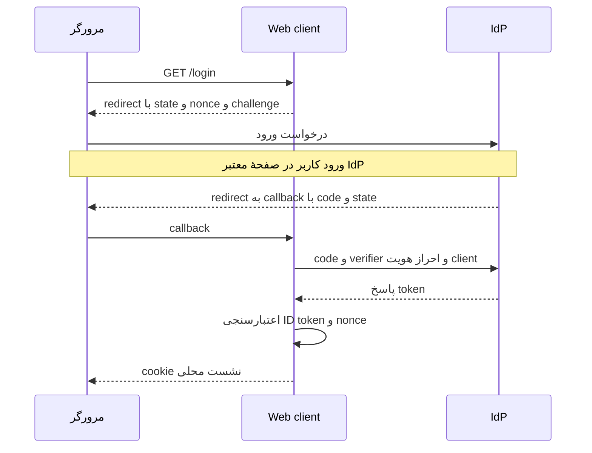

# مکمل ۶۴ـب — OAuth، OpenID Connect و ورود با PKCE

پیش‌نیاز: [JWT و API](../064a-jwt/README.md) و cookie/CSRF درس ۶۴. هدف این است که مسیر «رفتن به صفحهٔ ورود ارائه‌دهنده و برگشتن به برنامه» را بفهمی و با handler استاندارد اجرا کنی.

## ۱. سه مفهوم را یکی نکن

| مفهوم | نقش |
| --- | --- |
| OAuth 2.0 | چارچوب واگذاری اختیار محدود برای دسترسی به resource؛ صرفاً یک قالب token نیست |
| OpenID Connect / OIDC | لایهٔ هویت روی OAuth؛ client می‌تواند ورود کاربر را با ID token معتبر بشناسد |
| JWT | یک قالب داده؛ ممکن است در ID token یا access token استفاده شود، ولی خود پروتکل ورود نیست |

این نمونه یک **confidential web client** است: backend وب می‌تواند secret خود را خصوصی نگه دارد. مرورگر password را به Identity Provider یا IdP می‌دهد، نه به این client. client secret هویت برنامه را هنگام تبادل کد اثبات می‌کند؛ رمز کاربر نیست و در frontend یا Git قرار نمی‌گیرد. برای برنامهٔ موبایل یا SPA عمومی، secret داخل بستهٔ قابل دانلود راز محسوب نمی‌شود؛ طراحی client آن‌ها متفاوت است.

## ۲. مسیر Authorization Code با PKCE

نام `PKCE` مخفف `Proof Key for Code Exchange` است. هدف این جریان فقط دریافت یک code نیست؛ backend هنگام تعویض code باید نشان بدهد verifier مربوط به همان تلاش ورود را دارد. جدول را با سه نقش بخوان: مرورگر پیام را جابه‌جا می‌کند، web client برنامهٔ ماست و IdP ورود را انجام می‌دهد.

| گام | چه اتفاقی می‌افتد؟ | دادهٔ مهم |
| --- | --- | --- |
| ۱ | مرورگر /login برنامه را باز می‌کند | handler درخواست ورود می‌سازد |
| ۲ | برنامه مرورگر را به authorization endpoint IdP می‌فرستد | client_id، redirect_uri، scope=openid، state، nonce و code_challenge |
| ۳ | IdP ورود/رضایت لازم را انجام می‌دهد | password در صفحهٔ مورد اعتماد IdP وارد می‌شود |
| ۴ | مرورگر به callback ثبت‌شده برمی‌گردد | authorization code و state؛ نه password |
| ۵ | backend با token endpoint تبادل می‌کند | code، code_verifier، redirect_uri و احراز هویت client |
| ۶ | handler پاسخ را اعتبارسنجی می‌کند | ID token، issuer، امضا، audience، زمان و nonce |
| ۷ | برنامه cookie محلی session را صادر می‌کند | درخواست بعدی مرورگر به این برنامه با cookie است |

مقدار authorization code کوتاه‌عمر و برای تبادل است، نه credential مستقیم /api/tickets. client secret و code_verifier باید در backchannel، یعنی ارتباط backend با token endpoint بمانند. این جریان را با implicit flow یا فرستادن password کاربر به client عوض نکن.

## یک نگاه: ورود را بین سه بازیگر دنبال کن

خط‌های افقی پیام‌اند و زمان از بالا به پایین می‌رود. مرورگر رمز کاربر را به IdP می‌دهد؛ secret برنامه و code_verifier در تبادل backend با IdP می‌مانند.



**مکث کوتاه:** cookie محلیِ آخر مسیر را باید به جای access token به API مکمل JWT بدهی؟

<details>
<summary>پاسخ را ببین</summary>
<p>نه؛ cookie برای نشست همین Web client است. access token برای API مقصد و scope/audience آن است. این مکمل تماس downstream به API را پیاده نکرده است.</p>
</details>

## ۳. state، nonce و PKCE چه مشکلی را حل می‌کنند؟

| سازوکار | چه چیزی را به چه چیزی وصل می‌کند؟ |
| --- | --- |
| state و correlation | callback را به درخواست ورود و مرورگر آغازکننده مرتبط می‌کنند |
| nonce | ID token پاسخ را به همان تلاش ورود مرتبط می‌کند |
| PKCE با S256 | تبادل code را به کسی محدود می‌کند که code_verifier اولیه را دارد |

کد handler یک مقدار تصادفی خصوصی به نام `code_verifier` می‌سازد. از آن با روش S256 مقدار `code_challenge` به دست می‌آورد و فقط challenge را در درخواست authorization می‌فرستد. در مرحلهٔ `token exchange`، یعنی تعویض code با token از ارتباط backend، خود verifier ارائه می‌شود. IdP بررسی می‌کند verifier همان رابطهٔ لازم را با challenge ثبت‌شده داشته باشد. دانستن challenge برای ساخت verifier کافی نیست. PKCE جای client authentication در confidential client را نمی‌گیرد؛ هر دو در نمونه فعال‌اند.

هیچ‌کدام از این سه را خودت با string دلخواه پیاده نکن. nonce یا correlation validation را برای «رفع خطای callback» خاموش نکن؛ URI اشتباه، cookie نرسیده، زمان یا تنظیم provider را بررسی کن.

## ۴. هر token برای کجاست؟

در OIDC، مقدار ID token برای client و شناخت ورود کاربر است؛ audience آن client_id است. access token برای resource/API و اختیار scope است؛ مخاطب آن API است. refresh token، اگر صادر شود، برای گرفتن access token تازه از authorization server است. نباید ID token را صرفاً چون JWT است به API بدهیم.

در این نمونه SaveTokens=false است: هدف ایجاد session محلی است و access/refresh token در cookie session ذخیره نمی‌شوند. نمونه از API مکمل قبل تماس downstream نمی‌گیرد و refresh اجرا نمی‌کند. برای افزودن آن باید scope/audience، ذخیرهٔ server-side credential و مدیریت refresh را جدا طراحی کنی؛ secret یا token را در HTML برنگردان.

## ۵. کد واقعی را از بالا بخوان

فایل [Program](../../../supplements/identity/OidcClient/Program.cs) دو scheme دارد: Session برای cookie محلی و oidc برای challenge و callback ارائه‌دهنده. ResponseType=code و UsePkce=true هستند. فقط /login عمداً challenge خارجی می‌دهد؛ /me برای کاربر ناشناس 401 می‌دهد تا client API با redirect ناخواسته اشتباه نگیرد.

کد callback استاندارد /signin-oidc را handler می‌گیرد؛ لازم نیست endpoint دستی بسازی که code را از query بخواند و cookie صادر کند. مقصد پس از ورود یا `RedirectUri` در این برنامه همیشه `/me` است. اگر مقصد را بی‌بررسی از `returnUrl` کاربر بگیریم، مهاجم ممکن است مرورگر را پس از ورود به سایت دلخواه خودش بفرستد؛ این مشکل `open redirect` نام دارد. نمونه مقصد خارجی دلخواه را نمی‌پذیرد.

گزینهٔ RequireHttpsMetadata=true باقی مانده و الگوریتم امضای این lab به RS256 محدود است. metadata می‌گوید authorization/token/JWKS کجا هستند؛ Authority را از config مورد اعتماد می‌گیریم، نه از claim توکن یا ورودی client. سازوکار `PAR` یا `Pushed Authorization Requests` در providerهای پشتیبان، اطلاعات درخواست authorization را ابتدا از ارتباط backend می‌فرستد. بنابراین ممکن است پیش از redirect یک رفت‌وبرگشت backchannel دیگر ببینی؛ این lab آن را خاموش نکرده است.

## ۶. اجرای خودکار بدون حساب خارجی

از ریشهٔ مخزن:

```powershell
dotnet test supplements/identity/OidcClient.Tests/OidcClient.Tests.csproj
python scripts/identity_smoke.py
```

۱۲ case، handler واقعی OIDC، discovery و JWKS، code exchange، PKCE، state/correlation، nonce، امضا، issuer، audience، انقضا، session، logout محلی و جلوگیری از return URL خارجی را بررسی می‌کنند. TestProvider فقط در [پروژهٔ تست](../../../supplements/identity/OidcClient.Tests/OidcTests.cs) است و HTTP backchannel را کنترل می‌کند؛ handler صدور session یا اعتبارسنجی token عوض نشده است. امضا با RSA واقعی ساخته و بررسی می‌شود.

در تست موفق، Challenge را بگیر، پارامترهایش را بخوان، صدور code آزمایشی را دنبال کن و سپس callback و /me را ببین. در تست nonce نامعتبر، پاسخ 400 و /me همچنان 401 است. پیام عمومی خطا نباید token یا جزئیات credential را فاش کند.

این تست browser واقعی، TLS واقعی یا سرویس عمومی IdP نیست. برای مشاهدهٔ صفحهٔ ورود و cookie مرورگر، مرحلهٔ بعد را با یک provider واقعی انجام بده. نبود account خارجی باعث نمی‌شود تست خودکار skip شود.

## ۷. اتصال دستی به IdP واقعی

می‌توانی از Keycloak محلی با HTTPS یا ارائه‌دهندهٔ OIDC سازمان خودت استفاده کنی. این مرحله client registration و دسترسی تنظیم provider می‌خواهد؛ نمونه حساب خارجی برایت ایجاد نمی‌کند. برای Keycloak، راهنمای رسمی [شروع Docker](https://www.keycloak.org/getting-started/getting-started-docker) و [تنظیم TLS](https://www.keycloak.org/server/enabletls) را دنبال کن. start-dev و credential نمونهٔ راهنما برای production مناسب نیستند.

در provider یک client وب confidential بساز و این قرارداد را دقیق ثبت کن:

| تنظیم | مقدار نمونه |
| --- | --- |
| client_id | course-web |
| grant / standard flow | Authorization Code فعال |
| client authentication | فعال؛ secret خصوصی برای backend |
| PKCE method | S256 |
| redirect URI مجاز | https://localhost:5443/signin-oidc؛ بدون wildcard |
| scope | openid و profile |
| issuer | URL دقیق realm/tenant از discovery؛ با URL صفحهٔ admin اشتباه نکن |
| ID-token signing algorithm | RS256 برای این نمونه |

یک کاربر تمرینی بساز؛ password او با secret برنامه فرق دارد. گواهی issuer باید از مسیر معمول سیستم‌عامل مورد اعتماد باشد؛ این نمونه callback پذیرش همهٔ certificateها ندارد. برای HTTPS خود برنامه روی میزبان توسعه:

```powershell
dotnet dev-certs https --trust
$env:Tokens__Authority = 'https://issuer.example.test/realms/course'
$env:Oidc__ClientId = 'course-web'
$secret = Read-Host 'OIDC client secret' -AsSecureString
$env:Oidc__ClientSecret = [System.Net.NetworkCredential]::new('', $secret).Password
dotnet run --project supplements/identity/OidcClient/OidcClient.csproj -- --urls https://localhost:5443
```

نشانی issuer.example.test یک placeholder است و باید جایگزین شود. dev-certs فقط گواهی توسعهٔ خود برنامه را trust می‌کند؛ اعتماد به گواهی issuer خارجی را خودکار ایجاد نمی‌کند. در سیستم‌های غیر Windows روش trust رسمی SDK/سیستم‌عامل را انجام بده. پاسخ dev-certs را بخوان؛ هشدار certificate مرورگر را نادیده نگیر.

در مرورگر https://localhost:5443/login را باز کن. باید به **دامنهٔ درست IdP** بروی، آنجا وارد شوی و به /me برگردی. پاسخ /me فقط subject/name است و access token نمایش نمی‌دهد. callback را با address نادرست یا code دست‌نویس آزمایش کن؛ باید شکست بخورد. مقدار code، state، cookie یا token واقعی را در screenshot منتشر نکن.

پس از Ctrl+C در همان ترمینال:

```powershell
Remove-Item Env:Oidc__ClientSecret
Remove-Item Env:Oidc__ClientId
Remove-Item Env:Tokens__Authority
```

## ۸. logout و session واقعی

درخواست GET /csrf برای کاربر واردشده token ضد CSRF و cookie مربوط را فراهم می‌کند؛ POST /logout باید همان cookie و header X-CSRF-TOKEN را داشته باشد. GET /logout نداریم. logout این نمونه فقط session محلی را پاک می‌کند؛ نشست IdP ممکن است برقرار بماند و ورود بعدی بدون prompt انجام شود. end-session خارجی، single logout و ابطال access token صادرشده قراردادهای جدا هستند.

این cookieها Secure و HttpOnly هستند. Data Protection این lab از تنظیم پیش‌فرض host استفاده می‌کند؛ استقرار چند instance به key ring خصوصی، پایدار و هماهنگ، حفاظت کلید، سیاست session و تست نیاز دارد. این نمونه راه‌اندازی production این‌ها را تحویل نمی‌دهد. برای تحلیل key ring به درس ۶۴ برگرد.

## تمرین و معیار عبور

1. مسیر هفت‌گامی را با نام actorها بکش: مرورگر، web client، IdP و API. نشان بده password و client secret کجا نباید بروند.
2. دو تست nonce و PKCE نامعتبر را بخوان؛ توضیح بده چرا code داشتن به تنهایی کافی نیست.
3. access token، ID token و cookie session را با صادرکننده، مصرف‌کننده و audience مقایسه کن.
4. با provider واقعی، موفقیت ورود و callback نامعتبر را دستی ثبت کن؛ secretها را از گزارش حذف کن. این شاهد از تست خودکار مبتنی بر `WebApplicationFactory` مستقل است؛ اجرای handler در تست به‌تنهایی نمایش صفحهٔ provider در مرورگر را ثابت نمی‌کند.
5. برای تماس web client با API یک ADR بنویس؛ پیش از کد، scope، audience، محل امن نگهداری token و سیاست refresh/expiry را مشخص کن.

معیار عبور، توضیح جریان و رد سناریوی منفی است؛ صرف دیدن دکمهٔ «ورود» کافی نیست.

## منابع رسمی

- [Microsoft OIDC web client](https://learn.microsoft.com/en-us/aspnet/core/security/authentication/configure-oidc-web-authentication?view=aspnetcore-10.0)
- [OIDC Core](https://openid.net/specs/openid-connect-core-1_0.html)
- [PKCE، RFC 7636](https://www.rfc-editor.org/rfc/rfc7636)
- [OAuth Security BCP، RFC 9700](https://www.rfc-editor.org/rfc/rfc9700)

[قبلی: JWT](../064a-jwt/README.md) · [ادامه: مجوزدهی درس ۶۵](../065-authorization/README.md) · [فهرست امنیت](../README.md)
