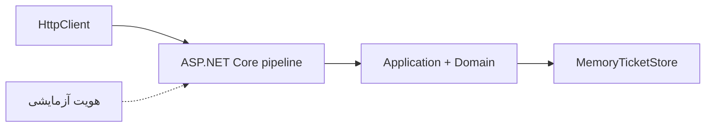

# درس 073 — integration و WebApplicationFactory

## خروجی قابل مشاهده

در `integration test` چند جزء را کنار هم اجرا می‌کنیم تا ارتباطشان هم آزموده شود. اینجا از `HttpClient` به test host درخواست می‌فرستی و مسیر routing، binding، DI، authorization و use case تا پاسخ طی می‌شود؛ تست فقط یک متد جداگانه را صدا نمی‌زند.
تست هشت درخواست resolve، دقیقاً یک موفقیت و هفت conflict می‌گیرد و تیکت بسته‌شده را دوباره می‌خواند.
پیش‌نیاز: [درس ۷۲](../072-test-design/README.md)، HTTP و تست‌های مالکیت بخش امنیت.

## چه چیزی زیر تست است؟

مسیر samples/72-http-testing یک API کوچک تست‌پذیر است؛ Domain و Application از HTTP جدا هستند و endpoint فقط DTO و status را نگاشت می‌کند.
MemoryTicketStore یک adapter کاری با lock و version است؛ PostgreSQL را جعل نمی‌کند و durability ندارد.
Microsoft.AspNetCore.Mvc.Testing نسخهٔ 10.0.13 در پروژهٔ tests/073-http-testing ثبت شده و WebApplicationFactory<Program> را فراهم می‌کند.
اعلان `public partial class Program` همان type نقطهٔ ورود برنامه را از پروژهٔ تست قابل استفاده می‌کند؛ در نتیجه `WebApplicationFactory<Program>` می‌داند کدام app را راه بیندازد. واژهٔ partial یعنی بخش‌های تعریف همان type می‌توانند جدا باشند، نه اینکه یک برنامهٔ دوم برای تست بسازیم.

| فایل | مسئولیت |
| --- | --- |
| Application/Tickets.cs | نتیجهٔ کاربردی و کنترل مالکیت و state و port |
| Endpoints/TicketEndpoints.cs | نگاشت DTO و 201/400/404/409 |
| Infrastructure/MemoryTicketStore.cs | state خصوصی هر host و commit مبتنی بر version |
| tests/073-http-testing/TestIdentity.cs | فقط هویت تست و factory |
| tests/073-http-testing/HttpTests.cs | درخواست و assert روی پاسخ و state |

این integration روی TestServer درون process اجرا می‌شود؛ TCP/TLS یا reverse proxy واقعی را آزمایش نمی‌کند.
یک probe مستقل runner نیز خروجی publish را روی Kestrel اجرا می‌کند و بسته بودن ورود عادی را می‌سنجد.

## اجرای نمونه و تست

```powershell
dotnet build samples/72-http-testing/SupportDesk.csproj
dotnet test tests/073-http-testing/SupportDesk.Tests.csproj
python scripts/testing_smoke.py
```

اجرای عادی app، /health عمومی و API خصوصیِ بسته دارد. provider ورود واقعی در این lab اضافه نشده است.
این تصمیم اجازه نمی‌دهد هویت تست به میان‌بر محیط واقعی تبدیل شود؛ برای authentication واقعی به نمونه‌های بخش ششم رجوع کن.

## یک نگاه: داخل تست چه چیزهایی واقعی‌اند؟

در TestServer، pipeline و endpoint و use case اجرا می‌شوند؛ در این درس store حافظه‌ای است و هویت فقط داخل test assembly جایگزین می‌شود. اتصال TCP و TLS این مسیر نیستند.



**مکث کوتاه:** آیا موفقیت این تست ثابت می‌کند login و گواهی HTTPS محصول درست‌اند؟

<details>
<summary>پاسخ را ببین</summary>
<p>نه؛ این suite آن‌ها را اجرا نمی‌کند. ورود و TLS به شاهد جدا نیاز دارند؛ host عادی نیز باید header هویت تست را رد کند.</p>
</details>

## هویت ساختگی را کجا قرار می‌دهیم؟

کلاس TestIdentity فقط در assembly تست compile می‌شود و فقط داخل TicketFactory در ConfigureTestServices ثبت می‌شود.
header با نام X-Test-Actor، در test host مقدار alice یا bob را به principal تبدیل می‌کند؛ این یک credential امن نیست.
خود app، ClosedGate دارد و همین header را در هر environment رد می‌کند؛ flag یا مسیر public برای فعال کردن bypass وجود ندارد.
اسکریپت، همان header را به host منتشرشدهٔ Production می‌فرستد و 401 می‌خواهد؛ همچنین نبود test DLL و runner در publish را بررسی می‌کند.
این تست authorization را با actor معلوم می‌سنجد؛ صدور cookie، رمز، token و Identity را تأیید نمی‌کند.

## جایگزینی وابستگی در DI

در `ConfigureTestServices` می‌توانیم پس از registrationهای app، dependency را برای همان test host عوض کنیم. برای تعویض store ابتدا registrationهای `ITicketStore` را با `RemoveAll` کنار می‌گذاریم و سپس adapter موردنظر را ثبت می‌کنیم. فقط افزودن یک registration دیگر بدون بررسی انتخاب DI ممکن است تست را به store ناخواسته وصل کند.
TicketFactory برای هر تست host و store تازه دارد. دو factory جدا نباید دادهٔ حافظهٔ هم را ببینند.
content root با attribute تولیدشده از مسیر MSBuild پروژه تنظیم شده است؛ اجرای تست به working directory اتفاقی یا یک solution خاص وابسته نیست.

## قرارداد مسیرها

| درخواست | انتظار اصلی |
| --- | --- |
| ناشناس به API خصوصی | 401 |
| POST /api/tickets با title معتبر | 201 و Location قابل GET |
| JSON خراب یا ownerId اضافی | 400 |
| GET و Start منبع alice توسط bob | 404 و حفظ Open |
| Resolve تیکت Open | 409 |
| Start سپس Resolve معتبر | 200 و Closed |
| Resolve نامعتبر در InProgress | 400 و حفظ state |
| ذخیره‌سازی با IOException کنترل‌شده | 500 عمومی و بدون diagnostic خصوصی در body |

گزینهٔ RouteHandlerOptions.ThrowOnBadRequest صریح false است تا binding خراب در test environment هم 400 بماند.
DTOهای write اعضای ناشناخته را Disallow می‌کنند؛ به entity ذخیره‌سازی bind نمی‌کنیم.
Create با Location همان منبعی را معرفی می‌کند که GET آن را برمی‌گرداند، نه یک مسیر نمایشیِ تست‌نشده.

## تست race در HTTP

از یک تیکت InProgress هشت resolve هم‌زمان ارسال می‌شوند.
حتی اگر بعضی درخواست‌ها پس از commit اول Load شوند، نتیجهٔ نهایی باید یک موفقیت و هفت 409 باشد.
پس از درخواست‌ها GET می‌زنیم و state نهایی را هم می‌سنجیم؛ فقط شمارش status کافی نیست.
این آزمون، رفتار یک process و store حافظه را می‌سنجد؛ کنترل رقابت SQL در درس بعد تست جدا دارد.
برای race به sleep و ترتیب تصادفی اجرای تست‌ها تکیه نمی‌کنیم.

## خطا و محدودیت شواهد

کلاس FailingFactory یک adapter خطادار در test assembly ثبت می‌کند تا pipeline خطای عمومی اجرا شود.
تست ثابت می‌کند body خطا متن خصوصی و نوع exception را نشان نمی‌دهد؛ policy logهای محصول را با این تست تأیید نکرده‌ایم.
برنامهٔ سادهٔ این بخش جای host نهایی و امکانات کامل امنیتی قبلی نیست؛ فقط مرزهای تست و HTTP را جدا نشان می‌دهد.
CORS، CSRF واقعی cookie، مرورگر و PostgreSQL در این suite پوشش داده نشده‌اند.

## تمرین مستقل

یک endpoint note با DTO محدود اضافه کن و از HTTP نشان بده actor دیگر نمی‌تواند به تیکت alice note اضافه کند.
با جایگزین کردن port، conflict ناشی از stale version را بدون وابستگی به زمان شبیه‌سازی کن.
یک assertion برای Content-Type و یک مورد 404 برای شناسهٔ واقعاً غایب بنویس؛ با رفتار مالکیت مقایسه کن.

### سرنخ

مرحلهٔ Arrange از API عمومی یا adapter کنترل‌شده استفاده کند؛ برای گرفتن موفقیت، شرط authorize را از app حذف نکن.

## معیار عبور

- مسیر واقعی HTTP داخل TestServer و DI اجرا شود.
- Location، body و state نهایی بررسی شوند.
- fake authentication فقط در test assembly باشد و host عادی آن را رد کند.
- factoryها state حافظهٔ مشترک نداشته باشند.
- مرز TestServer و شبکهٔ واقعی و authentication واقعی را توضیح بدهی.

## منابع رسمی

- [ASP.NET Core integration tests](https://learn.microsoft.com/en-us/aspnet/core/test/integration-tests?view=aspnetcore-10.0)
- [Test Minimal APIs](https://learn.microsoft.com/en-us/aspnet/core/fundamentals/minimal-apis/test-min-api?view=aspnetcore-10.0)

[قبلی](../072-test-design/README.md) · [فهرست بخش](../README.md) · [بعدی](../074-database-tests/README.md)
