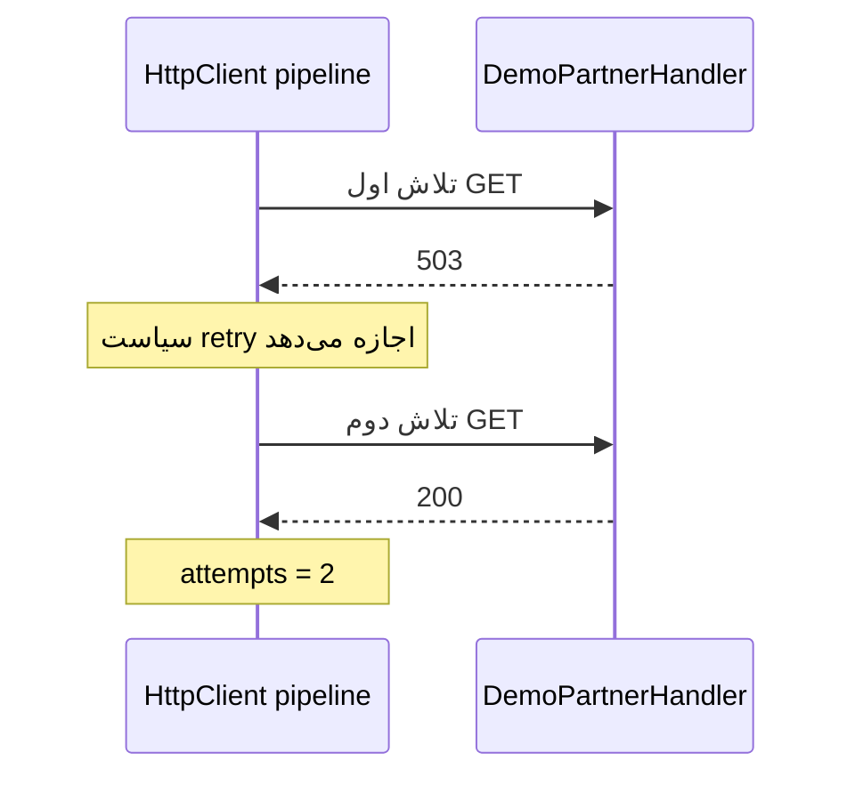

# درس ۰۷۵ — وقتی سرویس مقابل جواب نمی‌دهد

فرض کن worker باید وضعیت سرویس همکار را با `GET /health` بپرسد. پاسخ اول 503 است و پاسخ بعدی 200.
می‌خواهیم یک خطای موقت کار را متوقف نکند؛ اما درخواست هم تا بی‌نهایت منتظر نماند.
در پایان این درس، تعداد تلاش‌ها و دلیل توقف را با تست نشان می‌دهی.

پیش‌نیاز: async و CancellationToken، DI و تست‌های درس‌های ۷۱ تا ۷۴.
از ریشهٔ مخزن با SDK 10 اجرا کن؛ Docker یا سرویس اینترنتی لازم نیست. restore اولیه NuGet اینترنت می‌خواهد.

## ۱. اول نتیجه را ببین

```powershell
dotnet run --project samples/74-http-resilience/SupportDesk.csproj
dotnet test tests/075-http-resilience/SupportDesk.Tests.csproj
```

خروجی برنامه:

```text
status=200; attempts=2
```

کلاس `DemoPartnerHandler` نقش `transport` آزمایشی را دارد؛ یعنی آخرین بخشی که درخواست HttpClient را می‌گیرد و پاسخ برمی‌گرداند. اینجا به‌جای ارسال روی شبکه، خودش بار اول ۵۰۳ و بار دوم ۲۰۰ می‌دهد.
نام `partner.invalid` عمداً آدرس واقعی نیست. در Program این transport ساختگی صریحاً ثبت شده است؛ برنامه به اینترنت درخواست نمی‌فرستد.
این، تست رفتار client و pipeline است؛ DNS و TLS و اتصال واقعی را اثبات نمی‌کند.

## ۲. هر فایل چه مسئولیتی دارد؟

| محل | کاری که انجام می‌دهد |
| --- | --- |
| `PartnerRegistration` در `PartnerClient.cs` | ثبت client با نام partner و سیاست زمان و تکرار |
| `PartnerClient.CheckAsync` | ساخت GET ثابت و بازگرداندن status code |
| `DemoPartnerHandler` | پاسخ‌های قابل پیش‌بینی برای اجرا |
| `PartnerTests.cs` در test project | بررسی پاسخ، شمار تلاش‌ها، لغو و timeout |

ابزار `IHttpClientFactory` ساخت client و عمر handlerهای قابل استفادهٔ مجدد را مدیریت می‌کند.
نام `partner` باعث می‌شود فقط تنظیمات همین وابستگی را بگیریم. client کوتاه‌عمر را dispose می‌کنیم؛ factory مدیریت handler مشترک را بر عهده دارد.
در یک singleton، client ساخته‌شده را برای همیشه نگه ندار؛ factory را بگیر و برای هر عملیات client بساز.

## یک نگاه: یک بار درخواست؛ دو تلاش

کلاس PartnerClient یک درخواست به HttpClient می‌دهد و pipeline سیاست retry را اجرا می‌کند. transport ساختگی ابتدا 503 و بعد 200 می‌دهد؛ تصویر دو ورود به handler را نشان می‌دهد، نه تماس اینترنتی واقعی یا حلقهٔ دستی در PartnerClient.



**مکث کوتاه:** MaxRetryAttempts برابر ۲ یعنی مجموعاً فقط دو تلاش داریم؟

<details>
<summary>پاسخ را ببین</summary>
<p>نه؛ دو retry بعد از تلاش اول است، پس حداکثر سه تلاش. در توالی تصویر، موفقیتِ تلاش دوم باعث می‌شود تلاش سوم لازم نباشد.</p>
</details>

## ۳. یک درخواست، چند تلاش؟

این جدول قرارداد **همین نمونه** است:

| اتفاق | رفتار |
| --- | --- |
| 503 سپس 200 در GET | دو تلاش و خروجی 200 |
| 400 یا 404 در GET | همان پاسخ، فقط یک تلاش |
| 503 دائمی در GET | حداکثر سه تلاش و خروجی نهایی 503 |
| 503 در POST یا DELETE | یک تلاش؛ تکرار غیرفعال است |
| لغو توسط caller | انتقال cancellation و توقف بدون retry آن لغو |
| گیر کردن transport | timeout هر تلاش؛ پس از پایان فرصت، exception |

تنظیم `MaxRetryAttempts = 2` یعنی **دو تلاش مجدد بعد از تلاش اول**؛ جمعاً حداکثر سه.
با `retry` فقط یک تلاش دیگر می‌کنیم؛ موفقیت تضمین نمی‌شود. اگر پاسخ هر سه تلاش ۵۰۳ باشد، `CheckAsync` همان status نهایی را می‌دهد. در این متد `EnsureSuccessStatusCode` فراخوانی نشده است، پس خودِ دریافت status ناموفق به معنی exception این متد نیست.

قسمت مهمِ فایل موجود:

```csharp
options.Retry.MaxRetryAttempts = 2;
options.Retry.DisableForUnsafeHttpMethods();
```

عملیات POST ممکن است در سرویس مقابل انجام شده باشد ولی پاسخ آن گم شده باشد؛ ارسال دوباره می‌تواند اثر را تکرار کند.
حتی PUT و DELETE را در این آزمایش محافظه‌کارانه تکرار نمی‌کنیم.
برای نوشتن واقعی باید قرارداد idempotency و رفتار سرویس مقابل را جدا طراحی کنی.

## ۴. سه دلیل متفاوت برای قطع انتظار

| ابزار | چه چیزی را محدود می‌کند؟ | مقدار نمونه |
| --- | --- | --- |
| `AttemptTimeout` | یک بار تماس با transport | یک ثانیه |
| `TotalRequestTimeout` | مجموعهٔ تلاش‌ها و انتظار pipeline | پنج ثانیه |
| token ورودی | تمایل caller به ادامهٔ کار | از بیرون می‌آید |

تنظیم `HttpClient.Timeout` را Infinite گذاشته‌ایم تا دو زمان‌سنج مستقل برای همین تماس رقابت نکنند.
این به معنی انتظار نامحدود نیست؛ pipeline زمان را محدود می‌کند. لغو همچنان نیازمند همکاری handler است.
اگر محدودیت pipeline تمام شود `TimeoutRejectedException` از Polly می‌گیری؛ لغو caller از خانوادهٔ `OperationCanceledException` است.

کد از `ResponseHeadersRead` استفاده می‌کند و فقط status را می‌خواند. timeout این مثال برای رسیدن به header است؛ body اصلاً مصرف نمی‌شود.
اگر بعداً body بخوانی، باید اندازه و زمان خواندن آن را جدا محدود کنی و token را به آن هم بدهی.

## ۵. تست چگونه قابل اعتماد می‌ماند؟

تست `Caller_cancellation_reaches_the_transport_and_does_not_retry` با یک signal منتظر ورود handler می‌ماند، سپس token را لغو می‌کند؛ از Sleep برای حدس زدن زمان شروع استفاده نمی‌کند.
تست hanging transport، تأخیر بی‌نهایتِ قابل لغو می‌سازد و انتظار exception واقعی pipeline دارد. این تست چند ثانیه زمان می‌برد؛ زمان دقیق میلی‌ثانیه را assert نمی‌کند.
`WaitAsync(15s)` فقط محافظ گیر کردن خود تست است؛ سیاست برنامه پنج ثانیه است.

## ۶. بخش پیشرفته را فعلاً بشناس

پیکربندی Standard handler علاوه بر retry و timeout، محدودیت concurrency و circuit breaker دارد.
سازوکار `circuit breaker` پس از رسیدن شکست‌ها به شرط سیاست، برای مدتی جلوی تلاش تازه را می‌گیرد. تفاوتش با retry این است که retry همان عملیات را دوباره امتحان می‌کند، اما breakerِ باز می‌تواند پیش از رسیدن به transport آن را رد کند.
تست‌های این درس باز شدن breaker یا نرخ واقعی شبکه را نمی‌سنجند.

در نمونه برای دیدن سریع نتیجه، فاصلهٔ retry صفر و jitter خاموش است. برای سرویس واقعی، backoff و jitter و بودجهٔ متناسب لازم است؛ این تنظیم آزمایشگاهی را مستقیم منتقل نکن.
حداکثر تعداد retry به‌تنهایی بودجهٔ کل زمان را مشخص نمی‌کند، به‌خصوص اگر پاسخ `Retry-After` داشته باشد.

## تمرین کوچک

1. در DemoPartnerHandler پاسخ اول را 404 کن. قبل از اجرا حدس بزن attempts چند می‌شود، سپس خروجی را ثبت کن.
2. پاسخ را همیشه 503 کن. توضیح بده چرا سه تلاش خروجی موفق نمی‌دهد.
3. تغییرها را برگردان و تست‌ها را اجرا کن.
4. یک تست برای POST با transport گیرکرده اضافه کن؛ نشان بده پس از timeout فقط یک بار وارد transport شده است.

معیار عبور: تفاوت caller cancellation، timeout و پاسخ 503 را توضیح بدهی؛ همچنین بگویی کدام بخش شبکه هنوز آزمایش نشده است.

## منابع رسمی

- [IHttpClientFactory](https://learn.microsoft.com/en-us/dotnet/core/extensions/httpclient-factory)
- [HTTP resilience و روش‌های unsafe](https://learn.microsoft.com/en-us/dotnet/core/resilience/http-resilience)
- [نسخهٔ مرجع Microsoft.Extensions.Http.Resilience 10.11.0](https://www.nuget.org/packages/Microsoft.Extensions.Http.Resilience/10.11.0)

[قبلی](../074-database-tests/README.md) · [بعدی](../076-background-work/README.md) · [فهرست بخش](../README.md)
