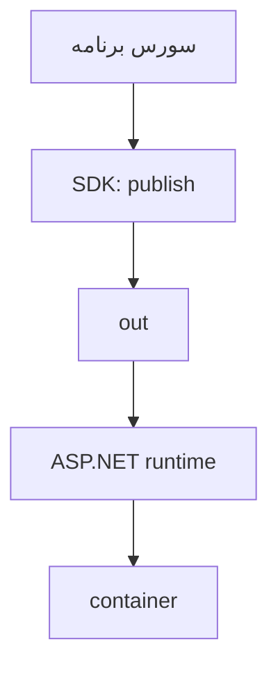

# درس ۰۷۹ — برنامه را داخل کانتینر اجرا کن

تا اینجا با dotnet run برنامه را اجرا می‌کردیم. حالا می‌خواهیم یک بسته بسازیم که runtime و فایل‌های برنامه را با هم داشته باشد و بتوان آن را روی ماشین دیگری با Docker اجرا کرد.
هدف اول فقط دیدن یک پاسخ HTTP است؛ هنوز دیتابیس و سرویس‌های دیگر را وارد نمی‌کنیم.

## ۱. پیش‌نیاز و اجرای معمولی

ابزار SDK 10، Python 3 و برای قسمت کانتینر، Docker Desktop با Linux containers یا Docker Engine لازم است.
در Windows نصب Docker Desktop ممکن است فعال بودن WSL 2 و مجازی‌سازی را بخواهد؛ [راهنمای رسمی نصب](https://docs.docker.com/desktop/setup/install/windows-install/) را دنبال کن.
اول مطمئن شو برنامهٔ کوچک خودش سالم است:

```powershell
dotnet run --project samples/78-container-lab/SupportDesk.csproj --urls http://127.0.0.1:5080
```

در ترمینال دوم:

```powershell
curl.exe http://127.0.0.1:5080/
curl.exe http://127.0.0.1:5080/health/live
```

پاسخ اول از نظر داده برابر زیر است؛ پاسخ دوم Healthy است:

```json
{"service":"container-lab","version":"1.0.0"}
```

در Linux به‌جای curl.exe از curl استفاده کن. با Ctrl+C برنامه را متوقف کن.
این نمونه عمداً هیچ حساب، secret یا دادهٔ کاربر ندارد؛ تمرین استقرار یک برنامهٔ کوچک است، نه نسخهٔ کامل TeamDesk.

## ۲. سه واژه، سه چیز متفاوت

| واژه | معنی در این تمرین |
| --- | --- |
| Dockerfile | دستور ساخت بسته |
| image | نتیجهٔ ساخته‌شده، شامل فایل‌های برنامه و runtime |
| container | یک اجرای مشخص از همان image |

می‌توانی از یک image چند container بسازی. تغییر فایل داخل یک container، image اصلی را عوض نمی‌کند.
برای تغییر برنامه، کد را تغییر بده و image تازه بساز.

## ۳. ساخت و اجرا

از ریشهٔ مخزن:

```powershell
docker info --format '{{.OSType}}'
docker build -t supportdesk-79:lab samples/78-container-lab
docker run --rm --name course79 -p 127.0.0.1:8080:8080 supportdesk-79:lab
```

خروجی فرمان اول باید linux باشد. در ترمینال دوم `http://127.0.0.1:8080/` را باز کن؛ همان JSON مرحلهٔ اول را می‌بینی.
بعد از Ctrl+C، گزینهٔ --rm همان container را حذف می‌کند؛ image برای اجرای بعدی می‌ماند.
اگر 8080 اشغال بود، سمت چپ را 8081 بگذار و مرورگر را به 8081 ببر.

| بخش نگاشت پورت | معنی |
| --- | --- |
| 127.0.0.1 | دسترسی از همین ماشین |
| 8080 اول | پورت روی ماشین تو |
| 8080 دوم | پورت برنامه در container |

دستور EXPOSE در Dockerfile فقط پورت مورد انتظار را بیان می‌کند؛ جای -p نیست.

## یک نگاه: یک مرحله برای ساخت، یک مرحله برای اجرا

در Dockerfile چندمرحله‌ای، خروجی publish به image نهایی می‌رود. SDK برای ساخت استفاده می‌شود؛ اجرای framework-dependent هنوز runtime لازم دارد.



**مکث کوتاه:** اگر فایل داخل یک container را تغییر بدهی، image اصلی هم عوض می‌شود؟

<details>
<summary>پاسخ را ببین</summary>
<p>نه؛ آن تغییر داخل همان اجراست. برای نسخهٔ تازهٔ برنامه، سورس و image تازه می‌سازی؛ حذف container نیز دادهٔ لایهٔ نوشتنی آن را از بین می‌برد.</p>
</details>

## ۴. Dockerfile را از بالا بخوان

فایل [Dockerfile نمونه](../../../samples/78-container-lab/Dockerfile) دو مرحله دارد:

| مرحله | image پایه | چه کاری می‌کند؟ |
| --- | --- | --- |
| build | SDK 10.0.402 | restore و publish در Release |
| final | ASP.NET runtime 10.0.13 | فقط فایل‌های /out را اجرا می‌کند |

مرحلهٔ final ابزار build را کپی نمی‌کند. UseAppHost=false یعنی برنامه با `dotnet SupportDesk.Lesson79.dll` اجرا می‌شود؛ runtime همچنان لازم است.
شمارهٔ SDK با شمارهٔ runtime برابر نیست. این نسخه‌ها برای نمونه pin شده‌اند؛ image tag همچنان ممکن است بازسازی شود و مثل digest ثابت نیست.

ساخت image به مرحله‌ها و لایه‌ها تقسیم می‌شود. ابتدا csproj کپی و dependencyها restore می‌شوند و بعد source کپی می‌شود. اگر فقط source عوض شده باشد، Docker می‌تواند نتیجهٔ لایهٔ restore را از `build cache` دوباره استفاده کند؛ لازم نیست صرف هر تغییر کد، دریافت dependencyها از ابتدا تکرار شود.
آرگومان انتهای فرمان build، پوشهٔ نمونه را مشخص می‌کند. این مجموعهٔ فایل‌های در اختیار عملیات ساخت، `build context` نام دارد. مسیرهای `COPY` از همین محدوده انتخاب می‌شوند؛ برای کپی فایل بیرون آن نباید انتظار دسترسی دلخواه به همهٔ فایل‌های دستگاه داشته باشی.

فایل .dockerignore فایل‌های bin و obj و کلید و فایل env را از context کنار می‌گذارد.
secret را با COPY یا ARG داخل image نگذار؛ پاک کردن آن در لایهٔ بعدی، لایهٔ قبلی را پاک نمی‌کند.

## ۵. کاربر و فایل‌سیستم

دستور `USER $APP_UID` کاربر غیر root موجود در image رسمی .NET را انتخاب می‌کند.
پورت 8080 نیاز به پورت privileged ندارد.
کانتینر، ماشین مجازی کامل یا تضمین امنیت مطلق نیست؛ دسترسی‌های process و host همچنان اهمیت دارند.
دادهٔ مهم را داخل لایهٔ نوشتنی container نگه ندار؛ حذف container آن داده را از بین می‌برد. volume و دیتابیس پایدار را در درس‌های بعد بررسی می‌کنیم.

## ۶. بررسی واقعی

```powershell
python scripts/production_smoke.py
python scripts/production_docker_smoke.py
```

فرمان اول بدون Docker کار می‌کند و build/publish و تست‌های این مجموعه را اجرا می‌کند.
فرمان دوم Docker واقعی می‌خواهد و نبود آن را شکست می‌داند؛ build، HTTP واقعی، UID غیر root، نبود SDK و توقف با SIGTERM را بررسی می‌کند.
همچنین فایل‌سیستم اصلی container را `read-only` اجرا می‌کند؛ برنامه برای فایل موقت فقط فضای محدودِ حافظه‌ای `tmpfs` در `/tmp` دارد. این بررسی نشان می‌دهد مسیر آزمایشی برای پاسخ HTTP به نوشتن آزاد روی فایل‌سیستم container وابسته نیست.
این اسکریپت فقط resourceهای خودش با نام تصادفی را پاک می‌کند؛ docker system prune اجرا نمی‌کند.

## تمرین و معیار عبور

1. پورت میزبان را تغییر بده، بدون تغییر کد برنامه دوباره پاسخ بگیر.
2. مقدار version را تغییر بده؛ نشان بده image قبلی همچنان پاسخ قبلی دارد و image تازه پاسخ تازه.
3. توضیح بده چرا dotnet build موفق، به‌تنهایی اجرای درست داخل container را اثبات نمی‌کند.
4. اگر Docker daemon وصل نشد، اول docker info را بررسی کن؛ خطای موتور را با خطای C# اشتباه نگیر.

برای عبور، پاسخ HTTP داخل container و نتیجهٔ UID و توقف تمیز را ثبت کن.

## منابع رسمی

- [Containerize a .NET app](https://learn.microsoft.com/en-us/dotnet/core/docker/build-container)
- [ASP.NET Core images](https://learn.microsoft.com/en-us/aspnet/core/host-and-deploy/docker/building-net-docker-images?view=aspnetcore-10.0)
- [کاربر app در image رسمی](https://learn.microsoft.com/en-us/dotnet/core/compatibility/containers/8.0/app-user)
- [Docker build context](https://docs.docker.com/build/concepts/context/)

[قبلی](../../07-testing/078-debugging/README.md) · [بعدی](../080-deployment/README.md) · [فهرست بخش](../README.md)
