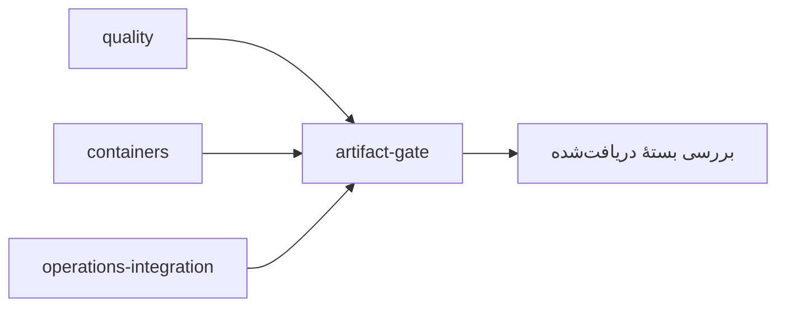

# درس ۰۸۱ — همان بسته‌ای را بررسی کن که قرار است تحویل بدهی

«روی کامپیوتر من اجرا شد» کافی نیست. CI یا Continuous Integration تغییرهای مخزن را در یک محیط خودکار بررسی می‌کند. runner ماشینی است که دستورهای این بررسی را اجرا می‌کند و job یک گروه از این دستورهاست. در این درس می‌خواهیم تست‌ها روی runner تمیز اجرا شوند، بستهٔ Release ساخته شود و job بعدی **همان فایل‌ها** را بدون build دوباره بررسی کند.
در این درس خط لولهٔ واقعی مخزن را می‌خوانیم؛ فقط یک YAML نمایشی نمی‌نویسیم.

مفهوم artifact خروجی ذخیره‌شدهٔ یک job است؛ در این نمونه، پوشه‌ای شامل فایل‌های منتشرشدهٔ برنامه و یک manifest. manifest فهرست فایل‌ها و اطلاعات لازم برای بررسی آن‌هاست. با منتقل کردن همین پوشه به job بعدی، می‌توانیم بررسی کنیم بستهٔ تحویلی واقعاً همان بستهٔ ساخته‌شده است.

## ۱. نمونهٔ نسخهٔ ساخته‌شده

از ریشهٔ مخزن:

```powershell
dotnet run --project samples/80-release-artifact/SupportDesk.csproj --urls http://127.0.0.1:5081
```

در ترمینال دوم، `http://127.0.0.1:5081/version` را بخوان:

```json
{"service":"release-lab","version":"1.0.0","commit":"local"}
```

مقدار local یعنی برای این اجرای دستی commit تزریق نکرده‌ایم. در CI، CourseCommit هنگام publish برابر GITHUB_SHA همان اجرا می‌شود.
این metadata به‌تنهایی امضای دیجیتال یا اثبات اعتماد نیست؛ برای تشخیص اینکه چه نسخه‌ای بالا آمده مفید است.
برنامه را با Ctrl+C تمام کن.

## ۲. مسیر خط لوله

فایل [production-labs.yml](../../../.github/workflows/production-labs.yml) این jobها را دارد:

| job | کاری که انجام می‌دهد | شرط شروع |
| --- | --- | --- |
| quality روی Linux و Windows | لینک‌ها، xUnit، publish و HTTP و بررسی منفی artifact | شروع workflow |
| containers روی Linux | Docker build و اجرای non-root و TLS واقعی | شروع workflow |
| operations-integration | Redis و صف پایدار و restore/rollback درس‌های ۸۳ تا ۸۶ | شروع workflow |
| artifact-gate | دریافت artifact لینوکس، بررسی hash و commit، اجرای DLL بدون build | موفقیت quality و containers و operations-integration |

با `needs` مشخص می‌کنیم اجرای یک job به موفقیت کدام jobهای دیگر وابسته است. اگر تست یا TLS شکست بخورد، artifact-gate اجرا نمی‌شود.
workflow قدیمی Check course هم بخش‌های قبلی را بررسی می‌کند؛ موفقیت این workflow جای موفقیت آن را نمی‌گیرد.
در PR، GITHUB_SHA معمولاً commit آزمایشیِ merge است؛ آن را با SHA شاخهٔ head اشتباه نگیر.

## یک نگاه: سه بررسی، یک دروازهٔ تحویل

مرحلهٔ تحویل artifact-gate بعد از موفقیت هر سه job شروع می‌شود و همان artifact لینوکسِ quality را دریافت می‌کند. فلش‌ها وابستگی job هستند؛ این workflow روی سرور عمومی deploy نمی‌کند.



**مکث کوتاه:** اگر در gate دوباره از سورس publish کنیم، هنوز همان بستهٔ دریافت‌شده را تأیید کرده‌ایم؟

<details>
<summary>پاسخ را ببین</summary>
<p>نه؛ بستهٔ تازه ساخته‌ایم. هدف این gate بررسی همان فایل‌های منتقل‌شده با provenance و hash مورد انتظار است.</p>
</details>

## ۳. quality gate یعنی چه؟

اسکریپت production_smoke خروجی واقعی TRX را بررسی می‌کند: تست کشف‌شده باید اجرا و pass شده باشد؛ skip را موفقیت حساب نمی‌کند.
بعد چهار sample این مجموعه را در Release publish می‌کند. build شدن test project را با اجرای تست اشتباه نمی‌گیرد.
بستهٔ درس ۸۱ شامل فایل‌های publish و manifest.json است.

| محتوای manifest | کاربرد |
| --- | --- |
| schema | نسخهٔ شکل manifest |
| commit | commit مورد انتظار pipeline |
| files | نام نسبی هر فایل و SHA-256 آن |

الگوریتم SHA-256 از محتوای هر فایل یک مقدار hash می‌سازد. تغییر محتوای فایل باید hash آن را هم تغییر دهد؛ gate مقدار محاسبه‌شده را با مقدار ثبت‌شده در manifest مقایسه می‌کند. اسکریپت برای آزمایش این کنترل، DLL را در یک کپی موقت تغییر می‌دهد و باید خطای `checksum mismatch` بگیرد؛ commit اشتباه را هم رد می‌کند.
فایل اصلی دست‌نخورده می‌ماند. خطای عمدی در این کپی، بخشی از آزمایش gate است، نه شکستِ پنهان‌شدهٔ تست اصلی.

## ۴. دریافت و اجرای همان artifact

اکشن `upload-artifact` با نام شامل `github.sha` فایل‌ها را ذخیره می‌کند. download-artifact همان نام را در job بعد می‌گیرد.
release_gate.py موارد زیر را بررسی می‌کند:

1. commit دقیقاً برابر مقدار مورد انتظار باشد.
2. فایل اضافه، فایل گمشده، symlink یا مسیر بیرون بسته پذیرفته نشود.
3. hash هر فایل برابر manifest باشد.
4. DLL بدون rebuild اجرا شود و /version همان commit و /health/live پاسخ Healthy بدهد.

اگر بین دو job دوباره publish کنیم، دیگر تحویل گرفتن همان artifact را اثبات نکرده‌ایم.
این نمونه framework-dependent است: runtime همراه بسته منتشر نمی‌شود و باید از قبل روی runner مقصد نصب باشد. اینجا runtime .NET 10 لازم است. بسته apphost، یعنی فایل اجرایی بومیِ راه‌انداز برنامه، هم ندارد؛ gate برنامه را با `dotnet` و مسیر DLL اجرا می‌کند.

## ۵. همان gate را محلی اجرا کن

ابزار Python 3 و SDK 10 لازم‌اند. یک مسیر **جدید و ناموجود** انتخاب کن؛ اسکریپت بستهٔ موجود را overwrite نمی‌کند.

```powershell
python scripts/production_smoke.py --artifact-dir artifacts/lesson81-local
python scripts/release_gate.py artifacts/lesson81-local local
```

خروجی نهایی gate باید PASS باشد و صریحاً بگوید rebuild یا deploy خارجی انجام نشده است.
برای آزمایش منفی، ابتدا پوشه را با نام دیگری کپی کن، یک فایل آن کپی را تغییر بده و gate را روی کپی اجرا کن؛ باید قبل از اجرا شدن DLL شکست بخورد.
فایل manifest را برای «سبز کردن نتیجه» دوباره تولید نکن.

## ۶. CI با CD چه تفاوتی دارد؟

فرایند CI یعنی تغییرها روی محیط تمیز build و test و با هم بررسی شوند.
Continuous delivery بستهٔ تأییدشده را برای انتشار آماده می‌کند؛ continuous deployment می‌تواند انتشار در مقصد را هم خودکار کند.
artifact-gate این درس یک مرحلهٔ محلی از آمادگی تحویل است؛ به سرور یا حساب کاربری تو deploy نمی‌کند و نام job هم همین مرز را می‌گوید.

برای انتشار واقعی هنوز مقصد، health پس از استقرار، rollback، credential محدود و سیاست مجوز محیط لازم است.
hash کنار فایل، امضا نیست؛ اگر مهاجم بتواند فایل و manifest را با هم عوض کند، hash به‌تنهایی جلوی او را نمی‌گیرد. این gate به artifact همان workflow اعتماد دارد.
در توسعهٔ تیمی، branch protection و required checks را متناسب با مخزن تنظیم کن؛ ساخت YAML به‌تنهایی این تنظیمات را فعال نمی‌کند.

## تمرین

1. در یک کپی، health را خراب کن و ببین probe بستهٔ منتشرشده شکست می‌خورد.
2. یک فایل اضافه به کپی artifact بگذار؛ gate باید آن را رد کند.
3. در Actions یک اجرای ناموفق را بخوان و بگو مشکل restore بوده، test بوده یا اجرای artifact.
4. بنویس برای CD روی سرور واقعی چه ورودی‌هایی هنوز مشخص نشده‌اند.

معیار عبور: بتوانی مسیر یک commit را تا artifact و پاسخ /version دنبال کنی و ثابت کنی gate همان DLL دانلودشده را اجرا می‌کند.

## منابع رسمی

- [Workflow artifacts](https://docs.github.com/en/actions/tutorials/store-and-share-data)
- [Job dependencies](https://docs.github.com/en/actions/using-jobs/using-jobs-in-a-workflow)
- [dotnet publish](https://learn.microsoft.com/en-us/dotnet/core/tools/dotnet-publish)

[قبلی](../080-deployment/README.md) · [بعدی](../082-observability/README.md) · [فهرست بخش](../README.md)
