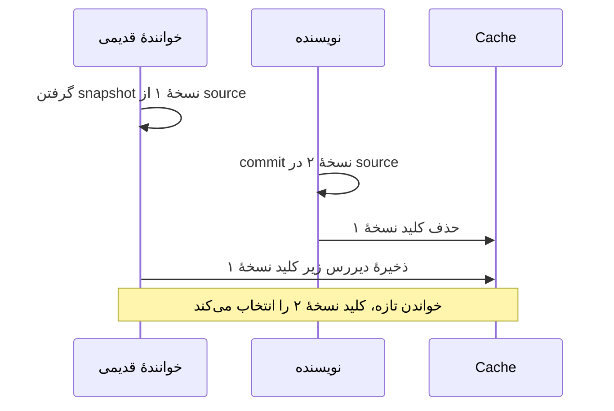

# درس ۰۸۳: کش، نگه‌داری موقت نتیجه و تشخیص نسخهٔ قدیمی

فرض کن نمایش خلاصهٔ یک درخواست به محاسبه‌ای پرهزینه نیاز دارد. اگر درخواست تغییر نکرده باشد، می‌توان نتیجهٔ محاسبهٔ قبلی را دوباره استفاده کرد. به محل نگه‌داری موقت این نتیجه، «کش» یا `cache` می‌گوییم.

دشواری از جایی شروع می‌شود که عنوان درخواست تغییر کند: نتیجهٔ قبلی هنوز در کش هست، اما دیگر با عنوان تازه مطابقت ندارد. در این درس، ابتدا کش داخل حافظه را اجرا می‌کنی و می‌بینی چطور شمارهٔ نسخه از استفادهٔ اشتباه از نتیجهٔ قبلی جلوگیری می‌کند. سپس همین رفتار را با Redis، که کش را در سرویسی جدا نگه می‌دارد، آزمایش می‌کنی.

پیش‌نیاز، [درس ۸۲](../082-observability/README.md) و آشنایی با متدهای ناهمگام و تست است. مسئلهٔ اصلی را در بخش‌های ۱ تا ۳ دنبال کن؛ بخش‌های بعد دربارهٔ زمان انقضا، اجرای Redis و رسیدگی به خطا هستند.

## ۱. اجرا و خروجی

از ریشهٔ مخزن با SDK ۱۰:

```powershell
dotnet run --project samples/82-versioned-cache/SupportDesk.csproj
dotnet test tests/083-cache/SupportDesk.Tests.csproj --filter 'Category!=Docker'
```

اگر متغیر محیطی `SUPPORTDESK_REDIS` را تنظیم نکرده باشی، نمونه نتیجه‌ها را در حافظهٔ همان برنامه نگه می‌دارد. خروجی:

```text
first=PRINTER; second=PRINTER; updated=NETWORK; builds=2
```

عنوان درخواست ابتدا `Printer` است. دو بار خلاصه‌اش را می‌خوانیم، اما محاسبه فقط بار اول انجام می‌شود؛ پس هر دو خواندن نتیجهٔ `PRINTER` را می‌دهند. بعد عنوان را به `Network` تغییر می‌دهیم و خلاصهٔ تازهٔ `NETWORK` ساخته می‌شود. مقدار `builds=2` یعنی در مجموع دو بار خلاصه ساخته شده است.

برای اینکه مسیر کش روشن بماند، محاسبهٔ نمونه عمداً ساده است: فقط عنوان را به حروف بزرگ تبدیل می‌کند. خود درخواست‌ها نیز در کلاس حافظه‌ای `TicketSource` قرار دارند. این برنامه منبع دادهٔ پایدار یا سامانهٔ کامل مدیریت حساب نیست.

## ۲. ابتدا کش را بررسی کن، سپس نتیجه را بساز

هر نتیجه در کش یک «کلید» دارد تا دوباره پیدا شود. اگر برای آن کلید نتیجه‌ای پیدا کنیم که هنوز قابل استفاده باشد، «یافتن نتیجه در کش» یا `cache hit` رخ داده است. اگر نتیجه وجود نداشته باشد یا معتبر نباشد، باید آن را دوباره بسازیم؛ به این حالت `cache miss` می‌گویند.

روش این درس `cache-aside` نام دارد: کد سرویس ابتدا کش را بررسی می‌کند؛ اگر نتیجهٔ قابل استفاده‌ای نبود، آن را از دادهٔ اصلی می‌سازد و برای دفعات بعد در کش می‌گذارد. خودِ کش از تغییر عنوان باخبر نمی‌شود و خودکار آن را با دادهٔ اصلی هماهنگ نمی‌کند.

خروجی بخش قبل را با همین مراحل توضیح بده:

| فراخوانی در Program | اتفاق | شمار ساخت خلاصه |
| --- | --- | --- |
| خواندن اول عنوان Printer | نتیجه در کش نیست؛ خلاصهٔ PRINTER ساخته می‌شود | ۱ |
| خواندن دوم همان نسخه | نتیجه در کش هست؛ همان خلاصه استفاده می‌شود | ۱ |
| تغییر عنوان به Network و خواندن | نسخه و کلید عوض شده‌اند؛ خلاصهٔ NETWORK ساخته می‌شود | ۲ |

در کد، به ساخت خلاصه از روی دادهٔ درخواست، `projection` گفته شده است. شمارندهٔ `builds` فقط تعداد همین محاسبه را نشان می‌دهد، نه تعداد خواندن از منبع اصلی. این تفاوت مهم است: برنامه برای تشخیص نسخهٔ فعلی، در هر خواندن همچنان به `TicketSource` مراجعه می‌کند.

| جزء در Cache.cs | مسئولیت |
| --- | --- |
| TicketSource | نگه‌داری دادهٔ اصلی درخواست و شمارهٔ نسخهٔ فعلی آن |
| CachedSummary | خواندن داده و نسخهٔ فعلی، جست‌وجو در کش و ساخت خلاصه در صورت نیاز |
| ICache | قرارداد خواندن، نوشتن و حذف نتیجه در کش |
| RedisCache | انجام عملیات قرارداد با فرمان‌های واقعی Redis |
| MemoryCache | نگه‌داری آموزشی در حافظه، با حداکثر ۱۲۸ ورودی و ساعت قابل کنترل در تست |

متد `ReadAsync` ابتدا یک تصویر از دادهٔ فعلی درخواست، همراه با شمارهٔ نسخه‌اش، می‌گیرد. سپس با آن کلید می‌سازد. کلید شامل پیشوند مخصوص خلاصه‌ها، شناسهٔ سازمان، شناسهٔ درخواست و شمارهٔ نسخهٔ داده است. در کد، شناسهٔ سازمان با نام `Tenant` آمده است؛ نتیجه‌های سازمان‌های مختلف نباید کلید مشترک داشته باشند.

پس از پیداکردن نتیجه، شمارهٔ نسخهٔ داخل آن هم بررسی می‌شود. اگر نتیجه قابل استفاده نبود، خلاصه ساخته می‌شود و با اعتبار سی‌ثانیه‌ای در کش قرار می‌گیرد. بنابراین این نمونه هزینهٔ تکرار ساخت خلاصه را کم می‌کند، اما خواندن منبع برای تشخیص نسخه را حذف نمی‌کند. در یک محصول واقعی باید هزینهٔ همین مراجعه را نیز در ارزیابی سود کش حساب کنی.

## یک نگاه: پاسخ قدیمی دیر می‌رسد

نمودار زیر را از بالا به پایین بخوان. یک عملیات، خلاصهٔ نسخهٔ ۱ را دیر آماده می‌کند؛ در این فاصله عملیات دیگری عنوان را تغییر داده و نسخهٔ ۲ را ثبت کرده است. چون هر نسخه کلید خودش را دارد، ذخیرهٔ دیرهنگامِ خلاصهٔ نسخهٔ ۱ جای خلاصهٔ نسخهٔ ۲ را نمی‌گیرد.



**مکث کوتاه:** اگر شمارهٔ نسخه در کلید نبود، ذخیرهٔ دیرهنگامِ خلاصهٔ قبلی چه مشکلی ایجاد می‌کرد؟

<details>
<summary>پاسخ را ببین</summary>
<p>پس از حذف نتیجهٔ قبلی، عملیات کندتر می‌توانست همان خلاصهٔ قدیمی را دوباره زیر کلید مشترک بنویسد. خواندن بعدی آن را نتیجهٔ فعلی تصور می‌کرد. با کلید جدا برای هر نسخه، این نوشتن به کلید نسخهٔ تازه دست نمی‌زند.</p>
</details>

## ۳. چرا حذف نتیجهٔ قبلی به‌تنهایی کافی نیست؟

این ترتیب هم‌زمان ممکن است رخ بدهد:

| لحظه | خوانندهٔ قدیمی | نویسنده |
| --- | --- | --- |
| ۱ | تصویر دادهٔ نسخهٔ ۱ را می‌گیرد | هنوز تغییری نداده است |
| ۲ | ساخت خلاصه هنوز تمام نشده | نسخهٔ ۲ را در منبع ثبت و کلید قبلی را حذف می‌کند |
| ۳ | خلاصهٔ نسخهٔ ۱ را دیر ذخیره می‌کند | تغییرش قبلاً ثبت شده است |

در روشِ کلید مشترک، حذف در لحظهٔ دوم کافی نیست، چون نوشتنِ لحظهٔ سوم هنوز رخ نداده است. همان نتیجه‌ای که می‌خواستیم کنار بگذاریم دوباره در دسترس خواندن‌های بعدی قرار می‌گیرد. در این نمونه، شمارهٔ نسخه بخشی از کلید است؛ خواندنی که پس از ثبت نسخهٔ ۲، دادهٔ فعلی را از منبع می‌گیرد، به کلید نسخهٔ ۲ مراجعه می‌کند.

این روش یک محدودیت دارد: عملیاتی که پیش از تغییر، دادهٔ نسخهٔ ۱ را گرفته است هنوز ممکن است خلاصهٔ همان نسخه را دریافت کند. تضمین درس این نیست که هر خواندنِ هم‌زمان با تغییر، حتماً تازه‌ترین نتیجه را ببیند. این مرز، تفاوت روش نمونه با تضمین قوی‌تری به نام `linearizability` است؛ یعنی رفتاری که بتوان هر عملیات هم‌زمان را مانند یک عملیات لحظه‌ای، با رعایت ترتیب واقعی عملیات‌های غیرهم‌پوشان توضیح داد.

تست `Late_old_projection` همین ترتیب را با علامت‌های هماهنگی بین عملیات‌ها ایجاد می‌کند. به انتظار حدسی با `Sleep` تکیه نمی‌کند؛ بنابراین هدف تست، بازتولید ترتیب مشخص است و نتیجه به سرعت دستگاه وابسته نمی‌شود.

## ۴. کنارگذاشتن نتیجهٔ قدیمی و زمان انقضا

کنارگذاشتن نتیجه‌ای که دیگر نباید معتبر حساب شود، `invalidation` نام دارد. متد `UpdateAsync` اول عنوان را در منبع اصلی تغییر می‌دهد و بعد برای حذف کلید قبلی از کش تلاش می‌کند. اگر ارتباط با Redis قطع شده باشد و حذف انجام نشود، خواندن تازه همچنان کلید نسخهٔ جدید را انتخاب می‌کند. یعنی درستیِ انتخاب نسخه فقط به موفقیت حذف وابسته نیست؛ منظور از حذفِ `best-effort` در کد همین است.

مدت اعتبار هر ورودی کش را با `TTL` مشخص می‌کنیم؛ این نام مخفف `Time To Live` است. پس از انقضا، آن ورودی دیگر پاسخ قابل استفادهٔ این کش نیست. این زمان در نمونه سی ثانیه است، اما به این معنی نیست که عنوان درخواست در این سی ثانیه تغییر نمی‌کند. شمارهٔ نسخه برای تشخیص تغییر است و انقضا، عمر نتیجهٔ باقی‌مانده را محدود می‌کند.

شمارهٔ نسخه در منبع واقعی باید پایدار باشد و برای داده‌ای متفاوت دوباره استفاده نشود. مثلاً اگر دیتابیس را از پشتیبان قدیمی برگردانی، ممکن است نسخه‌ای دوباره تولید شود که نتیجهٔ قدیمی‌اش هنوز در کش وجود دارد. در این حالت، پیشوند مشترک کلیدها یا شناسهٔ دورهٔ کش را تغییر بده تا نتیجه‌های پیش از بازیابی دوباره انتخاب نشوند.

ظرفیت حافظه مسئلهٔ دیگری است. حذف ورودی‌ها برای کنترل ظرفیت، `eviction` نام دارد و با انقضای زمانی فرق می‌کند. حافظهٔ آموزشی این نمونه حداکثر ۱۲۸ ورودی و روش حذف ساده‌ای دارد. برای Redis نیز باید سقف حافظه با `maxmemory` و سیاست حذف مناسب تعیین شود؛ تعیین زمان انقضا به‌تنهایی سقف مصرف حافظه را تضمین نمی‌کند.

## ۵. Redis واقعی

[آزمایشگاه عملیات](../../../handbook/operations-lab.md) روش اجرای Redis موقت با پورتی در دسترس فقط روی همین دستگاه را توضیح می‌دهد. پس از تنظیم `SUPPORTDESK_REDIS`، همان فرمان اجرای نمونه را بزن. برای اجرای تست کانتینری مستقل:

```powershell
dotnet test tests/083-cache/SupportDesk.Tests.csproj --filter 'Category=Docker'
```

برای این تست، Docker فعال با کانتینرهای Linux لازم است. کتابخانهٔ Testcontainers یک Redis مخصوص تست با پورت موقت می‌سازد و پس از تست جمع می‌کند. بنابراین تست به خالی‌کردن کش شخصی یا مشترک نیاز ندارد. نوشتن و خواندن مجدد مقدار، مدت اعتبار واقعی، حذف و انقضای نهایی بررسی می‌شوند.

در پیاده‌سازی، شیء `ConnectionMultiplexer` یک بار ساخته می‌شود و عملیات‌های مختلف از همان استفاده می‌کنند؛ برای هر خواندن، اتصال تازه‌ای ساخته نمی‌شود. همچنین `WaitAsync` می‌تواند انتظار کد فراخواننده را لغو کند، اما تضمین نمی‌کند فرمانی که قبلاً به Redis فرستاده شده دیگر اجرا نشود.

## ۶. خرابی کش و خطای دادهٔ اصلی دو رفتار متفاوت دارند

اگر هنگام خواندن یا نوشتن کش، ارتباط با Redis قطع شود یا مهلت پاسخ تمام شود، برنامه از مسیر دادهٔ اصلی نتیجه را می‌سازد. نام خطاهای مربوط در کد `RedisConnectionException` و `RedisTimeoutException` است. این بازگشت به مسیر جایگزین را `fallback` می‌نامند. خطای ساخت خلاصه یا خطای منبع اصلی پنهان نمی‌شود؛ خطای فرمان یا سرور ناشی از استفادهٔ نادرست نیز خودکار خطای قابل چشم‌پوشی حساب نمی‌شود.

محتوای کش هم پیش از استفاده بررسی می‌شود. متن JSON خراب، نسخهٔ نادرست، یا برچسبِ غایب، `null`، خالی یا فقط شامل فاصله باعث می‌شود نتیجه دوباره از دادهٔ اصلی ساخته شود. برای مثال، متن `{"Version":1}` از نظر ساختار JSON درست است، اما برچسبی برای نمایش ندارد. غیرقابل‌تهی‌بودن `Label` در تعریف C#، به‌تنهایی اعتبار داده‌ای را که از بیرون خوانده شده تضمین نمی‌کند.

هر سازمان کلید جدا دارد؛ شناسهٔ درخواست به‌تنهایی برای جداسازی نتیجه‌ها کافی نیست. شناسهٔ سازمان در این کنسول ثابت و آزمایشی است. در API واقعی، آن را از هویت معتبر کاربر بگیر و پیش از دادن پاسخ کش بررسی کن که کاربر اجازهٔ دیدن همان درخواست را دارد.

محدودیت دیگر این است که چند خواندن هم‌زمان با کش خالی ممکن است هر کدام خلاصه را جداگانه بسازند. نمونه جلوی این تکرار هم‌زمان را نمی‌گیرد؛ برای چنین کاری روش‌هایی مانند `single-flight`، یعنی مشترک‌کردن یک محاسبهٔ در حال اجرا بین درخواست‌های همان نتیجه، وجود دارد. هماهنگی چند نسخهٔ سرویس یا چند منطقهٔ جغرافیایی نیز در محدودهٔ این نمونه نیست.

## تمرین و معیار عبور

۱. تست انقضای حافظه‌ای را بخوان. ساعت آزمایشی جلو برده می‌شود تا نتیجه بدون انتظار واقعی منقضی شود؛ محل کنترل ساعت را پیدا کن.
۲. حذف کلید قدیمی را عمداً ناموفق کن. پس از تغییر عنوان، یک خواندن تازه انجام بده و نشان بده که نسخهٔ تازه برمی‌گردد.
۳. توضیح بده اگر دیتابیس از پشتیبان قدیمی برگردد، استفادهٔ دوباره از شمارهٔ نسخه و پیشوند قبلی کش چه خطری دارد.
۴. چند خواندن هم‌زمان برای کلیدی انجام بده که در کش نیست و تعداد دفعات ساخت خلاصه را بشمار. پیش از طراحی محاسبهٔ مشترک، مشخص کن تکرار فعلی چه هزینه‌ای دارد.

برای عبور از درس، با نتیجهٔ تست نشان بده چه زمانی کش استفاده می‌شود، چرا حذف به‌تنهایی کافی نیست، چگونه نتیجه‌های سازمان‌ها جدا می‌مانند و هنگام قطع ارتباط با Redis چه مسیری اجرا می‌شود. همچنین محدودیت خواندنی را که پیش از تغییر شروع شده توضیح بده.

## منابع رسمی

- [StackExchange.Redis basics](https://stackexchange.github.io/StackExchange.Redis/Basics.html)
- [نسخهٔ مرجع client 2.13.17](https://www.nuget.org/packages/StackExchange.Redis/2.13.17)
- [Testcontainers Redis](https://dotnet.testcontainers.org/modules/redis/)
- [Redis eviction](https://redis.io/docs/latest/develop/reference/eviction/)

[قبلی](../082-observability/README.md) · [بعدی](../084-jobs/README.md) · [فهرست بخش](../README.md)
