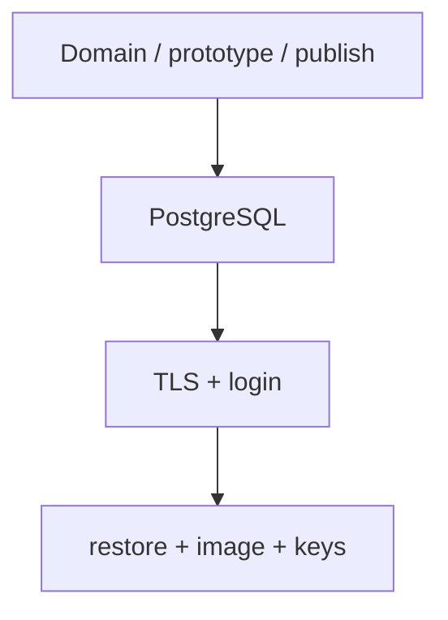

# درس 90: استقرار و مستندات و دفاع فنی

تحویل را قابل تکرار و قابل دفاع کن. پیش‌نیاز: [درس قبل](../089-hardening/README.md). زمان پیشنهادی: دو تا چهار جلسه با تمرین مستقل.

[صورت مسئله](../../../capstone/BRIEF.md) | [پذیرش و rubric](../../../capstone/ACCEPTANCE.md) | [راهنمای اجرا و تحویل](../../../capstone/DELIVERY.md)

## از «روی سیستم من اجرا شد» به تحویل قابل تکرار

ابتدا راهنمای تحویل را بخوان، سپس اسکریپت capstone_delivery را اجرا کن. Dockerfile از SDK برای ساخت و runtime برای اجرا استفاده می‌کند؛ CourseCommit داخل assembly ثبت می‌شود. Compose سه سرویس DB، app و proxy دارد. فقط پورت proxy روی loopback، یعنی رابط محلی همین دستگاه، منتشر می‌شود. درخواست HTTPS ابتدا به proxy می‌رسد و از آنجا به app می‌رود. گواهی TLS با یک CA محلیِ مخصوص آزمایش بررسی می‌شود؛ CA یا Certificate Authority مرجعی است که گواهی را امضا می‌کند. این CA آزمایشی را مرورگرها و دستگاه‌های دیگر خودکار قابل اعتماد نمی‌دانند.

اسکریپت login واقعی می‌کند، create تکراری و claim ممنوع را می‌سنجد، درخواست را با کارشناس می‌بندد، audit را می‌خواند، سپس DB تازه را از backup می‌سازد. در اجرای دوباره همان DLL و key ring، درخواست باید همچنان بسته باشد و token ورود قبلی پذیرفته شود. key ring مجموعهٔ کلیدهای ASP.NET Core Data Protection است؛ این نمونه برای خواندن tokenهای قبلی به همان کلیدها نیاز دارد. پس بازیابی فقط شامل جدول‌های DB نیست. این بررسی از تست‌های `WebApplicationFactory` یا WAF جداست و مسیر شبکه و TLS را هم اجرا می‌کند.

فرمان خودکار منابع تصادفی خودش را در پایان پاک می‌کند. اجرای دستی برای مشاهدهٔ مراحل در راهنمای تحویل آمده است. این درس سرویس عمومی منتشر نمی‌کند و حساب‌های lab برای کاربران واقعی مناسب نیستند.

برای تحویل، commit دقیق، نتایج تست، گزارش p95 با محدودیت روش و شاهد restore را ثبت کن. در صورت نیاز نمودار مسئولیت فایل‌ها را هم اضافه کن. runbook باید مراحل توقف و بررسی نتیجه را توضیح دهد. یک ADR یا Architecture Decision Record هم بنویس: یک تصمیم معماری، گزینه‌های بررسی‌شده، دلیل انتخاب و پیامدهای آن را ثبت کن. rubric پذیرش، همان جدول معیارهای ارزیابی در فایل پذیرش است؛ با آن کار خودت را review کن. در دفاع زنده یک تغییر مستقل انجام بده و اگر باعث failure شد، علت و راه تشخیص آن را توضیح بده.

معیار پایان دوره: هر ۹۰ درس محتوا دارد، ولی عبور شخصی فقط پس از انجام تمرین‌ها و دفاع از پروژه است. ادامهٔ یادگیری را بر اساس خطای مشاهده‌شده انتخاب کن: طراحی حساب واقعی، migration امن، monitoring یا outbox؛ صرف اضافه‌کردن کتابخانه امتیاز نیست.

## یک نگاه: برای تأیید هر لایه، شاهد خودش

این مسیر ترتیب پیشنهادی بررسی است. مرحلهٔ اول تست دیتابیس را فقط build می‌کند؛ PostgreSQL و بعد TLS و restore در مرحله‌های جدا واقعاً اجرا می‌شوند.



**مکث کوتاه:** اگر مرحلهٔ اول سبز باشد ولی Docker اجرا نشده باشد، می‌توانی تحویل دیتابیس و TLS را موفق گزارش کنی؟

<details>
<summary>پاسخ را ببین</summary>
<p>نه؛ فقط محدودهٔ اجراشده تأیید شده است. NOT RUN باید باقی بماند تا اجرای مستقلِ بررسی‌های دیتابیس، TLS و بازیابی کامل شود.</p>
</details>

## سه شاهد مستقل تحویل

1. `capstone_smoke.py`: ده حالت تست Domain و سه تست prototype، build suite دیتابیس و publish را بررسی می‌کند. پیام NOT RUN برای PostgreSQL و TLS در این حالت درست است؛ آن‌ها هنوز اجرا نشده‌اند.
2. `capstone_smoke.py --docker-only`: ده تست واقعی PostgreSQL درس ۸۹ را اجرا می‌کند. این مرحله با TestServer انجام می‌شود و گواهی TLS واقعی را نمی‌سنجد.
3. `capstone_delivery.py`: image درس ۹۰ و proxy و DB واقعی را می‌سازد؛ login، گردش درخواست، خواندن، dump/restore و اجرای همان DLL را روی TLS معتبر بررسی می‌کند.

اگر مرحلهٔ سوم شکست خورد، ابتدا آخرین شاهد موفق را پیدا کن: آماده‌شدن DB، bootstrap حساب، آماده‌شدن HTTPS، login یا restore؟ شکست TLS را با غیرفعال‌کردن اعتبارسنجی گواهی رفع نکن. برای اجرای مرحله‌به‌مرحله، [راهنمای تحویل](../../../capstone/DELIVERY.md) را دنبال کن. منابع ساخته‌شدهٔ اسکریپت خودکار موقت‌اند؛ برای مشاهدهٔ پایدار از مسیر دستی استفاده کن.

## گزارش تحویل را چطور بنویسم؟

برای هر فرمان، نام فرمان، commit بررسی‌شده، نتیجهٔ واقعی و محدودهٔ شاهد را ثبت کن. مثلاً «تست‌های PostgreSQL موفق شدند؛ HTTP داخل TestServer بود» با «ورود و بازیابی از مسیر HTTPS واقعی موفق شد» دو شاهد جدا هستند. پیام NOT RUN را به همان شکل ثبت کن تا معلوم باشد کدام مرحله هنوز باقی است.

بعد از restore فقط 200 بودن health را گزارش نکن: همان Id درخواست، وضعیت Closed، تاریخچهٔ audit و پذیرش token قبلی با key ring قبلی را بررسی کن. این‌ها نشان می‌دهند داده و کلید لازم کنار binary درست برگشته‌اند. اگر یکی شکست خورد، تحویل هنوز کامل نیست و runbook باید گام تشخیص آن را داشته باشد.

## فرمان از ریشهٔ مخزن

```powershell
dotnet build samples/89-servicedesk-delivery/SupportDesk.csproj
```

```powershell
python scripts/capstone_smoke.py
python scripts/capstone_smoke.py --docker-only
python scripts/capstone_delivery.py
```

[فهرست بخش](../README.md)
